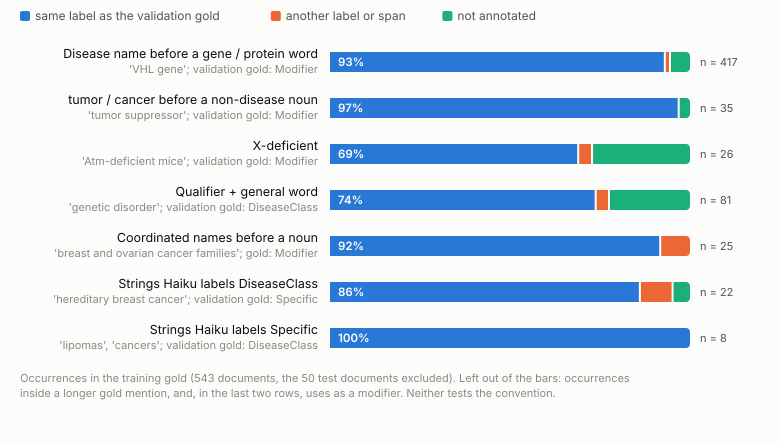
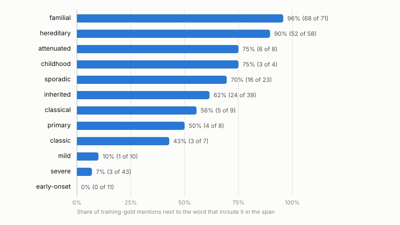
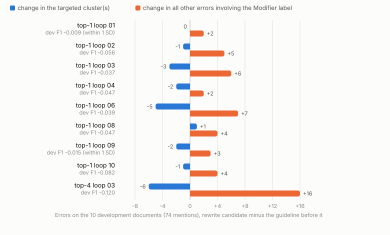
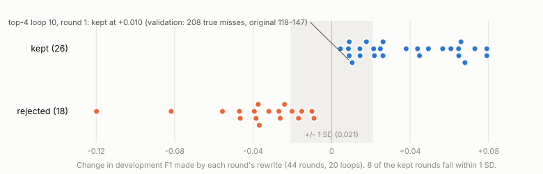
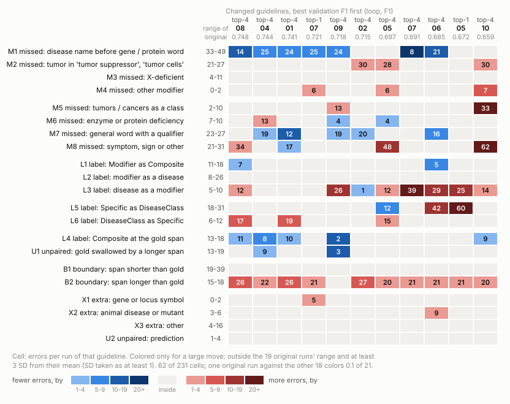

# Appendix: error analysis of the 10/23 reproduction

This appendix holds the material moved out of the main text (`20261024_error_analysis_report.md`) on 10/25: the detailed tables, the full design of the next step, the revision log and the full verification record. Sections follow the main text.

## A. Error groups in full (main §1)

**How errors are counted.**
- Each error is one discrepancy against gold, in the paper's kinds (Section 3.4.1): missed, extra, label mismatch, boundary mismatch, and unpaired overlap. Unpaired overlap means one prediction swallows two gold mentions.
- Rules on the strings and labels sort each distinct error into one of 23 patterns (`patterns_lib.py`), and the patterns form 7 groups. The group names describe what the rules detect: "span shorter or longer" includes any boundary difference, not only qualifiers, and the Composite group includes label errors at an identical span.
- **Counts:** mean per run over the 19 runs whose guideline is the original one. That's the 10 E1 runs plus the 9 loops that ended unchanged.
- **F1 if fixed:** how much F1 would rise if the whole group were fixed, averaged over the 19 runs. This is a ceiling.

| Group | Errors per run | Share | F1 if fixed | What Haiku does | Guideline | Training gold |
| --- | --- | --- | --- | --- | --- | --- |
| Disease name used as a modifier, missed | 71.5 | 24.1% | +0.061 | Misses "VHL" in "VHL gene", "tumor" in "tumor suppressor gene", "Atm-deficient mice" | The rule exists (What to Annotate 3), but its only example is "colorectal cancer families"; no gene names | Name before a gene word: Modifier 389 of 417 (93%). "Tumor" or "cancer" before a noun: Modifier on its own 34 of 60, inside a longer gold mention 25. "X-deficient": Modifier 18 of 28 |
| Other mentions missed: symptoms, general words, tumors, deficiencies, the rest | 64.1 | 21.6% | +0.055 | Misses "short stature", "blindness", "eye abnormalities", "genetic disorder", "these tumours", "deficiency of ASPA" | The guideline's first example sentence contains "short stature" but its list of annotations leaves it out. Example 6 calls "infectious complications" too general. What NOT 4 excludes bare "disease, deficiency, abnormalities". Symptoms appear only as Example 11's "grey area, if appropriate" | "Short stature": DiseaseClass 4 of 4 (all 19 runs miss both validation cases). "Infectious complications": not annotated, 1 of 1. Qualified general words: DiseaseClass 60 of 81 |
| Span shorter or longer than the gold span | 45.5 | 15.3% | +0.063 | Leaves out "familial", "sporadic", "inherited"; adds "classical", "simple", "chromophobe"; also every other boundary difference, including the stray-space gold spans | Left to the annotator (Examples 2, 14, 16); Example 15 includes "classical" | Mixed: familial 96% and hereditary 90% included, but inherited 62%, sporadic 70%, classical 56%, classic 43% |
| Modifier against disease or Composite label | 35.4 | 11.9% | +0.049 | "HNPCC kindreds", "ACG1B patients" labeled Specific; "breast and ovarian cancer families" labeled Composite | Example under What to Annotate 3 is literally "HNPCC kindreds" → Modifier. No rule says whether Modifier or Composite wins | Coordinated mention right before a noun it modifies (families, patients, genes, cells): Modifier 23 of 25 (92%) |
| Specific against DiseaseClass | 32.5 | 10.9% | +0.045 | "hereditary breast cancer", "non-papillary renal cell carcinomas" labeled DiseaseClass | The two definitions in What to Annotate 1 are abstract; both readings are defensible | Consistent: these strings are Specific 19 times, DiseaseClass 2 |
| Composite label at the gold span, or one prediction over two gold mentions | 32.6 | 11.0% | +0.037 | "AO2 / DTD", "breast cancer and ovarian cancer" as one prediction; also Composite given to a span the gold labels otherwise | Rule 2's sentence supports merging; its example (shared head, "Duchenne and Becker muscular dystrophy") implies merging only when splitting loses information | Not measured |
| Extra mentions and other | 15.5 | 5.2% | +0.008 | Mouse diseases ("scurfy", "Small eye"), variant names ("LA phenotype"), "infantile form" | Silent on animal diseases and variants | Not measured |

Notes:
- **Extra mentions are rare: about 14 per run.** Haiku errs toward leaving mentions out.
- **The gold has artifacts.**
  - 6 validation gold spans end with a space, for example "C9 deficiency " and "cancer ".
  - Two of them are composite mentions cut in two: "C6 or " + "C7 deficiency", and "classical and " + "Duarte galactosemia".
  - No run matched them (0 of 114 span × run cases). Together with the cut-off halves they caused 8.0 errors per run. This is observed, not a floor: the aligner (`text_utils.align_annotations`) keeps leading and trailing spaces, so a prediction that includes the space would match.
- **Shares sum to 100%** because every error has exactly one pattern. The F1 gains overlap and do not add up.

**Where the gold limits a simple rule.**
- Qualifiers the training gold includes only 43% to 70% of the time (inherited, sporadic, classical, classic): a plain include-or-exclude rule can fix only part of the span group. Context may decide some of them; that is untested.
- **Withdrawn:** "coordinated names before a noun are split in the gold (Modifier 24, Composite 23)". The old rule counted any following word as a noun, verbs included ("cancers harbour"). With a fixed list of the nouns such a mention modifies, the training gold says Modifier in 23 of 25; when a verb, a preposition or nothing follows, it says Composite (`gold_precedent_output.txt`, L1).

**Figure 2.** Does the training gold follow the validation gold's convention? Mostly yes: the same label in 69% (X-deficient) to 100% of the occurrences, depending on the construction.

**Figure 3.** Qualifiers in the training gold. Familial and hereditary are almost always included, severe and mild almost never. Inherited, sporadic, classical and primary go both ways, so a plain include-or-exclude rule cannot fix all of them.

Source: `error_patterns_output.txt`, `gold_precedent_output.txt`.

## B. Rejected rounds (main §2)

A round is kept only if development F1 rises. In 9 loops the first rewrite lowered it, so the loop stopped with the original guideline. Those 9 loops are top-1 loops 01, 02, 03, 04, 06, 08, 09, 10 and top-4 loop 03.

**Target.** Each round targets the largest error clusters on the 10 development documents.
- In 7 of the 9 loops the first target was "Specific labeled DiseaseClass".
- The development examples were "PAH deficiencies", "vasculitis", "arthritis", "cutaneous vasculitis" and "Chronic neisserial infection".
- 5 of the 6 come from one case report (PMID 6859721).

**What the rejected rewrites did on development.**
- **The target fell in 7 of the 9.** For example, it went from 6 to 1 in top-1 loop 06 and from 6 to 0 in top-4 loop 03. It did not fall in top-1 loop 01 (5 to 5) or top-1 loop 08 (6 to 7).
- **Errors involving the Modifier label rose in all 9.** Together the nine candidates labeled 41 development mentions Modifier against the gold:
  - **13 sit right after "a family history of"** in one development document (10196379), in 7 of the 9 loops. The same 7 candidates mention family history in their rule text.
  - **13 are "Tay-Sachs disease" or "TSD".** These flip to Modifier even under the unchanged guideline: in 6 and 2 of 20 development runs (Haiku trial). So this part is partly run-to-run variation.
  - The rest are scattered ("SLS", "Coats disease", "PKU").
- **Neither fully explains why these rounds were rejected.**
  - New family-history Modifier labels do not separate the two: 10 of the 26 kept rounds against 7 of the 18 rejected rounds.
  - A rise in Modifier errors is more common in rejected rounds (13 of 18) but also occurs in kept ones (8 of 26).

**Figure 4.** The 9 rejected first rewrites on the development documents.
- **Targeted cluster (blue):** seven cut it; top-1 loops 01 and 08 did not.
- **Other errors involving the Modifier label (orange):** rose in all nine.

**Was rejecting them right?**
- **Not testable on validation.** The rejected candidates were never annotated there.
- **On development, 7 of the 9 drops are unlikely to be noise alone.** Two runs of an unchanged guideline differ with SD 0.021. The chance that noise gives a drop at least this large (normal approximation, `rounds_table_output.txt`): top-1 loop 02 0.4%, 04 1.3%, 08 1.3%, 06 3.3%, 03 3.9%, 10 and top-4 loop 03 below 0.1%; but top-1 loop 01 (−0.009) 33% and 09 (−0.015) 23%. Checking 9 drops at once, one or two could look unlikely by luck alone, so a fairer bar is stricter: 5% divided by 9, about 0.6% (the Bonferroni correction). Three drops still pass it: top-1 loops 10 and 02, and top-4 loop 03.
- **13 of the 26 kept rounds gained an amount that noise alone gives at least 5% of the time,** so about half the keep decisions could be noise.
- **Part of each decision is luck in the baseline run.**
  - Each round compares the candidate with one noisy baseline run.
  - Across the 20 loops, the baseline's dev F1 and the round-1 gain correlate at r = −0.48.
  - Loops whose round 1 was rejected started from higher baselines: 0.774 against 0.761 for the kept ones.

**Figure 5.** All 44 rounds by their change in development F1. The gray band is ±1 SD of the difference between two runs (0.021). Most rejected rounds fall below it. 8 kept rounds fall inside it, including the round that produced the worst loop (+0.010; noise alone gives that much 31% of the time).

**The first target rarely transferred to validation.**
- Only top-4 loop 05 brought "Specific labeled DiseaseClass" below the original range: 12 against 18 to 31.
- Two loops made it much worse, with 60 and 42.

Source: `rounds_table_output.txt`, `rule_chain_output.txt` section B.

## C. All 11 changed guidelines (main §3)

**Figure 6.** Every error pattern in the 11 changed guidelines, best validation F1 on the left.
- **What is colored:** large moves only. A large move is outside the 19 original runs' range and at least 3 SD from their mean. 62 of 231 cells qualify. An original run tested against the other 18 colors about 0.1 of its 21 cells, so chance explains almost none of them.
- **Blue** means fewer errors than the original guideline, **red** more.

**Chance level of the fixed and broken counts.** Each original run, counted the same way against the other 18, gives 9.1 fixed (at most 21) and 12.0 broken (at most 17).

**Construction tags** (`rule_chain.py`):
- "before a gene word";
- "after 'history of'": the object of the phrase, or a later conjunct of it;
- "after a risk or population noun", as in "risk of X" or "families with X";
- "in a list".

| Guideline | Validation F1 | True misses (documents) | Gene-name misses (net change) | Gene word fixed | After "history of" broken | After a risk or population noun broken | Symptoms in a list, fixed / broken | Construction coverage: share of fixed + broken mentions in the three constructions |
| --- | --- | --- | --- | --- | --- | --- | --- | --- |
| top-4 loop 08 | 0.748 | 111 (46) | 14 (−26) | 22 | 6 | 0 | 1 / 5 | 41% |
| top-4 loop 04 | 0.744 | 114 (46) | 25 (−15) | 13 | 0 | 0 | 11 / 2 | 33% |
| top-4 loop 01 | 0.741 | 97 (40) | 24 (−16) | 13 | 0 | 0 | 7 / 1 | 32% |
| top-1 loop 07 | 0.721 | 126 (53) | 25 (−15) | 23 | 0 | 0 | 1 / 3 | 44% |
| top-4 loop 09 | 0.718 | 114 (44) | 24 (−16) | 7 | 5 | 4 | 5 / 0 | 21% |
| top-4 loop 02 | 0.715 | 126 (48) | 28 (−12) | 5 | 2 | 0 | 8 / 0 | 23% |
| top-4 loop 05 | 0.697 | 163 (65) | 39 (−1) | 12 | 5 | 3 | 0 / 12 | 34% |
| top-4 loop 07 | 0.691 | 104 (48) | 8 (−32) | 26 | 7 | 15 | 3 / 2 | 42% |
| top-4 loop 06 | 0.685 | 99 (43) | 21 (−19) | 14 | 8 | 6 | 6 / 1 | 31% |
| top-1 loop 05 | 0.672 | 119 (51) | 40 (0) | 8 | 7 | 9 | 0 / 1 | 17% |
| top-4 loop 10 | 0.659 | 208 (62) | 35 (−5) | 7 | 5 | 8 | 0 / 13 | 27% |
| 19 original runs: their range, and chance maximum in the count columns | 0.692 to 0.724 | 118 to 147 (49 to 57) | 33 to 49 (mean 40.3) | 5 | 0 | 1 | 1 / 3 | |

Notes on the columns:
- **Gene-name misses** is pattern M1: errors per run, with the change against the 19-run mean in brackets.
- **"Symptoms in a list"** counts missed symptoms and qualified general words (patterns M7 and M8) that sit in a list.
- **Top-4 loop 02** fixed only 5 gene-word mentions in the strict sense, which equals the chance maximum. Its net change is still −12, because it also fixed mentions that some original runs get right.
- **Construction coverage** is a string match on the three constructions (`rule_chain_output.txt` E). It does not check that the guideline has a rule for each mention or that the change follows that rule, so it is not a share of changes the rules caused.

**Case details not in the main text.**
- **Three documents appear in every round** (`rule_chain_output.txt` B). Two of them carry the sentences behind Rules 1 and 2: "Germline BRCA1 alterations ... a family history of ovarian cancer" and "Sjogren-Larsson syndrome is an autosomal recessive disorder characterized by ichthyosis, mental retardation, spasticity, ...".
- **The three channels, per development gold mention × round** (`rule_chain_output.txt` B):

  | Mention | Cases | Right before the rewrite | Rewrite prompt: document shown | Rewrite prompt: label listed | Analysis prompts: error example with gold | Target string appears in the principles |
  | --- | --- | --- | --- | --- | --- | --- |
  | "ovarian cancer" after "a family history of" | 44 | 29 | 44 | 0 | 7 | 1 |
  | "ichthyosis", "spasticity" in the list | 88 | 53 | 88 | 1 | 17 | 1 |
  | the 4 gene-word Modifier mentions | 176 | 128 | 112 | 105 | 23 (20 where the rewrite prompt did not show the document) | 0 |

  The last column is a string match only. The family-history hit is "ovarian cancer cases" and the symptom hit "a spasticity-type finding", neither in the target context; zero hits do not show that an abstract rule was not passed on.

  Earlier versions reported the gene-word label as "shown in 128 of 132 cases". That mixed the rewrite list (105) with analysis error examples (23) over a mixed denominator. The rewrite prompt itself showed the document 112 times.
- **Rule 1, seeing the gold did not always fix it.** In top-4 loop 09 the rule was written in round 1. In round 2 its own error appeared in the analysis prompt with the gold label, but that round's principles did not mention it, and the rule stayed.
- **Rule 1, top-4 loop 05.** It has two rules: a bare, unspecified "cancer" in a family history is not annotated (line 160), and a named disease there is Modifier (line 161). Its 5 broken family-history mentions follow both: three named diseases labeled Modifier ("breast cancer" twice, "ovarian cancer") and two bare "cancer" left out. Earlier versions coded only line 160 and called this an exception; that was a misreading.
- **Rule 2, the sequence in top-4 loop 08.** In its round 1:
  - the analysis prompt showed "spasticity" as an error with "Gold: DiseaseClass, LLM: O";
  - one of the principles then deferred bare symptoms in a coordinated list to "a separate symptom-level annotation convention";
  - the rewrite defined that convention as O; its "do not break" block showed that sentence without the two labels. Whether one led to the other is untested.
- **Rule 2, examples on validation.** Top-4 loop 08 missed "cataract" and "male-infertility" in "... myotonia, cataract and male-infertility", and "myotonia" in "defined by myotonia, short stature, and bone dysplasia".
- **Rule 3, why the label was listed.** The cap does not cut short documents (10724160 has 2 gold mentions).
- **Rule 3, two VHL abstracts.** They hold 13 and 4 of the gene-word mentions. Top-1 loop 07 and top-4 loop 07 fixed 17 there, and top-4 loop 08 fixed 13. Without these two documents, each guideline fixed 5 to 13.

**Figure 7, coding.** The rule texts are read and coded by hand; the script checks that each quoted phrase is on the stated line. Coded directions, with line numbers (`rule_chain_output.txt` C):
- after "history of": Modifier in top-4 loops 08 (L48), 09 (L130), 05 (L161, with a bare "cancer" left unannotated at L160), 07 (L65), 06 (L120), 10 (L146) and top-1 loop 05 (L63); Specific or not Modifier in top-4 loops 04 (L118), 01 (L373), 02 (L30); top-1 loop 07 has no rule;
- symptoms in a list: O in top-4 loops 08 (L104), 05 (L273), 10 (L295) and top-1 loop 07 (L42); DiseaseClass in top-4 loops 04 (L285), 01 (L631), 02 (L450), 06 (L323); other in top-4 loops 09 (L205) and 07 (L232); top-1 loop 05 has no rule.

**Other large moves.**

| Loop | What moved (errors per run; original range) | Rule behind it |
| --- | --- | --- |
| top-4 loop 07 | Diseases labeled Modifier: 39 (5 to 10); 15 broken mentions after a risk or population noun | Line 65: a disease name that "premodifies, or is the complement of, a context or population noun (such as cases, population, history, risk, or incidence) is annotated Modifier". The development gold supports the premodifier half ("ovarian cancer cases" is Modifier). For the complement half its only case is "a family history of ovarian cancer", which is Specific |
| top-1 loop 05 | Specific labeled DiseaseClass: 60 (18 to 31), including "breast cancer" 13 times | Round 2: an unnamed disease noun is Specific only when a patient has it, and DiseaseClass when "used generically for a category". This was learned from a case report. Validation abstracts discuss breast cancer at population level, so Haiku called it generic |
| top-4 loop 10 | Symptoms missed: 62 (21 to 31); tumors as a class missed: 33 (2 to 10); 208 true misses (118 to 147) | Round 1: symptoms in a list of manifestations are "routed to audit, not annotated", and "a bare, unqualified cancer or tumor ... is not annotated". The original says "the terms cancer and tumor were retained" |

- **Diseases labeled Modifier (pattern L3)** is a large move upward in 7 of the 11 changed guidelines (Figure 6). The Modifier rules overshoot more often than not.
- **Longer spans.** The span-longer pattern (B2: the prediction covers the gold span, for example with a qualifier added) is a large move in 10 of the 11 changed guidelines (Figure 6).
- **How top-4 loop 10's round 1 got through.**
  - The cost was visible on development but hidden by F1. FP fell from 10 to 5 because 6 label and boundary errors were fixed. Missed mentions rose by 7: Specific +4 and DiseaseClass +3 (`rounds_table_output.txt`, lines 243 to 249).
  - Dev F1 still rose by +0.010, and the round was kept, although noise alone gives a gain that large 31% of the time.
  - On validation: 208 true misses in 62 documents, against 118 to 147 in 49 to 57 documents for the original guideline.

**Top-4 loops: fixed and broken by kind** (`topk4_stability_output.txt` A). The 9 changed top-4 guidelines, best first. "Turned Modifier" is a disease labeled Modifier (pattern L3); "left out" is a missed tumor or cancer word used for a class, a general word with a qualifier, or a symptom (M5, M7, M8).

| Loop | F1 | Against the original range | Fixed | of which gene word | Broken | turned Modifier | left out | rest |
| --- | --- | --- | --- | --- | --- | --- | --- | --- |
| 08 | 0.748 | above | 52 | 19 | 30 | 6 | 7 | 17 |
| 04 | 0.744 | above | 55 | 6 | 31 | 1 | 10 | 20 |
| 01 | 0.741 | above | 48 | 7 | 21 | 0 | 4 | 17 |
| 09 | 0.718 | inside | 50 | 4 | 40 | 16 | 5 | 19 |
| 02 | 0.715 | inside | 37 | 3 | 36 | 0 | 5 | 31 |
| 05 | 0.697 | inside | 34 | 6 | 53 | 8 | 25 | 20 |
| 07 | 0.691 | below | 42 | 24 | 54 | 26 | 3 | 25 |
| 06 | 0.685 | below | 44 | 11 | 52 | 24 | 4 | 24 |
| 10 | 0.659 | below | 22 | 4 | 77 | 13 | 42 | 22 |
| Chance, mean (max) | | | 9.1 (21) | 1.3 (4) | 12.0 (17) | 0.6 (2) | 2.4 (6) | 9.0 (16) |

**What each changed top-4 guideline says about five development phrases** (`topk4_stability.py`, CLAIMS; read by hand, each quote checked on its line). The development gold labels are:
- P1 "ovarian cancer" in "a family history of ovarian cancer": Specific;
- P2 "cancer" in "a family history of cancer": DiseaseClass;
- P3 "cancer" in "91 Caucasian cancer cases": Modifier;
- P4 "ichthyosis" and "spasticity" in "characterized by ichthyosis, mental retardation, spasticity, …": DiseaseClass;
- P5 a disease name before a gene word ("the DTD gene", "SLS genes"; 4 mentions): Modifier.

"Wrong" marks a statement against that label. "Not labeled" covers "not annotated" and "flagged for manual checking"; "none" means the guideline gives the phrase no label.

| Loop | F1 | P1 | P2 | P3 | P4 | P5 | Wrong |
| --- | --- | --- | --- | --- | --- | --- | --- |
| 08 | 0.748 | Modifier, history only (wrong) | none | none | not labeled (wrong) | Modifier | 2 |
| 04 | 0.744 | Specific | none | none | DiseaseClass | Modifier | 0 |
| 01 | 0.741 | Specific | DiseaseClass | none | DiseaseClass | Modifier | 0 |
| 09 | 0.718 | Modifier, wider (wrong) | none | none | sent to review | Modifier | 1 |
| 02 | 0.715 | Specific | not labeled (wrong) | not labeled (wrong) | DiseaseClass | Modifier | 2 |
| 05 | 0.697 | Modifier, wider (wrong) | not labeled (wrong) | not labeled (wrong) | not labeled (wrong) | Modifier | 4 |
| 07 | 0.691 | Modifier, wider (wrong) | none | none | none | Modifier | 1 |
| 06 | 0.685 | Modifier, wider (wrong) | none | none | DiseaseClass | Modifier | 1 |
| 10 | 0.659 | Modifier, wider (wrong) | not labeled (wrong) | not labeled (wrong) | not labeled (wrong) | Modifier | 4 |

Of the 45 coded statements, 15 are wrong, 17 agree and 13 give no label or send the phrase to review. The two loops with none wrong (01, 04) are in the top three; loop 08 has two and is first, and its rules are narrow. The phrases were chosen after the validation breaks were known and one person coded them, so this is not a robust check.

**How far the family-history Modifier rule reaches**, by its own wording: a history frame only in loop 08 (L48); wider in loops 07 (L65, "cases, population, history, risk, or incidence"), 06 (L150, "patients, cases, families, risk, population, phenotype"), 09 (L158, "family-history and cohort descriptors"), 10 (L146, "a relational noun phrase") and 05 (L159, "cohort, family-history, or risk descriptors"). Diseases labeled Modifier after a risk or population noun: 15, 7, 6, 3 and 2 in loops 07, 10, 06, 09 and 05, none in loop 08. Of the 6 development gold mentions after a risk or population noun, 5 are Specific ("63 kindreds with SLS", "the patients with SLS", "a patient with chronic meningococcemia", "males with Coats disease", "the high prevalence of G6PD deficiency"). The sixth, "a population-based series of ovarian cancer cases", is Modifier because the name modifies "cases".

**When the wrong statements entered** (`topk4_stability_output.txt` C and D).
- The 15 entered in 9 rounds, all kept. In 12 of them, that round's own development run already labeled the phrase wrong. Top-4 loop 07 round 1, for example, turned "ovarian cancer" after "a family history of" from Specific to Modifier, broke 4 development mentions in all, fixed 9, and raised development F1 from 0.759 to 0.838.
- In 5 of the 9 rounds, development F1 rose so little that luck alone gives a rise that large at least 1 time in 20.
- All 10 top-4 loops wrote the family-history Modifier rule in some round; loop 03 did so in its only round, which was rejected. Loops 01, 02 and 04 reversed it in rounds 5, 4 and 2, each of which showed the gold label in an analysis prompt (`history_tally_output.txt`).
- Rounds that first wrote the rule were kept 9 of 10 times in top-4, against 12 of 19 for the other top-4 rounds (two-sided Fisher p = 0.20). In top-1 such rounds were kept 1 of 6 times (top-1 against top-4: p = 0.008). Observational.

Source: `rule_links_output.txt`, `rule_chain_output.txt` sections A to E, `error_patterns_output.txt` section C, `topk4_stability_output.txt`. For the rule texts, see each loop's `final/final_guidelines.txt` and its round snapshots.

## D. The next step in detail (main §5)

### D.1 The three limits set by n_examples

One parameter, n_examples = 5, caps three things (`iterative.py`):
- the documents in the "do not break" block (line 399);
- the correct annotations listed per document (line 397);
- the error examples per cluster in the analysis prompts (line 379).

The same function builds the block for the analysis prompts ("TRUE POSITIVE EXAMPLES") and the rewrite prompt ("DO NOT BREAK"). Effects in the 44 rounds (`tp_exposure_output.txt`, `example_caps_output.txt`):
- **Documents:** the block takes the first five, in file-name order, that have at least one correct mention. Haiku had correct mentions in 9.2 documents per round, but 1671881, 6859721 and 8326491 never appear. 6859721 is the case report behind the most common target, and 8326491 holds "Tay-Sachs disease".
- **Annotations per document:** 132 of the 220 document blocks hit the cap. The block lists 19.3 correct mentions per round.
- **Error examples:** 31 of the 131 targeted clusters had more than 5 errors, so 43 error examples never reached the analysis step.

### D.2 Why five, and could it be more?

Source: `example_caps_output.txt`.
- **Five has no stated reason.**
  - It is the default of the authors' published code (`n_examples: int = 5`, `experiment.py` line 52, `iterative.py` line 472). All 20 Haiku loops use it.
  - The paper gives no number. It says only that the verified true positives "are automatically sampled at each iteration from instances that are strict true positives".
  - The author's email of 2026-06-08 calls the 10 documents a heuristic set by time and budget, and says the prompting "is not very special". It says nothing about five.
  - Our 08/14 progress report wrote that "the paper's 5 is stated relative to 10 documents". I could not find this in the paper.
- **The code does not sample either.** It takes the first five documents in file-name order that have a correct mention, and under each the first five correct mentions in Python set order, which depends on the hash seed.
  - Rebuilt from each round's snapshot, the block matches the rewrite prompt verbatim in 43 of the 44 rounds.
  - The exception is the pilot, top-1 loop 01, run before the hash seed was fixed at 0: the same five documents, but a different five mentions under each.
- **Size and cost do not force five.**
  - Annotation is 91% of what the 20 loops cost (JPY 1,930 of 2,129, validation included). The analysis, principle and rewrite steps together are 9%.
  - The block is about 8,200 characters now and lists 19.3 correct mentions.
    - Per-document limit lifted: about 750 characters more, 35.9 mentions listed, about JPY 0.05 per round.
    - Document limit lifted as well: about 5,700 characters more, 55.3 mentions in 9.2 documents, about JPY 0.35 per round.
    - Error-example limit lifted: about 230 characters more per round, under JPY 0.01.
  - The costs are estimates from the added characters, the measured tokens per character and the batch price. For scale, the largest rewrite prompt so far had 106,427 characters.
- **So more is possible. Whether it is wise depends on the limit.**
  - **Mentions per document:** the change proposed in the main text. Whether copying rises is untested (D.3).
  - **Documents: not the ones the keep rule scores.** Every correct answer of the scoring set would be on screen, and copying would likely rise (D.3). Showing more documents needs a larger development set, split into documents shown and documents scored.
  - **Error examples per cluster: possibly, as a separate test later.** It costs almost nothing and would restore the 43 examples cut from 31 of the 131 targeted clusters. But development strings that appear in a principle were copied in 8 of 10 cases, so more examples may mean more copying. Untested.

### D.3 Would a fuller list make hard-coding worse?

Hard-coding here means copying development gold strings verbatim into the guideline, as in `reproduction/measure_hardcoding.py`. Evidence from the 44 Haiku rounds (`tp_exposure_output.txt`):
- **The per-document limit (the main-text change): no sign of a rise so far, but not tested.**
  - The rewrite already sees the full text of the five documents, and it copies their strings whether or not the label is listed.
  - Listed with its label: copied in 46% of 228 string × round cases. Right before the rewrite but cut by the cap: also 46% of 160.
  - The two rates compare different strings, so they suggest, but do not show, that a label on screen leaves copying unchanged. Lifting the limit would move about 3.6 such strings per round into the list. The replay must measure the copy rate.
- **The document limit: copying would likely rise.**
  - Strings in documents the prompt does not show are almost never copied (1 of 699). There are 15.9 such strings per round.
  - Shown and copied at the 46% rate, they would add about 7 copied strings per round. This is an extrapolation.
  - The block would then cover all 74 development gold mentions instead of 44.2.
- **The most-copied strings are the ones Haiku got wrong before the rewrite:** 53% overall, 77% in top-4. Examples: "spasticity", "deficiency of norrin", "deficient activity of fatty aldehyde dehydrogenase", "abnormal retinal vascular development". They have no label on screen, and these strings also appear in the rules against the gold (main §3); where those rules come from is untested. Lifting the per-document cap does not change this, because it lists only correct mentions. Only a later arm that shows the gold of errors would put a label on them.
- **The keep rule is the larger risk.**
  - The five shown documents hold 60% of the development gold (44.2 of 74 mentions per round), and the keep rule scores the same 10 documents.
  - Copying already tracks development F1 (Spearman +0.73 over the 11 changed guidelines) and the gap between development and validation F1 (+0.70), but not validation F1 (+0.08).
  - With more labels on screen, a rewrite could be kept for writing down answers of the scoring set.
- **Safeguards:**
  - Report the copy rate next to F1. The replay can measure both.
  - Where possible, show the list only for documents the keep rule does not score. A smaller scoring set makes the keep decision noisier.
- **Limits:** string × round cases are not independent; a copied string can be a legitimate example of a general rule; the correlations rest on 11 guidelines; the August GPT-5.4 hard-coding results are not used.

### D.4 Replay design and cost

- **Design.** Start each of the 44 recorded rounds from its recorded state: the same guideline, the same baseline annotation, so the same error clusters. Regenerate the analysis, principles and rewrite with the per-document cap lifted, which changes both prompts through the one block. Annotate the 10 development documents once with each candidate. The recorded rounds are the control.
- **Measures:** the rule directions coded as in Figure 7; development F1 and true misses; the copy rate (D.3).
- **What it tests:** one round of the method from fixed starting points, a local mechanism. It does not test the multi-round loop, the keep decisions that follow, or validation F1, and by itself it does not meet either track's goal.
- **Unit of analysis.** The 44 rounds come from 20 loops, and rounds of one loop share a guideline history, so they are not 44 independent trials. Analyze by loop, or by round with the loop as a cluster.
- **When the recorded rounds count as a control:** the same model and effort, the same prompt templates apart from the list, the same output cap and the same hash seed. The pilot loop (top-1 loop 01, round 1) ran with another hash seed and needs its own rerun control.
- **To fix in a one-page plan before any run:** the primary measure and its unit; success and stopping criteria; a budget cap; and a pilot on a few recorded states before all 44.
- **A cheaper variant fixes the recorded principles and redoes only the rewrite.** It isolates the rewrite step but leaves out the analysis prompt, which also shows the block, so it does not test the method as a whole.
- **Cost estimate** (`example_caps_output.txt` section 4, scaled from the measured cost of the same calls):
  - whole round step: about JPY 470 for one arm, or 940 if the control is rerun alongside;
  - rewrite only: about JPY 410, or 810;
  - per call: a rewrite costs JPY 1.05 to 3.21 in top-1 and 2.78 to 5.27 in top-4; one annotation of the 10 development documents JPY 5.01 to 7.52.
- **Why not compare methods on validation F1:** a rough estimate, assuming one validation run per loop, the SD of F1 over the 10 top-4 loops (0.033 on 50 documents), 80% power and a two-sided 5% test, gives about 42 loops per arm for a 0.02 difference, or 19 for 0.03 (`test_power_output.txt`). The SD itself rests on 10 loops.

### D.5 A hand-written gene-name rule

A narrow Modifier rule for disease names right before a gene, protein or locus word.
- **Feasible as guideline text:** every changed guideline already states it, and none broke more than 2 gene-word mentions. Three guidelines that state it did not reduce the misses, so writing the rule is not enough to guarantee an improvement.
- **"Tumor suppressor" is not supported.** No changed guideline reduced those misses below the original range (21 to 27).
- **Realistic gain on validation:**
  - the loops' net changes in gene-name misses (0 to 32 fewer per 100 documents) correspond to +0.000 to +0.028 F1 at the original mean;
  - each 5 correct mentions the rule relabels costs −0.007.
- **Test design:**
  - **Arms:** the original guideline against the original plus the rule, on the 50 held-out documents.
  - **Primary outcome:** misses before a gene word, the rule's direct target.
  - **Secondary outcomes:** strict F1, true misses, and diseases labeled Modifier as a guard.
  - **Runs per arm**, at 80% power and two-sided 5% (`test_power_output.txt`):

    | Outcome | Effect | Runs per arm |
    | --- | --- | --- |
    | Misses before a gene word | 5 fewer | 6 |
    | F1 | +0.015 | 15 |
    | True misses | 5 fewer | 13 |
  - **How many targets to expect:** 50 random training documents hold a median of 37 gene-word mentions (5% to 95%: 23 to 54). The validation set holds 92 per 100 documents, or 46 per 50.
  - **Cost:** about JPY 31 to 35 per 50-document run (half of an E1 run). Six runs per arm cost about JPY 380 to 420, and 15 runs per arm about JPY 940 to 1,060. These are estimates.
- **Limit:** this tests whether the guideline can carry the convention, not whether the refinement method works.

### D.6 Not supported as stated: a stricter keep rule

The idea was to keep a round only if its development gain exceeds one SD of the difference between two runs and development FN does not rise.
- **Replay on the 44 recorded rounds:** it would reject round 1 of top-4 loop 04 (+0.009). That round led to the second-best guideline.
- **The FN half alone** would have stopped top-4 loop 10 at round 1 (dev FN 22 to 24). It should count true misses, with a tolerance for run-to-run variation.
- **Threshold variants, on the 44 recorded rounds one at a time** (`keep_criteria_output.txt`). The chance level of broken development mentions comes from the 20 round-1 baseline runs of the original guideline: between two runs, 2.5 of the 74 development gold mentions go from right to wrong on average (95th percentile 5, maximum 6).

  | Criterion | All 44 rounds | 29 top-4 rounds | 9 rounds that let in wrong statements | 16 rounds that first wrote the family-history Modifier rule | 3 rounds that reversed it |
  | --- | --- | --- | --- | --- | --- |
  | C0 development F1 rises (current) | 26 | 21 | 9 | 10 | 3 |
  | C1 rise larger than luck gives 1 time in 20 (above 0.0345) | 13 | 12 | 4 | 4 | 2 |
  | C2 F1 rises and at most 5 mentions broken | 18 | 14 | 5 | 3 | 3 |
  | C3 both C1 and C2 | 9 | 8 | 2 | 1 | 2 |

  None of them rejects top-4 loop 07 round 1, which wrote the rule behind 26 validation breaks (gain +0.079, 4 development mentions broken). The constructions involved are rare in 10 documents, and one rewrite carries helpful and harmful changes together: top-4 loop 02 round 4 reversed the family-history rule and, in the same rewrite, left bare "cancer" unannotated. These variants still judge the net development F1 of the whole round.

### D.7 Candidates from the top-4 analysis (none tested)

Each targets a pattern in §3.5 and Appendix C. The evidence status is in brackets.
- Check a rule against the gold of the phrases and constructions it covers before it enters the guideline. [The 15 wrong statements contradict the development gold of phrases they cover, and the gene-word rule agrees in 9 of 9 guidelines. Coded by hand after the fact for five phrases; no automatic detector exists.]
- Judge each rule on its own instead of the net development F1 of the whole rewrite. One way is to reject a rule when a development gold mention that was right goes wrong and its annotation cites the rule's section (the saved replies record `guideline_section`). Another is to annotate the development documents once per principle, up to three more annotations per top-4 round (about JPY 18.5). [12 of the 15 wrong statements entered in rounds whose own run got the phrase wrong. Whether the citations name the responsible rule is unchecked. Netting gains against losses is not an error in itself, and whether per-rule judging does better is untested.]
- Require a rule to name exactly the construction it covers. [Association only: the narrow rule of loop 08 against the five wider wordings.]
- Restrict rules that tell the annotator not to annotate. [Loops 05 and 10: 25 and 42 left-out breaks, 163 and 208 true misses.]
- Judge rules on more gold than the 10 development documents hold. [In the training gold, a disease right after "history of" is Modifier 0 of 21 times (`rule_chain_output.txt` D). This uses more annotation than the low-resource setting assumes.]
- Group discrepancies by construction instead of by label pair. [No evidence.]

## E. Revision log

**10/25, first independent review: errors of fact corrected.**
- "the three loops that learned the gene rule are the three best": 8 of 11 cut gene-name misses;
- top-4 loop 10's round 1 did not remove 5 extra mentions: it fixed 6 label and boundary errors and added 7 true misses;
- "340 missed mentions" is strict FN; the true misses are 208;
- the Figure 4 caption: two of the nine rewrites did not cut their target;
- gold artifacts cause 8.0 errors per run, not 6.0;
- the 92% figure covered gene names only.

**10/25, first review: claim withdrawn.** "The rewrites broke the Modifier decision through syntactic wording" was untested.

**10/25, second independent review: corrections.**
- Labels are hidden by the five-item cap, not because Haiku got them wrong.
- Error examples with gold labels appear in the analysis prompt, not the rewrite prompt.
- Conclusion 3 is rewritten around top-4 loop 08.
- "The family-history rule explains the rejected rounds" is dropped: kept rounds show it just as often.
- The three rules explain 17% to 44% of the changed mentions, not "most".
- Gene-name gains are stated as net changes.
- The "history of" detector is narrowed.

**10/25, final review pass: wording fixes.**
- Figure 7 covers rules stated by 10 of 11 guidelines, not all;
- the Modifier-error rise is more common in rejected rounds (13 of 18 against 8 of 26);
- the gene-name rule is "stated in all 11, effective in 8";
- the order of the top three is not established;
- "follows mention by mention" is softened, with top-4 loop 05 as the exception.

**10/25, after the final pass.**
- **Your point:** n_examples couples the number of documents with the annotations per document, and also the error examples per cluster. The three limits are now separated (D.1, `tp_exposure.py`).
- **Your question "why five, can it be more?":** answered in D.2 (`example_caps.py`).
- **Correction:** the replay estimate assumed a top-4 rewrite costs about JPY 10. Measured, it costs JPY 2.78 to 5.27.

**10/25, restructuring after a reader's review.**
- The main text is cut to the conclusion, the seven error groups, the three rules, the two tracks and one hypothesis. Everything else moved here.
- **Claim softened:** "lifting the per-document limit would not raise copying" became "no sign of a rise so far, but not tested". The two 46% rates compare different strings (D.3).
- **Proposal made consistent with "one variable":** the change is now only the per-document cap on correct mentions. Listing the gold of mentions Haiku got wrong, or marking right and wrong, adds information and is left to a later arm. The earlier text proposed both at once while calling it one variable.
- **Replay changed:** it now regenerates the analysis, principles and rewrite of each round, because the change affects both prompts. Fixing the principles and redoing only the rewrite tests only the rewrite step (D.4). Cost about JPY 470 for one arm.
- Top-4 loop 06's validation F1 (0.6855) appeared as both 0.685 and 0.686. It is now 0.685 everywhere, as the scripts print it.

**10/25, second reader review: corrections.** No annotation was rerun; scripts, codings, wording and figures changed.
- **Floors withdrawn.**
  - "Coordinated names before a noun are split in the gold (24 against 23)": the rule counted verbs as nouns. With a fixed noun list the training gold says Modifier in 23 of 25 (`gold_precedent.py`, Figure 2).
  - "No prediction can match the stray-space spans": the aligner keeps spaces. No run matched them (0 of 114); the 8.0 errors per run are observed, not a floor.
  - Qualifiers: "no rule can fix" became "a plain include-or-exclude rule can fix only part".
- **Channels separated.** The rewrite list, the analysis error examples and the principles are now counted separately (`rule_chain.py` B). Gene-word labels: listed in 105 of the 112 cases where the rewrite prompt showed the document, not "128 of 132". Symptom labels: listed in 1 of 88, so missing from the rewrite list in 87.
- **Top-4 loop 05 recoded.** Its line 161 makes a named disease after "a family history of" Modifier; line 160 covers only a bare "cancer". It joins the Modifier group (now 7 guidelines, still 5 to 8 broken; the other 4 still 0 to 2), and the "one exception" is withdrawn (`rule_chain.py`, Figure 7).
- **"The three rules explain 17% to 44%" renamed construction coverage.** The script matches constructions by string; it does not check rule by rule.
- **Group names now match what the rules detect:** "span shorter or longer than the gold span" (any boundary difference); "Composite label at the gold span, or one prediction over two gold mentions"; "other mentions missed" (`patterns_lib.py`).
- **Statistical wording.** "Exceeds the noise" became "larger than one SD of the difference between two runs". The 42-loops figure is labeled a rough estimate with its assumptions.
- **Replay plan.** The 44 rounds come from 20 loops and are not independent. The main text and D.4 now require a one-page plan (primary measure and unit, control conditions, success and stopping criteria, budget cap, pilot) before any run, say that the replay tests a local mechanism only, and say that "without F1 falling" needs a margin fixed in advance. The plan is drafted in `20261025_replay_plan.md`.

**10/25, third reader review (8.5 of 10): wording and figure fixes.** No script logic or count changed.
- **The principles column renamed:** "target string appears in the principles". It is a string match: the one family-history hit is "ovarian cancer cases", not the target context, and zero hits do not show that a rule was not passed on.
- **Causal wording softened to the exploratory scope:** "the rewrite generalizes from that part" became "suggests a possible generalization mechanism"; "this is where the rules against the gold come from" became "these strings also appear in the rules against the gold; where those rules come from is untested"; "so the wording matters" became "writing the rule is not enough to guarantee an improvement".
- **Old pattern names removed from Figure 6 and the appendix:** "separate names merged", "qualifier left out" and "qualifier added" became "Composite at the gold span", "span shorter than gold" and "span longer than gold"; M1 and L1 descriptions now state what the rule detects.
- **Track 2 caveat added:** true misses are a proxy for search effort and "cheaper to fix once located" is a cost assumption; no correction time was measured.
- **The analysis is frozen at this version.**

**10/25, after your question on the "one SD" sentence.** "7 of 9 drops are larger than one SD; one SD is not a significance threshold" said nothing usable. It is replaced by the chance that noise alone gives each change (`rounds_table.py`): 7 of 9 drops below 5% (3 after Bonferroni), and 13 of 26 kept gains at or above 5%. "The top three differ by less than one SD" now says what follows: a rerun could reorder them.

**10/25, after your question on what §2 shows.** §2 now opens with its two points (the rejected rewrites fixed their targets but added Modifier errors; the keep decision is unreliable, with half the kept gains within reach of luck) and says what follows for the research. The probabilities are given as "1 time in 20" and the like; the Bonferroni detail moved to this appendix, explained in plain words. Conclusion 3 now names the unreliable keep decision.

**10/25, prose edit of the main text (humanizer).** Bold labels on every bullet removed, labeled lists turned into prose, staged openers and stacked qualifiers cut, the three rules given subheadings. No number, quote or claim changed; the main text grew from about 3,500 to 4,000 words because lists became sentences.

**10/25, wording.** The Figure 7 caption now says in plain words what is shown and who judged it. "Coded by one coder, by your decision" is withdrawn: your decision was to skip the agreement check on the error categories, not on the Figure 7 rule directions.

**10/26, files moved.** The folder now has `reports/` (with `figures/`), `scripts/`, `outputs/`, `notes/` and `prompts/`. Each script changed only in its path lines (ROOT, HERE, and FIG in `make_figures.py`), so the script hashes in F are updated. All scripts except `draw_test_split.py` were re-run from the new place with PYTHONHASHSEED=0 and reproduce every output and figure byte for byte, except that `tp_exposure_output.txt` lists six tied example strings in a different order (all counts identical); the saved file is kept, so its hash in F stands. No number changed.

**10/26, wording.** The copy-risk paragraph in §5 now says what the Spearman +0.73 and +0.08 correlate (the number of copied development strings against development and validation F1) and what follows from it. No number changed.

**10/26, top-4 analysis added.** §3.5, a paragraph in §2, a paragraph in Conclusion 2, two limits, the top-4 tables in C, the threshold table in D.6 and the candidates in D.7 come from the analysis of why some top-4 loops improved and others fell (`history_tally.py`, `topk4_stability.py`, `keep_criteria.py`; rows added to F). A separate 10/26 report that held the same material together with method proposals was withdrawn.

## F. Verification record

Since 2026-11-13 the error analysis is split by seminar node into four folders under `nodes/`; an `outputs/X` or `scripts/X` below is in the node that produced it (file names are unique; see `nodes/path_map_20261113.tsv`). Only the paths inside the scripts changed, so the script SHA-256 values below are those before 11/13; re-run outputs match the table (exceptions in `nodes/README.md`).

| Artifact | SHA-256 (first 12) | Content |
| --- | --- | --- |
| `draw_test_split.py` → `reproduction/test_splits/ncbi_disease_heldout50.json` | 8540c0a742bc → f6d86403f3d8 | 50 test documents from 537 (593 training, minus 50 development, minus 6 also in BioRED), seed 20261024 |
| `error_table.py` → `error_table_output.txt`, `error_rows.csv`, `error_items.csv` | 1f6e4c350a79 → 4f4507660a31, 012db607b14c, 191d78dbabb8 | 8,855 errors, 924 distinct. TP, FP and FN derived from the kinds reproduce `valid_metrics.json` for all 30 runs (assert) |
| `patterns_lib.py` | 769d38886b3f | Pattern rules shared by the scripts below; group and pattern names describe what each rule detects (renamed 10/25, counts unchanged) |
| `error_patterns.py` → `error_patterns_output.txt`, `error_items_patterns.csv`, `error_patterns.json` | 0677684c8a8f → 2daa9276f36e, fc8820903f0c, 875c08556b7c | Pattern table, groups, gold spans with stray spaces and the mentions that continue them (matched exactly: 0 of 114 span × run cases), changed loops against the 19-run range |
| `gold_precedent.py` → `gold_precedent_output.txt`, `gold_precedent.json` | c4f4168ababa → fe4ec769c58a, 69afe7d82083 | Training gold of 543 documents, the 50 test documents excluded; M1 by the same rule as the pattern; L1 by a fixed list of following nouns, with the other following words printed; the guideline's example strings |
| `rounds_table.py` → `rounds_table_output.txt`, `rounds.json` | d6cd69b02366 → 7cda0dea0f68, f97af9c726d9 | 44 rounds; new Modifier labels in the rejected first rewrites; baseline correlation; development against validation; the chance that noise alone gives each change (normal, SD 0.021) |
| `rule_links.py` → `rule_links_output.txt`, `rule_links.json` | ffb4f9401d25 → fec21781f847, e8de4cefca45 | Fixed and broken validation mentions per changed guideline, chance level, true misses and documents |
| `rule_chain.py` → `rule_chain_output.txt`, `rule_chain.json` | 0673106c74b6 → 55b149bb18b8, 11b3b96a22c9 | Constructions; what reached the rewrite in all 44 rounds, by channel (rewrite list, analysis error examples, principles), the cap, labels right before each rewrite, kept against rejected rounds; the hand-coded rule directions; net gene-name misses and construction coverage; training gold |
| `test_power.py` → `test_power_output.txt` | 5fabb52ca897 → 223707fc85b2 | Run-to-run SD on 50 documents, runs per arm, F1 effect of k mentions, gene-word mentions in random training sets, loop comparison |
| `tp_exposure.py` → `tp_exposure_output.txt` | c26653031ba4 → 06e5cca0f2eb | Copy rate of development strings by what the rewrite prompt showed (44 rounds); the three limits set by n_examples; copied strings against development and validation F1 (definition of copying as in `reproduction/measure_hardcoding.py`, a700d40eb04f) |
| `example_caps.py` → `example_caps_output.txt` | ac28af762c6e → 80b987702b2b | Prompt size, tokens and cost by step over the 20 loops (saved batch usage, priced with `nodes/2026-10-23_seminar/haiku-trial/run_haiku.py`, f53e79fdf2ba); the "do not break" block rebuilt from each round's snapshot (verbatim in 43 of 44 rewrite prompts) and with each limit lifted; measured cost of the calls a replay repeats, rewrite only and whole round step. Run with PYTHONHASHSEED=0; two runs give identical output |
| `test_size_check.py` → `test_size_check_output.txt` | 6ee361c141be → 167f1be7c3d6 | SD of F1 on 50 documents per group |
| `make_figures.py` → `figures/fig1` to `fig7` (SVG) | fa8e4169e28f → 34eb3170a310, e082bea503a7, 6fae1f015e51, 7e5294669902, 87e84b85c800, 24b1e63d6222, ffbb1eb885da | Charts drawn only from the JSON files above. Colors: the dataviz reference palette; the categorical slots and both diverging arms pass `validate_palette.js`. Each figure was rendered in headless Chrome and checked by eye |
| `history_tally.py` → `history_tally_output.txt` | cc80f0eac474 → 6844bbdf8e8d | Direction of the family-history rule in each of the 44 rounds' candidate guidelines (hand-coded; line and phrase checked by the script), by whether the analysis prompt showed the gold label |
| `topk4_stability.py` → `topk4_stability_output.txt`, `topk4_stability.json` | e795072f9be0 → bc842fa09964, 8699f71c45b2 | Top-4 fixed and broken by kind; what 9 guidelines say about five development phrases (hand-coded, quotes checked); the rounds in which wrong statements entered; keep rates |
| `keep_criteria.py` → `keep_criteria_output.txt`, `keep_criteria.json` | 62ff1dec674f → 0cb9f99ff073, 353356a78c76 | Chance level of broken development mentions (20 original-guideline runs); threshold variants applied to the 44 rounds one at a time. Asserts that the recorded decisions equal C0 |
| `src/llm_guideline_moderation/iterative.py` | cb0b8831e54a | Lines 367 to 381: error examples and their cap; lines 383 to 401: the matched-annotation block and its two caps; line 472: the default n_examples = 5 (also 5 in each loop's `inputs/resolved_run_config.json`) |
| `src/llm_guideline_moderation/text_utils.py` | 941c5c298aaa | Lines 48 to 140: the aligner keeps leading and trailing spaces of a predicted string |
| `src/llm_guideline_moderation/experiment.py` | 2261c6b6209e | Line 52: `n_examples: int = 5`, the default of the published code |
| `archive/references/backbone-research.pdf` | 5209159a4b3e | Section 3: verified true positives "are automatically sampled at each iteration"; no number given |
| `archive/correspondence/email_with_auther_of_backbone-research.pdf` | 5e1a5f738d27 | The author's reply of 2026-06-08: 10 documents chosen by heuristic, time and budget; nothing on five |

- **Original-guideline runs:** 19, identified by guideline hash after normalizing line endings (e6232d944d68).
- **Rule quotes** come from each loop's `final/final_guidelines.txt` (line numbers as given; checked by `rule_chain.py`) and the round snapshots. The prompt quotes come from `rounds/iteration_NN/refine_guidelines.txt` and `infer_discrepancy_patterns_N.txt`.
- **Other sources:**
  - Tay-Sachs and TSD flip rates: `nodes/2026-10-23_seminar/haiku-trial/report_output.txt`, lines 27 and 28;
  - E1 run costs and P1 to P3: `nodes/2026-10-23_seminar/seminar-20261023/reproduction_analysis_output.txt`;
  - per-call costs for the replay estimate: `example_caps_output.txt`, section 4.
- **Reviews:** two independent reviews and a final pass (exp-statistician, read-only), then three reader reviews of the restructured version, all on 10/25. Their corrections are listed in E. The analysis is frozen at this version.
- **Unchanged by those corrections:** `test_power_output.txt` (rerun, same hash), `tp_exposure_output.txt` and `example_caps_output.txt` (inputs unchanged; `rounds.json` has the same hash).
- **No API calls. The test documents' gold was not read.**
