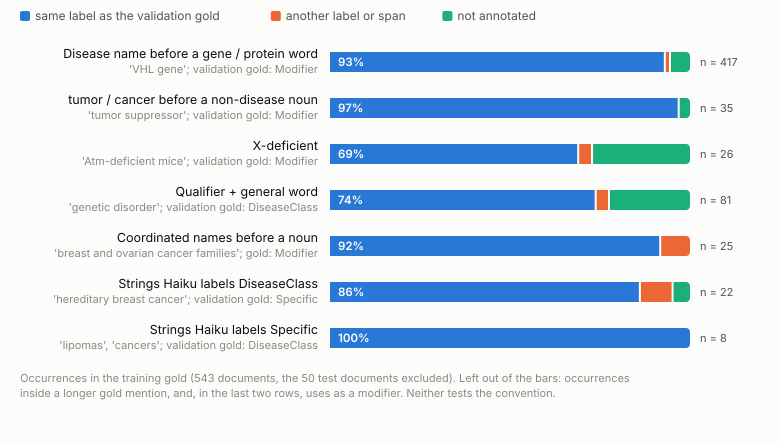
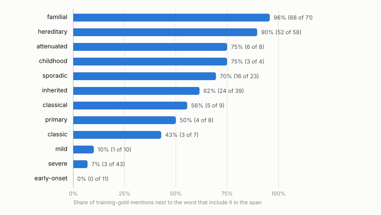
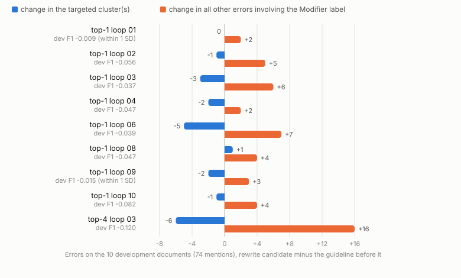
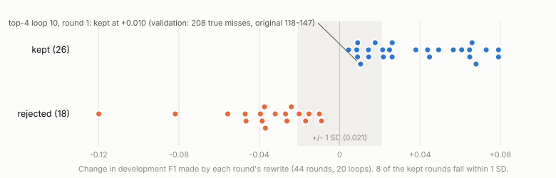
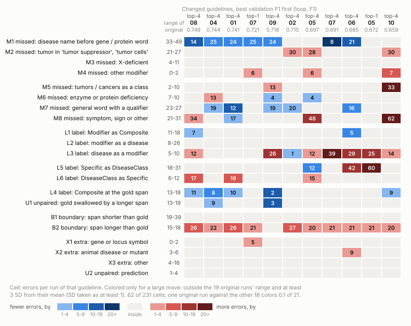

# 附录：10/23 复现的错误分析

本附录收录详细表格、候选设计、修订记录和核查证据。10/30 增加 J 节的 rationale 语义核查。英文版 `20261024_error_analysis_appendix.md` 尚未同步。

## A. 错误组详表（正文第 2 节）

**错误如何计数。**
- 每个错误是相对 gold 的一处差异，按论文的类型（第 3.4.1 节）划分：漏标、多标、标签不符、边界不符、未配对重叠。未配对重叠指一个预测吞掉两个 gold 提及。
- 基于字符串和标签的规则把每个不同的错误分入 23 种模式之一（`patterns_lib.py`），这些模式组成 7 个组。组名描述规则实际检测的内容："跨度比 gold 短或长"包括任何边界差异，不只是限定词；Composite 组也包括跨度完全相同、只有标签错误的情形。
- **计数：** 19 次原指南运行的每次运行均值，即 10 次 E1 运行，加上最终保留原指南的 9 个循环。
- **修复后 F1：** 整组都修好时 F1 的上升量，取 19 次运行的平均。这是一个上限。
- **模式编号**（只在附录中使用）：M 漏标，L 标签错，B 边界错，U 一个预测吞掉两个 gold 提及，X 多标；数字区分同一类下的不同模式。

| 组 | 每次运行错误数 | 占比 | 修复后 F1 | Haiku 的表现 | 指南 | 训练集 gold |
| --- | --- | --- | --- | --- | --- | --- |
| 作为修饰语的疾病名，漏标 | 71.5 | 24.1% | +0.061 | 漏掉 "VHL gene" 中的 "VHL"、"tumor suppressor gene" 中的 "tumor"、"Atm-deficient mice" | 规则存在（What to Annotate 3），但唯一例子是 "colorectal cancer families"，没有基因名 | 基因词前的名称：417 例中 389 例为 Modifier（93%）。名词前的 "tumor" 或 "cancer"：单独标为 Modifier 60 例中 34 例，包含在更长的 gold 提及中 25 例。"X-deficient"：28 例中 18 例为 Modifier |
| 其他漏标：症状、泛称词、肿瘤、缺乏症及其余 | 64.1 | 21.6% | +0.055 | 漏掉 "short stature"、"blindness"、"eye abnormalities"、"genetic disorder"、"these tumours"、"deficiency of ASPA" | 指南第一个例句包含 "short stature"，但其标注列表没有它。Example 6 称 "infectious complications" 过于笼统。What NOT 4 排除单独的 "disease, deficiency, abnormalities"。症状只在 Example 11 中作为 "grey area, if appropriate" 出现 | "Short stature"：4 例中 4 例为 DiseaseClass（19 次运行都漏掉验证集中的两处）。"Infectious complications"：未标注，1 例中 1 例。带限定的泛称词：81 例中 60 例为 DiseaseClass |
| 跨度比 gold 短或长 | 45.5 | 15.3% | +0.063 | 漏掉 "familial"、"sporadic"、"inherited"；多加 "classical"、"simple"、"chromophobe"；也包括其他所有边界差异，含带多余空格的 gold 跨度 | 交给标注者判断（Examples 2、14、16）；Example 15 包含 "classical" | 不一致：familial 96%、hereditary 90% 纳入，但 inherited 62%、sporadic 70%、classical 56%、classic 43% |
| Modifier 与疾病标签或 Composite 混淆 | 35.4 | 11.9% | +0.049 | "HNPCC kindreds"、"ACG1B patients" 被标成 Specific；"breast and ovarian cancer families" 被标成 Composite | What to Annotate 3 下的例子正是 "HNPCC kindreds" → Modifier。没有规则说明 Modifier 与 Composite 冲突时取哪个 | 紧接在其所修饰名词（families、patients、genes、cells）之前的并列提及：25 例中 23 例为 Modifier（92%） |
| Specific 与 DiseaseClass 混淆 | 32.5 | 10.9% | +0.045 | "hereditary breast cancer"、"non-papillary renal cell carcinomas" 被标成 DiseaseClass | What to Annotate 1 中的两个定义很抽象，两种理解都说得通 | 一致：这些字符串 19 次为 Specific，2 次为 DiseaseClass |
| 在 gold 跨度上标成 Composite，或一个预测覆盖两个 gold 提及 | 32.6 | 11.0% | +0.037 | "AO2 / DTD"、"breast cancer and ovarian cancer" 被作为一个预测；也包括 gold 标为其他标签的跨度被标成 Composite | Rule 2 的句子支持合并；它的例子（共享中心词，"Duchenne and Becker muscular dystrophy"）意味着只有拆开会丢失信息时才合并 | 未测量 |
| 多标及其他 | 15.5 | 5.2% | +0.008 | 小鼠疾病（"scurfy"、"Small eye"）、变体名（"LA phenotype"）、"infantile form" | 对动物疾病和变体没有规定 | 未测量 |

说明：
- **多标很少：每次运行约 14 个。** Haiku 倾向于漏标。
- **gold 存在瑕疵。**
  - 6 个验证集 gold 跨度末尾带空格，例如 "C9 deficiency " 和 "cancer "。
  - 其中两个是被切成两半的复合提及："C6 or " + "C7 deficiency"，以及 "classical and " + "Duarte galactosemia"。
  - 没有任何运行匹配上它们（114 个跨度 × 运行组合中 0 个）。连同被切开的另一半，每次运行因此产生 8.0 个错误。这是观察值，不是下限：对齐函数（`text_utils.align_annotations`）保留首尾空格，包含该空格的预测就能匹配。
- **占比合计 100%**，因为每个错误恰好属于一种模式。各组的 F1 增益互相重叠，不能相加。

**gold 限制简单规则的地方。**
- 训练集 gold 对某些限定词（inherited、sporadic、classical、classic）只有 43% 至 70% 的情况纳入跨度：简单的"一律纳入或一律排除"规则只能修好跨度组的一部分。其中一些可能由语境决定，这一点没有检验。
- **已撤回：** "名词前的并列疾病名在 gold 中对半分歧（Modifier 24，Composite 23）"。旧规则把后面跟着的任何词都当作名词，包括动词（"cancers harbour"）。改用此类提及所修饰名词的固定列表后，训练集 gold 25 例中 23 例为 Modifier；后面是动词、介词或什么都没有时，gold 标为 Composite（`gold_precedent_output.txt`，L1）。

**图 2.** 训练集 gold 是否遵循验证集 gold 的惯例？大体是：按构式不同，同一标签占 69%（X-deficient）至 100%。

**图 3.** 训练集 gold 中的限定词。familial 和 hereditary 几乎总被纳入，severe 和 mild 几乎从不纳入。inherited、sporadic、classical 和 primary 两种情况都有，所以简单的"一律纳入或一律排除"规则不能全部修好。

来源：`error_patterns_output.txt`、`gold_precedent_output.txt`。

## B. 被拒轮次（正文第 6 节）

只有开发集 F1 上升时一轮才被保留。9 个循环的第一次改写使 F1 下降，于是循环停在原指南。这 9 个循环是 top-1 loop 01、02、03、04、06、08、09、10 和 top-4 loop 03。

**目标。** 每轮针对 10 篇开发文档上最大的错误簇。
- 9 个循环中有 7 个，第一个目标是 "Specific labeled DiseaseClass"（Specific 被标成 DiseaseClass）。
- 开发集中的例子是 "PAH deficiencies"、"vasculitis"、"arthritis"、"cutaneous vasculitis" 和 "Chronic neisserial infection"。
- 6 个中有 5 个来自同一篇病例报告（PMID 6859721）。

**被拒的改写在开发集上做了什么。**
- **9 次中有 7 次目标下降。** 例如 top-1 loop 06 从 6 降到 1，top-4 loop 03 从 6 降到 0。top-1 loop 01（5 到 5）和 top-1 loop 08（6 到 7）没有下降。
- **9 次中涉及 Modifier 标签的错误全部上升。** 9 个候选共把 41 个开发集提及错标为 Modifier：
  - **13 个紧接在 "a family history of" 之后**，位于同一篇开发文档（10196379），出现在 9 个循环中的 7 个。这 7 个候选的规则文本都提到了家族史。
  - **13 个是 "Tay-Sachs disease" 或 "TSD"。** 即使指南不变，它们也会翻转为 Modifier：20 次开发集运行中分别有 6 次和 2 次（Haiku 试跑）。所以这部分在一定程度上是运行间波动。
  - 其余零散（"SLS"、"Coats disease"、"PKU"）。
- **两者都不能完全解释这些轮次为何被拒。**
  - 新增的家族史 Modifier 标签不能区分两类轮次：26 个保留轮次中有 10 个，18 个被拒轮次中有 7 个。
  - Modifier 错误上升在被拒轮次中更常见（18 次中 13 次），但保留轮次中也有（26 次中 8 次）。

**图 4.** 9 次被拒的第一次改写在开发文档上的表现。
- **目标错误簇（蓝）：** 7 次减少；top-1 loop 01 和 08 没有。
- **其他涉及 Modifier 标签的错误（橙）：** 9 次都上升。

**拒绝它们对吗？**
- **无法在验证集上检验。** 被拒的候选从未在验证集上标注。
- **在开发集上，9 次下降中有 7 次不太可能纯属噪声。** 参照值：`rounds_table.py` 取原指南单次运行 F1 的标准差 0.015，按两次独立运行换算为差值标准差约 0.021；下面的概率都依赖独立、等方差和正态近似三个假设（`rounds_table_output.txt`）：top-1 loop 02 为 0.4%，04 为 1.3%，08 为 1.3%，06 为 3.3%，03 为 3.9%，10 和 top-4 loop 03 低于 0.1%；但 top-1 loop 01（−0.009）为 33%，09（−0.015）为 23%。同时检查 9 个下降时，单靠运气也可能有一两个看起来"不太像运气"，所以更公平的标准要更严：5% 除以 9，约 0.6%（即 Bonferroni 校正）。仍能通过这个标准的有 3 个：top-1 loop 10、02 和 top-4 loop 03。
- **在上述假设下，26 个保留轮次中有 13 个的增益低于单侧 5% 门槛（0.0345），** 低于 0.021 的有 8 个。这是门槛敏感性描述，不估计这些决定由波动造成的概率。（10/27 更正：此前写成"大约一半的保留决定可能只是噪声"。不能排除噪声，不等于有一半决定由噪声造成。）
- **每次判定部分取决于基线运行的运气。**
  - 每轮只把候选与一次有噪声的基线运行比较。
  - 20 个循环中，基线开发集 F1 与第 1 轮增益的相关为 r = −0.48。
  - 第 1 轮被拒的循环起点更高：0.774，保留的为 0.761。

**图 5.** 44 轮按开发集 F1 的变化排列。灰带是两次运行之差的 ±1 个标准差（0.021，由单次运行标准差 0.015 换算的参照值）。大多数被拒轮次落在其下方。8 个保留轮次落在灰带内，包括产生最差循环的那一轮（+0.010；纯靠噪声出现这么大增益的概率为 31%）。

**第一个目标很少迁移到验证集。**
- 只有 top-4 loop 05 把 "Specific labeled DiseaseClass" 降到原范围以下：12，原范围为 18 至 31。
- 两个循环让它明显变差，分别为 60 和 42。

来源：`rounds_table_output.txt`、`rule_chain_output.txt` B 节。

## C. 全部 11 份修改后的指南（10/24 至 10/27 正文 §3 的依据，已被取代）

**10/29 注：** 本节的修正与破坏计数（门槛筛查）、构式覆盖率、图 6 和图 7 不再进入正文论证。正文第 3 至 5 节改用不设门槛的逐状态分解（`error_overview.py`、`modifier_subset.py`、`outside_subset.py`）。本节中"15 处与开发集 gold 相反的规定"仍被正文第 6 节引用，其余内容保留作记录。

**图 6.** 11 份修改后指南的每种错误模式，验证集 F1 最高的在左。
- **着色规则：** 只给大幅变动着色。大幅变动指超出 19 次原指南运行的范围，且距其均值至少 3 个标准差。231 个格子中有 62 个符合。把一次原指南运行与其余 18 次比较，它的 21 个格子平均约 0.1 个会着色，所以偶然几乎解释不了这些着色。
- **蓝色**表示错误比原指南少，**红色**表示多。

**修正与破坏计数的偶然水平。** 每次原指南运行以同样方式与其余 18 次比较，得到修正 9.1 个（最多 21 个）、破坏 12.0 个（最多 17 个）。

**构式标签**（`rule_chain.py`）：
- "基因词之前"；
- "'history of' 之后"：该短语的宾语，或其后的并列成分；
- "风险或人群名词之后"，如 "risk of X" 或 "families with X"；
- "在列表中"。

| 指南 | 验证集 F1 | 真正漏标（文档数） | 基因名漏标（净变化） | 修正的基因词提及 | 破坏的 "history of" 之后提及 | 破坏的风险或人群名词之后提及 | 列表中的症状，修正 / 破坏 | 构式覆盖率：修正 + 破坏提及中落在三类构式的比例 |
| --- | --- | --- | --- | --- | --- | --- | --- | --- |
| top-4 loop 08 | 0.748 | 111（46） | 14（−26） | 22 | 6 | 0 | 1 / 5 | 41% |
| top-4 loop 04 | 0.744 | 114（46） | 25（−15） | 13 | 0 | 0 | 11 / 2 | 33% |
| top-4 loop 01 | 0.741 | 97（40） | 24（−16） | 13 | 0 | 0 | 7 / 1 | 32% |
| top-1 loop 07 | 0.721 | 126（53） | 25（−15） | 23 | 0 | 0 | 1 / 3 | 44% |
| top-4 loop 09 | 0.718 | 114（44） | 24（−16） | 7 | 5 | 4 | 5 / 0 | 21% |
| top-4 loop 02 | 0.715 | 126（48） | 28（−12） | 5 | 2 | 0 | 8 / 0 | 23% |
| top-4 loop 05 | 0.697 | 163（65） | 39（−1） | 12 | 5 | 3 | 0 / 12 | 34% |
| top-4 loop 07 | 0.691 | 104（48） | 8（−32） | 26 | 7 | 15 | 3 / 2 | 42% |
| top-4 loop 06 | 0.685 | 99（43） | 21（−19） | 14 | 8 | 6 | 6 / 1 | 31% |
| top-1 loop 05 | 0.672 | 119（51） | 40（0） | 8 | 7 | 9 | 0 / 1 | 17% |
| top-4 loop 10 | 0.659 | 208（62） | 35（−5） | 7 | 5 | 8 | 0 / 13 | 27% |
| 19 次原指南运行：范围；计数列为偶然最大值 | 0.692 至 0.724 | 118 至 147（49 至 57） | 33 至 49（均值 40.3） | 5 | 0 | 1 | 1 / 3 | |

列说明：
- **基因名漏标**即模式 M1：每次运行的错误数，括号内为相对 19 次均值的变化。
- **"列表中的症状"**统计位于列表中的漏标症状和带限定的泛称词（模式 M7 和 M8）。**10/27 撤回这一列的比较：** 是否计入取决于错误类型。验证文档 8673131 的 cataract 和 male-infertility（gold 为 Specific）在 top-4 loop 08、05、10 下被漏标，计为破坏；在其余 8 份指南下被错标为 DiseaseClass（模式 L5），不计入。这一列也不要求单个词，入选的 82 条记录中 47 条是多词短语。所以各指南不是在同一组提及上比较的。
- **top-4 loop 02** 严格意义上只修正了 5 个基因词提及，等于偶然最大值。它的净变化仍为 −12，因为它还修正了部分原指南运行能标对的提及。
- **"修正的基因词提及"**的检测规则还收入了所有以 -deficient 结尾的提及（`rule_chain.py` 第 46 行），比"紧接在基因或蛋白词前"宽；"基因名漏标"列用的是模式 M1，不受影响。
- **构式覆盖率**是对三类构式的字符串匹配（`rule_chain_output.txt` E 节），受上面两处口径问题影响，需要重算。它不检查指南对每个提及是否有规则、变化是否遵循该规则，所以不是规则导致的变化所占的比例。

**正文未写的案例细节。**
- **三篇文档每轮都出现**（`rule_chain_output.txt` B 节）。其中两篇含有规则 1 和规则 2 背后的句子："Germline BRCA1 alterations ... a family history of ovarian cancer" 和 "Sjogren-Larsson syndrome is an autosomal recessive disorder characterized by ichthyosis, mental retardation, spasticity, ..."。
- **三条渠道，按开发集 gold 提及 × 轮统计**（`rule_chain_output.txt` B 节）：

  | 提及 | 情形数 | 改写前标对 | 改写提示：展示文档 | 改写提示：列出标签 | 分析提示：带 gold 的错误示例 | 目标字符串在原则中出现 |
  | --- | --- | --- | --- | --- | --- | --- |
  | "a family history of" 之后的 "ovarian cancer" | 44 | 29 | 44 | 0 | 7 | 1 |
  | 列表中的 "ichthyosis"、"spasticity" | 88 | 53 | 88 | 1 | 17 | 1 |
  | 4 个基因词 Modifier 提及 | 176 | 128 | 112 | 105 | 23（其中 20 次所在轮次的改写提示未展示该文档） | 0 |

  最后一列只是字符串匹配。家族史那 1 次是 "ovarian cancer cases"，症状那 1 次是 "a spasticity-type finding"，都不在目标语境中；0 次也不说明抽象规则没有被传递。

  早期版本把基因词标签报告为"132 次中展示 128 次"。那是把改写列表（105）和分析错误示例（23）混在一起，分母也是混合的。改写提示本身展示该文档 112 次。
- **规则 1，看到 gold 并不总能纠正。** top-4 loop 09 在第 1 轮写下该规则。第 2 轮，分析提示带 gold 标签展示了它自己造成的错误，但那一轮的原则没有提到，规则保留了下来。
- **规则 1，top-4 loop 05。** 它有两条规则：家族史中单独、未具体化的 "cancer" 不标注（第 160 行），具名疾病为 Modifier（第 161 行）。它破坏的 5 个家族史提及都符合这两条：三个具名疾病标为 Modifier（"breast cancer" 两次，"ovarian cancer" 一次），两个单独的 "cancer" 未标注。早期版本只编码了第 160 行并称之为例外，这是误读。
- **规则 2，top-4 loop 08 的经过。** 在其第 1 轮：
  - 分析提示把 "spasticity" 作为错误展示，标为 "Gold: DiseaseClass, LLM: O"；
  - 随后一条原则把并列列表中的单独症状交给 "a separate symptom-level annotation convention"；
  - 改写把该惯例定义为 O；它的"不得破坏"块展示了那个句子，但没有这两个标签。两者之间是否有因果关系，没有检验。
- **规则 2，验证集上的例子。** top-4 loop 08 漏掉了 "... myotonia, cataract and male-infertility" 中的 "cataract" 和 "male-infertility"，以及 "defined by myotonia, short stature, and bone dysplasia" 中的 "myotonia"。
- **规则 3，为什么标签被列出。** 上限不会截断短文档（10724160 只有 2 个 gold 提及）。
- **规则 3，两篇 VHL 摘要。** 它们分别含 13 个和 4 个基因词提及。top-1 loop 07 和 top-4 loop 07 在其中修正 17 个，top-4 loop 08 修正 13 个。去掉这两篇，每份指南修正 5 至 13 个。

**图 7 的编码。** 规则文本由人工阅读并编码；脚本核对每处引用的短语确实在所注的行上。编码方向及行号（`rule_chain_output.txt` C 节）：
- "history of" 之后：Modifier 为 top-4 loop 08（L48）、09（L130）、05（L161，L160 规定单独的 "cancer" 不标注）、07（L65）、06（L120）、10（L146）和 top-1 loop 05（L63）；Specific 或非 Modifier 为 top-4 loop 04（L118）、01（L373）、02（L30）；top-1 loop 07 没有相关规则；
- 列表中的症状：O 为 top-4 loop 08（L104）、05（L273）、10（L295）和 top-1 loop 07（L42）；DiseaseClass 为 top-4 loop 04（L285）、01（L631）、02（L450）、06（L323）；其他为 top-4 loop 09（L205）和 07（L232）；top-1 loop 05 没有相关规则。

**其他大幅变动。**

| 循环 | 变动内容（每次运行错误数；原范围） | 背后的规则 |
| --- | --- | --- |
| top-4 loop 07 | 疾病被标为 Modifier：39（5 至 10）；风险或人群名词之后破坏 15 个 | 第 65 行：一个疾病名若 "premodifies, or is the complement of, a context or population noun (such as cases, population, history, risk, or incidence)"，标为 Modifier。开发集 gold 支持前置修饰这一半（"ovarian cancer cases" 为 Modifier）。补足语这一半，开发集中唯一的例子是 "a family history of ovarian cancer"，而那里是 Specific |
| top-1 loop 05 | Specific 被标为 DiseaseClass：60（18 至 31），其中 "breast cancer" 13 次 | 第 2 轮：未具名的疾病名词只有在指某位患者所患时才是 Specific，"used generically for a category" 时为 DiseaseClass。这是从一篇病例报告学来的。验证集摘要在人群层面讨论乳腺癌，于是 Haiku 判为泛指 |
| top-4 loop 10 | 症状漏标：62（21 至 31）；作为类别的肿瘤漏标：33（2 至 10）；真正漏标 208（118 至 147） | 第 1 轮：表现列表中的症状 "routed to audit, not annotated"，并且 "a bare, unqualified cancer or tumor ... is not annotated"。原指南写的是 "the terms cancer and tumor were retained" |

- **疾病被标为 Modifier（模式 L3）** 在 11 份修改后指南中有 7 份大幅上升（图 6）。Modifier 规则多半矫枉过正。
- **跨度过长。** 跨度过长模式（B2：预测覆盖 gold 跨度，例如多加了限定词）在 11 份中有 10 份是大幅变动（图 6）。
- **top-4 loop 10 的第 1 轮如何通过。**
  - 代价在开发集上可见，但被 F1 掩盖。FP 从 10 降到 5，因为修好了 6 个标签和边界错误。漏标增加 7 个：Specific +4，DiseaseClass +3（`rounds_table_output.txt` 第 243 至 249 行）。
  - 开发集 F1 仍上升 +0.010，该轮被保留，尽管纯靠噪声出现这么大增益的概率为 31%。
  - 验证集上：62 篇文档中有 208 个真正漏标，原指南为 49 至 57 篇中 118 至 147 个。

**top-4 循环：修正与破坏按类型拆分**（`topk4_stability_output.txt` A 节）。9 份修改后的 top-4 指南，按 F1 从高到低。"标成 Modifier"指疾病被标为 Modifier（模式 L3）；"漏掉"指被漏标的、用来指一类疾病的 tumor 或 cancer 词，带修饰语的一般词，或症状（M5、M7、M8）。

| 循环 | F1 | 相对原指南范围 | 修正 | 其中基因词 | 破坏 | 标成 Modifier | 漏掉 | 其余 |
| --- | --- | --- | --- | --- | --- | --- | --- | --- |
| 08 | 0.748 | 高于 | 52 | 19 | 30 | 6 | 7 | 17 |
| 04 | 0.744 | 高于 | 55 | 6 | 31 | 1 | 10 | 20 |
| 01 | 0.741 | 高于 | 48 | 7 | 21 | 0 | 4 | 17 |
| 09 | 0.718 | 之内 | 50 | 4 | 40 | 16 | 5 | 19 |
| 02 | 0.715 | 之内 | 37 | 3 | 36 | 0 | 5 | 31 |
| 05 | 0.697 | 之内 | 34 | 6 | 53 | 8 | 25 | 20 |
| 07 | 0.691 | 低于 | 42 | 24 | 54 | 26 | 3 | 25 |
| 06 | 0.685 | 低于 | 44 | 11 | 52 | 24 | 4 | 24 |
| 10 | 0.659 | 低于 | 22 | 4 | 77 | 13 | 42 | 22 |
| 偶然水平，均值（最大） | | | 9.1 (21) | 1.3 (4) | 12.0 (17) | 0.6 (2) | 2.4 (6) | 9.0 (16) |

**每份修改后的 top-4 指南对五个开发集短语的说法**（`topk4_stability.py` 中的 CLAIMS；人工阅读，引用由脚本逐行核对）。开发集 gold 标签：
- P1 "a family history of ovarian cancer" 中的 "ovarian cancer"：Specific；
- P2 "a family history of cancer" 中的 "cancer"：DiseaseClass；
- P3 "91 Caucasian cancer cases" 中的 "cancer"：Modifier；
- P4 "characterized by ichthyosis, mental retardation, spasticity, …" 中的 "ichthyosis" 和 "spasticity"：DiseaseClass；
- P5 基因词之前的疾病名（"the DTD gene"、"SLS genes"；共 4 个提及）：Modifier。

"错"表示与该标签相反的陈述。"不标"包括"不标注"和"标记待人工核查"；"无"表示指南没有给该短语标签。

| 循环 | F1 | P1 | P2 | P3 | P4 | P5 | 错 |
| --- | --- | --- | --- | --- | --- | --- | --- |
| 08 | 0.748 | Modifier，只限 history（错） | 无 | 无 | 不标（错） | Modifier | 2 |
| 04 | 0.744 | Specific | 无 | 无 | DiseaseClass | Modifier | 0 |
| 01 | 0.741 | Specific | DiseaseClass | 无 | DiseaseClass | Modifier | 0 |
| 09 | 0.718 | Modifier，范围更宽（错） | 无 | 无 | 送交审查 | Modifier | 1 |
| 02 | 0.715 | Specific | 不标（错） | 不标（错） | DiseaseClass | Modifier | 2 |
| 05 | 0.697 | Modifier，范围更宽（错） | 不标（错） | 不标（错） | 不标（错） | Modifier | 4 |
| 07 | 0.691 | Modifier，范围更宽（错） | 无 | 无 | 无 | Modifier | 1 |
| 06 | 0.685 | Modifier，范围更宽（错） | 无 | 无 | DiseaseClass | Modifier | 1 |
| 10 | 0.659 | Modifier，范围更宽（错） | 不标（错） | 不标（错） | 不标（错） | Modifier | 4 |

45 条编码陈述中，15 条是错的，17 条一致，13 条没有给标签或送交审查。没有错误陈述的两个循环（01、04）在前三名；loop 08 有两条错误却排第一，它的规则写得很窄。短语是在知道验证集破坏之后选出的，且由一人编码，所以这不是稳健的检查。

**家族史 Modifier 规则覆盖的范围**，按其自身措辞：loop 08 只限 history 框架（第 48 行）；更宽的有 loop 07（第 65 行，"cases, population, history, risk, or incidence"）、06（第 150 行，"patients, cases, families, risk, population, phenotype"）、09（第 158 行，"family-history and cohort descriptors"）、10（第 146 行，"a relational noun phrase"）和 05（第 159 行，"cohort, family-history, or risk descriptors"）。风险或人群名词之后被标成 Modifier 的疾病：loop 07、10、06、09、05 分别为 15、7、6、3、2 个，loop 08 为 0 个。开发集中风险或人群名词之后的 6 个 gold 提及，5 个是 Specific（"63 kindreds with SLS"、"the patients with SLS"、"a patient with chronic meningococcemia"、"males with Coats disease"、"the high prevalence of G6PD deficiency"）。第六个 "a population-based series of ovarian cancer cases" 是 Modifier，因为这个疾病名修饰的是 "cases"。

**错误陈述是何时写入的**（`topk4_stability_output.txt` C、D 节）。
- 15 条在 9 个轮次中写入，这 9 轮全部被保留。这 15 条是对 5 个事后选定的开发集短语、9 份 top-4 终版指南的核查，不是全部错误规定的普查，也不是 15 条独立规则（一轮可写入几条）。其中 12 条写入的那一轮，开发集上至少有一个对应 gold 提及从对变错；另外 3 条（loop02 的 FH cancer、loop10 的 Caucasian cancer cases 和 ichthyosis, spasticity）在那一轮之前已经标错。例如 top-4 loop 07 第 1 轮把 "a family history of" 之后的 "ovarian cancer" 从 Specific 改成 Modifier，这一轮总共破坏 4 个开发集提及、修正 9 个，开发集 F1 从 0.759 升到 0.838。
- 9 轮中有 5 轮，开发集 F1 涨得很少，单靠运气至少每 20 次就会出现一次这么大的上涨。
- 10 个 top-4 循环都在某一轮写过家族史 Modifier 规则；loop 03 是在它唯一的一轮中写的，那一轮被拒绝。loop 01、02、04 分别在第 5、4、2 轮把它改回，这几轮的分析提示都展示了 gold 标签（`history_tally_output.txt`）。
- 在 top-4 中，首次写出这条规则的轮次 10 次保留 9 次，其他 top-4 轮次 19 次保留 12 次（双侧 Fisher p = 0.20）。在 top-1 中，这类轮次 6 次保留 1 次（top-1 对 top-4：p = 0.008）。均为观察性比较。

来源：`rule_links_output.txt`、`rule_chain_output.txt` A 至 E 节、`error_patterns_output.txt` C 节、`topk4_stability_output.txt`。规则原文见各循环的 `final/final_guidelines.txt` 及其轮次快照。

## D. 下一步的详细设计（10/24 至 10/27 正文 §5 的依据，已降为候选）

**10/29 注：** 取消"不得破坏"清单上限不再是正文唯一的下一步；正文第 6 节把它所依据的对比列为候选解释之一。D.6、D.7 仍被正文第 6 节引用。

### D.1 n_examples 设定的三个上限

一个参数 n_examples = 5 同时限制三样东西（`iterative.py`）：
- "不得破坏"块中的文档数（第 399 行）；
- 每篇文档列出的正确标注数（第 397 行）；
- 分析提示中每个错误簇的错误示例数（第 379 行）。

分析提示中的 "TRUE POSITIVE EXAMPLES" 和改写提示中的 "DO NOT BREAK" 由同一个函数生成。在 44 轮中的影响（`tp_exposure_output.txt`、`example_caps_output.txt`）：
- **文档：** 该块按文件名顺序取前五篇至少有一个正确提及的文档。每轮 Haiku 在 9.2 篇文档中有正确提及，但 1671881、6859721 和 8326491 从未出现。6859721 是最常见目标背后的病例报告，8326491 含有 "Tay-Sachs disease"。
- **每篇文档的标注：** 220 个文档块中有 132 个达到上限。该块每轮列出 19.3 个正确提及。
- **错误示例：** 131 个目标错误簇中有 31 个超过 5 个错误，所以有 43 个错误示例从未到达分析步骤。

### D.2 为什么是五，能不能更多？

来源：`example_caps_output.txt`。
- **五没有说明理由。**
  - 它是作者公开代码的默认值（`n_examples: int = 5`，`experiment.py` 第 52 行，`iterative.py` 第 472 行）。20 个 Haiku 循环都用它。
  - 论文没有给出数字，只说验证过的真阳性 "are automatically sampled at each iteration from instances that are strict true positives"。
  - 作者 2026-06-08 的邮件说 10 篇文档是凭经验、并受时间和预算限制而定，提示设计 "is not very special"，没有提到五。
  - 我们 08/14 的进展报告写过"论文的 5 是相对 10 篇文档而言的"。我在论文中没有找到这一说法。
- **代码也没有抽样。** 它按文件名顺序取前五篇有正确提及的文档，每篇按 Python 集合顺序取前五个正确提及，而集合顺序取决于哈希种子。
  - 用每轮快照重建的块，在 44 轮中有 43 轮与改写提示逐字一致。
  - 例外是试跑循环 top-1 loop 01，它在哈希种子固定为 0 之前运行：五篇文档相同，但每篇列出的五个提及不同。
- **规模和费用并不要求是五。**
  - 标注占 20 个循环费用的 91%（2,129 日元中 1,930 日元，含验证集）。分析、原则和改写三步合计占 9%。
  - 该块目前约 8,200 个字符，列出 19.3 个正确提及。
    - 取消每篇上限：多约 750 个字符，列出 35.9 个提及，每轮约 0.05 日元。
    - 同时取消文档上限：多约 5,700 个字符，在 9.2 篇文档中列出 55.3 个提及，每轮约 0.35 日元。
    - 取消错误示例上限：每轮多约 230 个字符，不到 0.01 日元。
  - 费用由增加的字符数、实测的每字符 token 数和 Batch 价格估算。作为参照，目前最大的改写提示有 106,427 个字符。
- **所以可以更多，是否明智取决于是哪个上限。**
  - **每篇文档的提及：** 即正文提出的改变。复制是否上升尚未检验（D.3）。
  - **文档数：不能是保留规则评分的那些文档。** 否则评分集的所有正确答案都会出现在屏幕上，复制很可能上升（D.3）。展示更多文档需要更大的开发集，并分成展示用和评分用两部分。
  - **每个错误簇的错误示例：可以考虑，作为后续单独的检验。** 几乎没有成本，能恢复 131 个目标错误簇中 31 个被截掉的 43 个示例。但出现在原则中的开发集字符串，10 次中有 8 次被复制，所以更多示例可能带来更多复制。尚未检验。

### D.3 更完整的列表会加重硬编码吗？

这里的硬编码指把开发集 gold 字符串原样抄进指南，定义同 `reproduction/measure_hardcoding.py`。44 个 Haiku 轮次的证据（`tp_exposure_output.txt`）：
- **每篇上限（正文提出的改变）：目前没有上升的迹象，但没有检验。**
  - 改写步骤已经看到五篇文档的全文，无论标签是否列出，都会复制其中的字符串。
  - 带标签列出的：228 个字符串 × 轮情形中复制 46%。改写前标对但被上限截掉的：160 个中同样是 46%。
  - 两个比率比较的是不同字符串，所以只能提示、不能证明屏幕上出现标签不改变复制。取消上限后，每轮约有 3.6 个这类字符串移入列表。重放必须测量复制率。
- **文档上限：复制很可能上升。**
  - 提示未展示的文档中的字符串几乎从不被复制（699 个中 1 个）。每轮有 15.9 个这样的字符串。
  - 如果展示并按 46% 的比率复制，每轮约多复制 7 个字符串。这是外推。
  - 该块将覆盖全部 74 个开发集 gold 提及，而不是 44.2 个。
- **被复制最多的是改写前 Haiku 标错的字符串：** 总体 53%，top-4 中 77%。例子："spasticity"、"deficiency of norrin"、"deficient activity of fatty aldehyde dehydrogenase"、"abnormal retinal vascular development"。它们在屏幕上没有标签，这些字符串也出现在与 gold 相反的规则中（正文 §3）；那些规则从何而来尚未检验。取消每篇上限不会改变这一点，因为它只列出正确提及。只有后续展示错误 gold 的那一组才会给它们加上标签。
- **保留规则是更大的风险。**
  - 展示的五篇文档包含开发集 gold 的 60%（每轮 74 个提及中 44.2 个），而保留规则就在这 10 篇文档上评分。
  - 复制已经与开发集 F1 同向（11 份修改后指南上 Spearman +0.73），也与开发集和验证集 F1 之差同向（+0.70），但与验证集 F1 无关（+0.08）。
  - 屏幕上标签更多时，改写可能因为写下评分集的答案而被保留。
- **防护措施：**
  - 在 F1 旁报告复制率。重放可以同时测量两者。
  - 条件允许时，只为保留规则不评分的文档展示列表。评分集变小会使保留判定更不稳定。
- **局限：** 字符串 × 轮情形彼此不独立；被复制的字符串也可能是一般规则的正当例子；相关系数只基于 11 份指南；8 月 GPT-5.4 的硬编码结果没有使用。

### D.4 重放的设计与费用

- **设计。** 44 个记录轮次各从记录状态开始：同一指南、同一基线标注，因而错误簇相同。在取消每篇上限的条件下重新生成分析、原则和改写；两种提示共用同一个块，所以两者都会改变。每个候选指南对 10 篇开发文档标注一次。记录中的原轮次作为对照。
- **指标：** 按图 7 的方式编码的规则方向；开发集 F1 和真正漏标；复制率（D.3）。
- **它检验什么：** 从固定起点出发的方法的一轮，即一个局部机制。它不检验多轮循环、其后的保留判定或验证集 F1，单靠它也不能完成任何一条 Track 的目标。
- **分析单位。** 44 轮来自 20 个循环，同一循环的各轮共享指南历史，所以不是 44 次独立试验。应按循环分析，或以轮为单位、以循环为聚类。
- **记录轮次可作对照的条件：** 同一模型和 effort，除列表外提示模板相同，输出上限相同，哈希种子相同。试跑循环（top-1 loop 01 第 1 轮）使用了另一个哈希种子，需要单独重跑对照。
- **运行前须在一页方案中固定：** 主要指标及其单位；成功与停止判据；预算上限；先用少量记录状态试跑，再跑满 44 轮。
- **更便宜的变体是固定记录中的原则，只重做改写。** 它能单独考察改写步骤，但漏掉了同样展示该块的分析提示，所以不检验整个方法。
- **费用估计**（`example_caps_output.txt` 第 4 节，按同类调用的实测费用换算）：
  - 整轮：一组约 470 日元，同时重跑对照约 940 日元；
  - 只做改写：约 410 日元，或 810 日元；
  - 单次调用：top-1 改写 1.05 至 3.21 日元，top-4 改写 2.78 至 5.27 日元；10 篇开发文档标注一次 5.01 至 7.52 日元。
- **为什么不在验证集 F1 上比较方法：** 这是一个粗略估计。假设每个循环在验证集上运行一次，采用 10 个 top-4 循环的 F1 标准差（50 篇文档上 0.033）、80% 检验力和双侧 5% 检验，差异 0.02 需每组约 42 个循环，差异 0.03 需 19 个（`test_power_output.txt`）。该标准差本身只基于 10 个循环。

### D.5 人工编写的基因名规则

一条窄的 Modifier 规则：紧接在基因、蛋白或基因座词之前的疾病名。
- **作为指南文本是可行的：** 每份修改后的指南都已写出这条规则，且没有一份破坏超过 2 个基因词提及。有 3 份写了规则却没有减少漏标，所以写出规则不足以保证改善。
- **"Tumor suppressor" 没有得到支持。** 没有一份修改后的指南把这类漏标降到原范围（21 至 27）以下。
- **验证集上的现实增益：**
  - 各循环基因名漏标的净变化（每 100 篇减少 0 至 32 个）在原指南均值处对应 F1 +0.000 至 +0.028；
  - 规则每把 5 个原本正确的提及改标，代价为 −0.007。
- **检验设计：**
  - **两组：** 原指南，对比原指南加该规则，在 50 篇留出文档上。
  - **主要结局：** 基因词前的漏标，即规则的直接目标。
  - **次要结局：** 严格 F1、真正漏标，以及作为防护指标的疾病被标为 Modifier。
  - **每组运行次数**，80% 检验力、双侧 5%（`test_power_output.txt`）：

    | 结局 | 效应 | 每组运行次数 |
    | --- | --- | --- |
    | 基因词前的漏标 | 减少 5 个 | 6 |
    | F1 | +0.015 | 15 |
    | 真正漏标 | 减少 5 个 | 13 |
  - **预期目标数：** 随机 50 篇训练文档的基因词提及中位数为 37 个（5% 至 95% 分位：23 至 54）。验证集每 100 篇有 92 个，即每 50 篇 46 个。
  - **费用：** 每次 50 篇文档运行约 31 至 35 日元（E1 运行的一半）。每组 6 次约 380 至 420 日元，每组 15 次约 940 至 1,060 日元。均为估计。
- **局限：** 这检验的是指南能否承载这一惯例，不是改进方法是否有效。

### D.6 按原设想不成立：更严格的保留规则

设想是：只有开发集增益超过两次运行之差的一个标准差、且开发集 FN 不上升时，才保留一轮。
- **在 44 个记录轮次上回放：** 它会拒绝 top-4 loop 04 的第 1 轮（+0.009），而那一轮带来了第二好的指南。
- **单看 FN 这一半**，会让 top-4 loop 10 停在第 1 轮（开发集 FN 从 22 到 24）。它应统计真正漏标，并为运行间波动留出容差。
- **门槛变体，在 44 个记录轮次上逐轮应用**（`keep_criteria_output.txt`）。开发集破坏的偶然水平取自 20 个第 1 轮的原指南基线运行：任取两次比较，74 个开发集 gold 提及中平均有 2.5 个从对变错（第 95 百分位为 5，最大为 6）。

  | 判据 | 全部 44 轮 | 29 个 top-4 轮次 | 写入错误陈述的 9 轮 | 首次写出家族史 Modifier 规则的 16 轮 | 把它改回的 3 轮 |
  | --- | --- | --- | --- | --- | --- |
  | C0 开发集 F1 上升（现行） | 26 | 21 | 9 | 10 | 3 |
  | C1 涨幅超过运气每 20 次才出现一次的水平（大于 0.0345） | 13 | 12 | 4 | 4 | 2 |
  | C2 F1 上升且破坏不超过 5 个提及 | 18 | 14 | 5 | 3 | 3 |
  | C3 同时满足 C1 和 C2 | 9 | 8 | 2 | 1 | 2 |

  没有一个变体会拒绝 top-4 loop 07 第 1 轮，而这一轮写出了造成 26 个验证集破坏的规则（涨 0.079，开发集破坏 4 个）。涉及的构式在 10 篇文档中很少见，而且一次改写同时带来有益和有害的改动：top-4 loop 02 第 4 轮把家族史规则改了回来，同一次改写又规定不标单独的 "cancer"。这些变体仍然是按整轮的开发集净 F1 判定。

### D.7 来自 top-4 分析的候选（都没有检验过）

每一条针对 §3.5 和附录 C 中的一种模式，方括号内是证据状况。
- 规则进入指南之前，先与它所覆盖的短语和构式的 gold 核对。[15 条错误陈述都与它们覆盖短语的开发集 gold 相矛盾，基因词规则在 9 份指南中全部一致。这是事后针对五个短语的人工编码；还没有自动检测方法。]
- 逐条判断规则，而不看整次改写的开发集净 F1。一种做法是：某个原本标对的开发集 gold 提及变错、且其标注引用了该规则所在章节时（保存的回复记录了 `guideline_section`），拒绝这条规则。另一种是每条原则单独标注一次开发文档，一个 top-4 轮次最多多出三次标注（约 18.5 日元）。[15 条错误陈述中有 12 条，写入那一轮自己的运行已把该短语标错。引用的章节是否就是起作用的规则，尚未核实。收益与损失相抵本身不是错误，逐条判断是否更好没有检验过。]
- 要求规则准确写出它覆盖的构式。[只是对应关系：loop 08 的窄规则与另外五种更宽的措辞相比。]
- 限制让标注者"不标"的规则。[loop 05 和 10："漏掉"的破坏为 25 和 42 个，真正漏标为 163 和 208 个。]
- 用比 10 篇开发文档更多的 gold 判断规则。[训练集 gold 中，紧跟 "history of" 的疾病 21 次中 0 次被标为 Modifier（`rule_chain_output.txt` D 节）。这会用到比低资源设定所假设的更多标注。]
- 按构式而不是按标签对归类差异。[没有证据。]

## E. 修订记录

**10/25，第一次独立审阅：更正事实错误。**
- "学到基因规则的三个循环就是最好的三个"：实际是 11 份中有 8 份减少了基因名漏标；
- top-4 loop 10 的第 1 轮没有去掉 5 个多标：它修好了 6 个标签和边界错误，并增加了 7 个真正漏标；
- "340 个漏标"是严格 FN；真正漏标是 208 个；
- 图 4 图注：9 次改写中有 2 次没有减少目标；
- gold 瑕疵每次运行造成 8.0 个错误，不是 6.0 个；
- 92% 这个数字只针对基因名。

**10/25，第一次审阅：撤回的说法。** "改写通过句法措辞破坏了 Modifier 判断"没有经过检验。

**10/25，第二次独立审阅：更正。**
- 标签被隐藏是因为五项上限，而不是因为 Haiku 标错。
- 带 gold 标签的错误示例出现在分析提示中，不在改写提示中。
- 结论 3 围绕 top-4 loop 08 重写。
- 删去"家族史规则解释了被拒轮次"：保留轮次中同样常见。
- 三条规则解释的是变化提及的 17% 至 44%，不是"大部分"。
- 基因名收益改为按净变化表述。
- 收窄 "history of" 的检测规则。

**10/25，终审：措辞修改。**
- 图 7 覆盖的是 11 份中 10 份写出的规则，不是全部；
- Modifier 错误上升在被拒轮次中更常见（18 次中 13 次，对比 26 次中 8 次）；
- 基因名规则是"11 份都写出，8 份有效"；
- 前三名的排序不成立；
- "逐个提及照做"的说法改弱，并以 top-4 loop 05 为例外。

**10/25，终审之后。**
- **你指出：** n_examples 把文档数与每篇标注数耦合在一起，也决定每个错误簇的错误示例数。三个上限现已分开（D.1，`tp_exposure.py`）。
- **你的问题"为什么是五，能不能更多？"：** 见 D.2（`example_caps.py`）。
- **更正：** 重放估算曾假设 top-4 改写约 10 日元。实测为 2.78 至 5.27 日元。

**10/25，读者审阅后重组。**
- 正文压缩为结论、七个错误组、三条规则、两条 Track 和一个假设，其余内容移入本附录。
- **说法改弱：** "取消每篇上限不会增加复制"改为"目前没有上升的迹象，但没有检验"。两个 46% 比较的是不同字符串（D.3）。
- **提案与"单一变量"保持一致：** 改变现在只有每篇正确提及的上限。列出 Haiku 标错提及的 gold，或标注对错，会增加信息，留给后续另一组。早期文本把两者同时提出，却称之为单一变量。
- **重放方式改变：** 现在重新生成每轮的分析、原则和改写，因为这项改变会影响两种提示。固定原则、只重做改写，只检验改写步骤（D.4）。一组约 470 日元。
- top-4 loop 06 的验证集 F1（0.6855）曾同时写作 0.685 和 0.686，现统一为脚本输出的 0.685。

**10/25，第二次读者审阅：更正。** 没有重跑任何标注；修改的是脚本、编码、措辞和图表。
- **撤回"下限"。**
  - "名词前的并列疾病名在 gold 中对半分歧（24 对 23）"：规则把动词当成了名词。改用固定名词列表后，训练集 gold 25 例中 23 例为 Modifier（`gold_precedent.py`，图 2）。
  - "没有预测能匹配带多余空格的跨度"：对齐函数保留空格。没有运行匹配上（114 个中 0 个）；每次运行 8.0 个错误是观察值，不是下限。
  - 限定词："没有规则能修好"改为"简单的一律纳入或一律排除规则只能修好一部分"。
- **渠道分开统计。** 改写列表、分析错误示例和原则现在分别计数（`rule_chain.py` B 节）。基因词标签：在改写提示展示该文档的 112 次中列出 105 次，而不是"132 次中 128 次"。症状标签：88 次中列出 1 次，所以改写列表中缺失 87 次。
- **重新编码 top-4 loop 05。** 它的第 161 行把 "a family history of" 之后的具名疾病定为 Modifier；第 160 行只涉及单独的 "cancer"。它并入 Modifier 组（现为 7 份指南，仍各破坏 5 至 8 个；其余 4 份仍为 0 至 2 个），"唯一例外"的说法撤回（`rule_chain.py`，图 7）。
- **"三条规则解释 17% 至 44%"改称构式覆盖率。** 脚本按字符串匹配构式，不逐条核对规则。
- **组名改为与规则实际检测的内容一致：** "跨度比 gold 短或长"（任何边界差异）；"在 gold 跨度上标成 Composite，或一个预测覆盖两个 gold 提及"；"其他漏标"（`patterns_lib.py`）。
- **统计措辞。** "超过噪声"改为"大于两次运行之差的一个标准差"。"42 个循环"标明为带假设的粗略估计。
- **重放方案。** 44 轮来自 20 个循环，彼此不独立。正文和 D.4 现在要求任何运行前先写一页方案（主要指标和单位、对照条件、成功与停止判据、预算上限、试跑），说明重放只检验局部机制，并说明"F1 不下降"需要事先固定的容许幅度。方案草稿见 `20261025_replay_plan.md`。

**10/25，第三次读者审阅（8.5/10）：措辞和图表修改。** 脚本逻辑和计数都没有变。
- **原则一列改名：** "目标字符串在原则中出现"。这是字符串匹配：家族史那 1 次是 "ovarian cancer cases"，不在目标语境中；0 次也不说明规则没有被传递。
- **因果措辞按探索性定位改弱：** "改写从这部分泛化"改为"提示一种可能的泛化机制"；"与 gold 相反的规则就来自这里"改为"这些字符串也出现在与 gold 相反的规则中，那些规则从何而来尚未检验"；"所以措辞很重要"改为"写出规则不足以保证改善"。
- **从图 6 和附录中删去旧模式名：** "separate names merged"、"qualifier left out"、"qualifier added" 改为 "Composite at the gold span"、"span shorter than gold"、"span longer than gold"；M1 和 L1 的描述改为说明规则实际检测的内容。
- **补充 Track 2 的限定：** 真正漏标是搜索负担的代理指标，"定位后修改更便宜"是成本假设；没有测量修正时间。
- **分析在本版冻结。**

**10/25，中文版。** 正文和附录译为中文（`20261024_error_analysis_report_zh.md`、`20261024_error_analysis_appendix_zh.md`），数字与英文版一致。图中文字仍为英文。

**10/25，回应你对"一个标准差"那句话的质疑。** "9 次下降中有 7 次大于一个标准差；一个标准差不是显著性阈值"没有给出可用的信息。现改为每个变化纯靠噪声出现的概率（`rounds_table.py`）：9 次下降中 7 次低于 5%（Bonferroni 校正后 3 次），26 个保留增益中 13 个不低于 5%。"前三名差距小于一个标准差"现在写明了推论：重跑一次排序就可能改变。

**10/25，回应你对第二节要说明什么的提问。** §2 现在开头先写两点（被拒的改写修好了目标，却新增了 Modifier 错误；保留判定不可靠，一半的保留增益单靠运气就可能出现），并写明对研究的意义。概率改用"二十分之一"这类说法；Bonferroni 的细节移到本附录，并用白话解释。结论 3 现在写明保留判定不可靠。

**10/25，正文行文修改（humanizer）。** 删去每条要点前的加粗标签，把带标签的列表改成段落，删去铺垫式开头和层层叠加的限定语，三条规则改用小标题。数字、引文和结论都没有改变。

**10/25，措辞。** 图 7 图注改为直接说明图中内容和由谁判断。撤回"由一名编码者人工编码，这是你的决定"：你决定的是不做错误类别的一致性检查，不涉及图 7 的规则方向。

**10/26，文件移动。** 文件夹现分为 `reports/`（含 `figures/`）、`scripts/`、`outputs/`、`notes/` 和 `prompts/`（`prompts/` 于 11/03 删除，见提交 3df8d00）。每个脚本只改了路径行（ROOT、HERE，以及 `make_figures.py` 中的 FIG），因此 F 中的脚本哈希已更新。除 `draw_test_split.py` 外，所有脚本都在新位置以 PYTHONHASHSEED=0 重新运行，逐字节复现了全部输出和图，只有 `tp_exposure_output.txt` 中六个并列的示例字符串顺序不同（所有计数相同）；保留原文件，F 中它的哈希不变。没有任何数字改变。

**10/26，措辞。** §5 关于抄写风险的一段，改为说明 Spearman +0.73 和 +0.08 是哪两个量的相关（抄写的开发集字符串数量分别与开发集 F1、验证集 F1），以及由此得出什么。没有数字改变。

**10/26，补入 top-4 分析。** §3.5、§2 的一段、结论 2 的一段、两条局限、附录 C 的 top-4 表、D.6 的门槛表和 D.7 的候选，来自对 top-4 循环为何有的变好、有的变差的分析（`history_tally.py`、`topk4_stability.py`、`keep_criteria.py`；F 中已加行）。此前把同样内容和方法提案放在一起的 10/26 单独报告已撤回。

**10/26，正文改写表述。** 中文正文按写作规则重写：每节先写中心论点，术语先定义，正文不再出现模式编号和自造的规则名，每段最多一两个数字，§5 改为未检验的候选。删去的数字仍在 `outputs/`，没有搬进附录。没有数字改变。新存档的只有三处此前临时算出的数字：791 个 gold 提及按标对次数的分组（`rule_links.py`）、训练集 gold 提及总数和 sporadic、classical 的例子（`gold_precedent.py`）。两个脚本只在输出末尾追加；以 PYTHONHASHSEED=0 重跑后，原有文本输出是新文件逐字节相同的前缀，json 删去新增键后与原文件逐字节相同。本附录在 A 节加了模式编号的图例。英文正文和英文附录待中文版确认后同步。

**10/27，更正事实错误（依据一次外部审阅，逐条核对后确认）。** 撤回"列表中的症状"的修正与破坏比较（计入与否取决于错误类型，且不要求单个词）；注明"修正的基因词提及"误收 -deficient，构式覆盖率需要重算；正文删去"SLS 来自短文档"（SLS 与两个症状词同在 10577908，该文档有 14 个 gold 提及）；"超出了运气"改为"超过原指南运行互相比较时的最大值"；Track 1 的结论改用存档的十次平均 F1（`todo-temp/seminar-20261023/reproduction_analysis_output.txt` 第 34 至 36 行）；B 节"约一半保留决定可能只是噪声"改为"不能排除噪声"。没有重算任何数字，没有改脚本。分析框架（要回答的主问题、案例如何选择）另行讨论。

**10/29，重构正文中心论证。** 正文由"改写看到过正确标签的规则写对了，没看到的有对有错"改为：方法平均收益未确认；各错误类型的变化方向不一致；修饰语境中前置修饰的收益与关系名词补足语的损失可以分开，损失与条文范围对应；其余变化分散，只有 top-4 loop10 逐例对照；清单上限一说降为候选解释。新增计数来自 `error_overview.py`、`modifier_subset.py`、`outside_subset.py`；人工编码来自 `modifier_b2_coding.py`（v3：把"无适用条文"和"与本指南条文相反"的编码按正向规定、例外和交叉引用复查，6 条改为适用不明）和 `loop10_broken_coding.py`（v2：读第 61 至 101 行后，两处 bone dysplasia 因第 87 行 1c(ii) 改为与本指南条文相反，其余重新给出两种读法）。撤出正文：门槛筛查、图 7、构式覆盖率、单独症状词的比较。第 C、D 节加注。

**10/29，证据审校。** 正文第 7 节：0.021 写明为由单次运行标准差换算的参照值及其假设，只保留门槛敏感性；删去"这些规定在验证集上造成了更多错误"，改为指南之间的对应；D.6 的回放结论限定为四种门槛放行了 top-4 loop07 第 1 轮；15 与 12 按实际定义报告。编码：`modifier_b2_coding.py` v4 复读与并列竞争有关的 15 条（9 条改为明文相容）；`loop10_broken_coding.py` v3 区分"明文要求不标""正向规则不适用""已读段落中没有找到规定"，myopathy 改为适用不明。陈述来源追踪改为最窄结论：标签映射首次明确出现在候选指南；原则提到 Modifier 一次，但与家族史无关。正文删去"没有一种错误决定得失"和三份指南"由窄到宽"的排序。本附录第 B、C 节的相应表述同步修正。

**10/29，面向独立读者的收尾。** 正文改为先交代要回答的问题和范围，结论直接陈述发现，计数单位（提及、提及 × 指南、指南、运行）在首次使用处写明，方法说明与局限集中到第 10 节。编码：`modifier_b2_coding.py` v5 撤回 v4 中把 loop09 的 Composite 条件（并列项依赖共享中心词，第 104、105 行）套用到其他指南的做法；top-1 loop05 第 76 行、top-4 loop05 第 70 行、loop07 第 48 行、loop08 第 29 行、loop10 第 106 行只有"一个字符串可能指两个以上疾病"的总则，信息损失只在例子里，所以 "a history of breast cancer but not ovarian cancer" 在这 5 份指南中改回两种读法；loop06 因第 135 行优先顺序保持按字面覆盖。v5 分布：按字面覆盖 43、两种读法 42、未找到条文 6、与本指南条文相反 1。各版复读范围：v2 统一判定标准（27 条改动），v3 复查"无适用条文"和"相反"（6 条），v4 复读与并列竞争有关的 15 条，v5 改回其中 6 条；其余记录没有按最终标准逐条复读，属于单人解释编码。指南层面"7 份有错、4 份为零"的对应不依赖这些编码。

**10/29，第 4 节按两个问题重组。** 撤下"修饰语境"这一统一名称。第 4 节先在全部提及上回答两个问题：218 个 gold Modifier 是否多标对（10 份指南多 4 至 51 个，top-4 loop10 少 3.3 个）；573 个非 Modifier gold 是否更多被标成 Modifier（原指南每次平均 7.2 个；11 份合计 175 条"提及 × 指南"）。203 和 71 两组改称子集 A、子集 B，写明检索条件、选择理由（与指南条文的写法对应）、覆盖与遗漏：子集 A 覆盖 218 个中的 203 个，子集 B 覆盖 175 条中的 92 条。第 5 节的 495 个提及改称"第 4 节之外"。新增计数来自 `modifier_subset.py` L 节。

**10/29，第 4 节按三个问题重写。** 第 4 节改为回答三个问题：应标 Modifier 的提及是否标得更好，其他提及是否更多被标成 Modifier，哪些变化能与条文逐份对照。主表改为每份指南在 218 个 gold Modifier 和 573 个非 Modifier gold 上的实际个数，并给出原指南 19 次运行的范围（`modifier_subset.py` M 节）。计数单位改为"11 次运行合计出错多少次"和"不同文本位置数"（175 次在 75 个位置上）。完整案例用 9145677 的 "women with a family history of breast cancer"（N 节）。词表检索、编码分布、Composite 读法争议和优先顺序移到本附录第 G 节；原 4.5 节的 FP 账撤下，由正文第 2 节的 FN、FP 公式覆盖。296 和 495 的划分只作为旧检索记录，第 5 节沿用它计数。

**10/29，第 4 节补齐选择依据和覆盖范围。** 正文第 3 节末加按 gold 标签的总览：每类的提及数和比例、原指南平均 FN 及占比、FN 率、真正漏标，FP 按预测标签另算；据此说明先看 Modifier 的依据（FN 和真正漏标最多，改写后变化幅度最大），以及它在 FN 率和 FP 上不排第一。第 4 节先给全部 218 和 573 个提及上的结果，再举例；两个例子各注明所属表达组的大小、占总体的比例和错误或改善的份额。"名词加 of 或 with"后的 71 个提及按前面的名词分成五组，家族史只是其中 9 个提及、8 个出错位置，risk 和指人名词两组分开说明。新增计数来自 `modifier_subset.py` O 节。

**10/29，第 5 节改为在全部 791 个 gold 上按错误类型聚合。** 旧版第 5 节沿用词表检索的 296/495 边界，漏掉了 78 个被检索到的非 Modifier gold 上的错误。现在每个 FN 归入一种错误类型（gold Modifier 的错误、其他提及标成 Modifier、Specific 与 DiseaseClass 互相标错、标成 Composite、Specific 和 DiseaseClass 的真正漏标、边界错、未配对、其余），各类型加总等于 FN，30 次运行逐次核对；多标按 FP 单列。数字随之更新：DiseaseClass 漏标在 top-4 loop10、05、08 增加 50.2、23.2、5.2（旧表为 43.3、17.3、5.3），Specific 标成 DiseaseClass 在 top-1 loop05 增加 35.8（旧表 27.9）。loop10 的逐例编码写明覆盖范围：新错的 63 个非 Modifier 提及中对照了 48 个，另 15 个中 11 个已在 G 节编码，4 个没有编码。旧 495 表保留在 `outside_subset_output.txt` A 节作局部记录。新增计数来自 `outside_subset.py` D、E 节。

**10/29，删去正文第 6 节"各类证据分别支持什么"。** 证据分类表撤下，必要信息放回各自服务的发现：计数留在结果段落，条文要求与预测留在第 4.2 节的完整案例，与 gold 冲突的规定留在第 4.2 节末的规则核查，来源追踪压缩为第 6 节的两三句话，关键词核查移到本附录第 H 节。loop10 第 191 行写明是对原指南的改动，与 gold 不一致之处另说。"本文任何因为都不能支持"的笼统说法删去，改为在局限中说明没有改条文后重新标注的对照。原第 7 至 10 节改为第 6 至 9 节，交叉引用随之更新；本条以前的修订记录保留原编号。

**10/29，第 5 节改写为最终结果分析。** 正文只用全部 791 个 gold 上的统一计数（`outside_subset.py` D 节），先说明总体、错误类型和比较参照，再给最终结果表，指出主要的改善和退化及所在指南，loop10 接逐例核对和完整案例（9072974 "human cancers"），未核查的变化写明"目前只有计数，原因尚未核查"。表中不再列第 4 节的两类和"其余"一行（这三类仍在 D 节输出中，加总核对不变）。修订过程从正文移到这里，供追查：
- 上一版第 5 节沿用词表检索的边界，只统计 495 个提及，漏掉被检索到的 78 个非 Modifier gold。补回后，top-1 loop05 的 Specific 标成 DiseaseClass 多出 7.9 个增量（旧表 +27.9，现 +35.8），top-4 loop10 的 DiseaseClass 漏标多出 6.9 个增量（旧表 +43.3，现 +50.2）；各类的这部分增量见 D 节每类的第二行。
- 旧的 495 表保留在 `outside_subset_output.txt` A 至 C 节，只作局部记录。
- loop10 逐例编码的 48 个提及全部取自旧的 495 个提及；它新错的 63 个非 Modifier 提及中，另外 15 个落在 78 个之内（11 个标成 Modifier，4 个漏标），见 E 节。
- 第 8 节"DiseaseClass 漏标减少的指南"由 top-4 loop01、02、06 改为 loop01、06：在全部 gold 上 loop02 减少 6.8 个，仍在原指南范围内。

**10/29，第 5 节以后按研究发现压缩。** 第 5 节用主要变化对照表和一个完整案例替代大矩阵及逐项复述，完整表和 loop10 核查范围移到 I 节。第 6 节分开说明标签展示、错误规定首次出现和保留判定，原斜体批注保留，门槛敏感性移到 I.3。第 7 至 9 节压缩重复的结果与局限；四档编码方法移到 G.4，脚本与文件清单统一引用 F 节。数量和编码不变。DiseaseClass 漏标的三份指南改称“超出原指南范围”，避免遗漏仍在范围内的 loop09（+0.2）。本次编辑前的正文和附录曾保存在 `notes/20261029_section5_review_before/`，11/03 整理时删除，可从提交 3df8d00 找回；前四节保持原样。

**10/29，独立审稿后修订。** 正文按审稿意见重写，修改前的正文和附录曾存于 `notes/20261029_review_before/`，11/03 整理时删除，可从提交 3df8d00 找回。没有调用 API，没有改动已有输出的原有内容。
- **结论：** 七条重写，每条一两个数字；原结论 5、6 合并为流程记录一条，单例追踪移到附录 H。
- **第 1 节：** 补 95% 区间，以及 11 份中 7 份 F1 落在原指南范围外（`error_overview.py` 新增 D 节）。
- **第 2 节：** 加入附录 A 的 7 组原因分类；删去与读前须知重复的类型含义和示例。
- **第 3 节：** 用按 gold 标签拆开的严格 TP 变化表替换两张只给范围的标签表；F1 排序与 Specific 标对数的等级相关为 0.84，与 Modifier 为 0.44。
- **第 4 节：** Modifier 误标改按相对原指南水平的增量陈述（约 96 次，约 91 次在短语后），撤回把 175 次当作新错误的说法；补按文档的分布和误标率（`modifier_subset.py` 新增 P 节）；短语表改为逐指南计数并附条文；"4 份没有出错"改为"没有标成 Modifier"；删去 loop07"点名的 21 个位置改了 17 个"（分母只取点名的名词）；加入模型自述的条文依据（新脚本 `cited_sections.py`）、人工对照的覆盖率，以及 loop09 与本指南条文相反的漏标；开发集 "breast cancer susceptibility gene 1" 一例移到 G.5。
- **第 5 节：** 恢复"loop10 第 191 行改动了原指南"；送审的症状写明标注回复没有送审通道；"48 个逐例对照"改为 38 个漏标。
- **第 6 节：** 改用 `history_tally_output.txt` 和 `rule_chain_output.txt` 的全轮次数字；保留判定补原指南两次运行之间的偶然水平；斜体批注改为"候选方向"小标题；删去正文中未定义的三种更严门槛（仍在 D.6、I.3）。
- **第 7 节：** Track 2 并列 FN 与真正漏标；主指标是否改用真正漏标待定。
- **第 9 节：** 局限集中在此；补"验证集的逐例错误已用于挑选改动"。

**10/30，第 4.2 节按文档的比较改写。** 误标数改为"平均每次运行标成 Modifier 几个"，并补上原指南在同一组的平均（`modifier_subset.py` P 节同步输出）；此前只比较修改后的误标率，混进了原指南本来就有的错误。表按"是否在 4 篇摘要里"和"是否紧跟在 history of 这类短语后"分成四组，删去未说明影响的词表一句（第 9 节已写）。结论 3 随之改为"两者各自都伴随误标增加"。

**10/30，第 4.3 节重写。** 先写中心论点（只有写了这类条文的指南才出现这类误标，模型的标注依据也是这些条文），每段只留一两个数字；家族史 9 个提及的逐份结果移到 G.6，覆盖率的定义和计数移到 G.7。`cited_sections.py` D 节改正一处说法：130 个对照中有 5 个不属于"改错"（原指南本来就常错），此前写成全部属于。结论 4 随之改写。

**10/30，第 4.2 节检验 hard-coding 解释。** 用户在正文批注，要求分析误标是否由开发文档的 hard-coding 造成。`modifier_subset.py` 新增 Q 节：11 份指南都抄进了 10196379 的短语（2 至 8 个，共 9 个），抄得最多的 top-4 loop01、02 没有这类误标；误标只出在把家族史写成 Modifier 的 7 份，其条文删去例句仍可执行，按 OVERVIEW 的 hard-coding 审核标准不算写死答案；这 7 份在乳腺癌、卵巢癌上误标最多。正文"一条线索"一句和批注改为这一段，结论 6 随之改写。

**10/30，第 5 节重写，指南名称写全。** 第 5 节只留三点：top-4 loop10 删掉了原指南"cancer、tumor 要标"的规定；它新漏掉的提及一半多是自己的条文要求不标的（送审的症状因标注输出没有送审一项而漏标）；其余损失原因未查。删去只列极值的错误类型表（完整数字在 I.1）和逐项编码计数（在 I.2）。读前须知加"指南名称"一条，正文中单独的 loopNN 一律写成 top-1 或 top-4 加循环编号。结论 5 随之改写。

**10/30，第 6 节重写。** 先用两句话交代分析步骤和改写步骤各看到什么，再分两小节：6.1 改写没见过家族史的正确标签，就照同一篇文档写成了 Modifier；6.2 保留判定只看开发集总分，与 gold 相反的规则也能通过。删去 Fisher 检验的数字（仍在 `history_tally_output.txt`），"74 个提及平均 2.5 个"改为"原指南重复标注时很少出现"。结论 6、7 随之改写。数字和来源不变。

**10/30，第 6 节的轮次数字说明含义。** "17 轮、16 轮、7 轮中 3 轮"读者无法对应：改为"改写给原本没有家族史规则的指南新加这条规则，一共 17 次，16 次写成 Modifier"；"7 轮中 3 轮改回"改为具体的指南：没有这类误标的 top-4 loop01、02、04 正是在分析步骤展示了 gold 的那一轮改回 Specific，top-1 loop07 从没写过这条规则，top-4 loop09 看到 gold 后仍保留 Modifier（`history_tally_output.txt`）。6.2 的 15 处补上分母：9 份 top-4 终版指南对 5 个短语明确给出标签的 32 处（`topk4_stability_output.txt`：相反 15、一致 17）。

**10/30，第 6 节改为只读正文就能看懂。** 开头用白话说明分析和改写两步各看到什么；6.1 先讲开发文档 10196379 里 ovarian cancer 的 8 次标注，再讲改写看到什么、写成什么、看到答案后谁改回；去掉"20 个循环"等需要回查读前须知的说法，"没有这类误标的 4 份指南"写明是"验证集上没有把家族史后的疾病标成 Modifier 的 4 份"；6.2 写明 5 个短语是什么样的；文件出处集中到每小节末尾。数字不变。

**10/30，候选方向补两条。** 用户问"开放全部 discrepancy cases"能否作为候选。`history_tally.py` 末尾追加两行（原有输出仍是前缀，下游 `topk4_stability_output.txt`、`keep_criteria_output.txt` 重跑后哈希不变）：首次写出家族史规则的 17 次改写之前，这个提及都标对了，所以开放标错例子防不住规则的出现；全部轮次中它标错过 15 轮，只有 7 轮被展示给分析一步，开放后可让纠正更早发生。挡住它的是"已标对"清单每篇 5 个的上限，因此另列"取消这一上限"为候选，代价是抄写增加（`tp_exposure_output.txt`：列出的字符串约一半被抄进指南）。

**10/30，已保存理由的语义核查。** 新增正文第 8 节和附录 J：先按完整请求与调用记录准确关联 30 次验证集运行的回复，重放后的全部预测与保存结果一致，再固定选取 16 条预测判读。新增脚本及产物均保存在本目录，原始运行输出未改。旧表的 92 条理由、引用与准确关联结果全部相同；撤回“模型引用了条文，所以适用范围一定比字面宽”的推论。保留初判、主助手复核及材料隔离未完全执行的记录，未追加案例或调用标注 API。

**10/31，按 10/30 seminar 意见增加逐循环表和按标签的错标。** 教授看不懂 19 次原指南运行和 11 份修改后指南怎么来的，问验证集的比较没有配对时提升是否真的发生在那一轮，并要求按标签的分析也做 FP 一侧、考虑原指南的起点。新脚本 `loop_label_tables.py`，没有改动已有脚本和输出。
- **第 1 节：** 加入 20 个循环的逐循环表（开发集 F1 从本循环起点到终版，终版的验证集 F1 对比原指南范围），说明两列各自比的是什么；加一句被保留的 26 轮中 14 轮不能排除波动，逐轮数字和推算方法为新的 K 节。波动改用 20 个循环第 1 轮的原指南标注估计（单次 0.0169，差值 0.024）；I.3 用试验的 0.015 得到 13 轮，补注说明。
- **第 3 节：** 前面加起点表（各标签的 gold 数、原指南平均标对数、还剩多少）；主表改为三个标签各列"标对"和"错标"的变化，删去真正漏标和总 FP 两列（真正漏标仍在第 7 节）；表下写明 Composite 的错标 11 份全部减少；"损失分在不同指南"改为"没标对的提及去了哪里"，补 top-4 loop06 的 Specific 标成 DiseaseClass（+17.8）和 Modifier 收益的来源。读前须知加"标对与错标"一条，"原指南运行"一条指向第 1 节的表。
- **结论 2：** 补错标一侧（F1 高的几份没有更多 Modifier 错标，F1 低于范围的三份错标随收益同步增加）和起点只能解释一部分。其余结论不变。

**11/03，补 Modifier 以外两类损失的条文对照、逐轮记录和删条文检验的准备。** 按 10/30 seminar 的两项 Todo（条文对应结果模式；Specific 标成 DiseaseClass、DiseaseClass 漏标照 Modifier 的做法查）和删条文检验设计说明里的准备步骤。新脚本 `dc_loss_clauses.py`、`ablation_stage0.py`，新的人工编码 `loop05_dc_missed_coding.csv`、`clause_ablation_stage0/rule_locations.csv`。没有改动已有脚本；新脚本经 runpy 运行上游脚本时会重写它们的输出，核对过与提交版本逐字节相同。条文一律读各循环 `final/final_guidelines.txt` 原文，引文由脚本核对。
- **第 3 节（同日用户审阅后重写，11/04 再次重写）：** 第一版只把损失归成四种变化，没有解释 10/30 slides 第 5 页柱状图的正负组合；第二版（`bar_patterns.py`、`guideline_practices.csv`）经独立审阅后撤回，见下面 11/04 一条。
- **第 5 节：** 分三小节。5.1 新增 Specific 标成 DiseaseClass 的条文对照（top-1 loop05、top-4 loop06）；5.2 是原有的 top-4 loop10；5.3 新增 top-4 loop05 的漏标对照。删去"其余损失还没有查原因"。
- **第 6.3 节（新增）：** 11 份指南都处理过同一个开发集错误簇；Specific 标成 DiseaseClass 的害处开发集看不出来，DiseaseClass 漏标在开发集上已经翻倍。
- **第 9 节：** 改为删条文检验的准备结果和待定事项。
- **结论：** 改写第 5 条，新增第 8 条。
- **附录：** 新增 L 至 P 节。

**11/04，第 3 节与附录 P 按独立审阅重写。** 一位只读审阅者（统计审阅代理，按挑剔的 NLP 研究者要求审阅）指出 11/03 第二版的问题：33 根柱子中 17 根落在原指南范围内，按正负号分组是在给波动找原因；条文编码把"沿用原指南原文"记成"没写"，还漏编了几处；有几行统计的提及与条文对不上（例如基因名一行混入了缩写和单独的 tumor）；推断和措辞越界。审阅者随后又审了改法。据此：
- **条文由没看过结果的编码员重编。** 只读 12 份指南原文，回答 8 个问题，记下方向、行号、逐字引文和是否沿用原文（`blind_clause_coding.csv`，99 行，引文由脚本核对）。
- **重算前写定规则。** 提及类别、每种条文写法按字面预言的错误、"三条证据至少两条"的判定，写入 `bar_attribution_rules.json` 并记下哈希（6fc87d4c82e2，2026-11-03 12:46 UTC），脚本断言这个哈希。
- **偏离预先规则的两处，在第一次运行之后决定：** 第三条证据（理由引用条文所在节）只统计处于条文所预言状态的预测，不统计所有变化了的预测；一条条文只记到方向与预言一致、超出范围的类别变化上。另修了一个实现错误（节号识别时正则里混入了退格字符）。都已在输出 D 节注明。
- **只在类别一级筛选。** 每根柱子拆成的 165 个类别变化中，63 个超出原指南范围（纯波动约 16 个），只给这些找条文；落在范围内的照常列出。
- **第 3 节：** 先说明 33 根柱子中只有 16 根超出波动，五组里"三根都正"和"Specific 负、其余正"分不开；再列出超出范围的柱子对上的条文；候选写法降级为"与这批指南的差异同时出现"，逐条写明依据。删去"不因病人有症状就升为 Specific"这条。
- **第 9 节：** 补上每份指南再标 2 次的费用（约 ¥1,874，`rerun_cost.py`）。
- **结论第 2 条**改写。`bar_patterns.py`、`guideline_practices.csv` 及其输出保留在目录里，标为已撤回，不再被正文引用。

**11/10，新增正文第 4.4 节和结论第 9 条：top-4 loop08 与 top-4 loop04 的 Modifier 柱高差。** 按 11/06 seminar Todo（挑两份指南直接对比 Modifier 条文，再对到柱子上）。11/08 已只读条文判断过方向（`outputs/overall_view/pair_loop08_loop04_modifier.md`）；这次逐个比较 218 个 gold Modifier 在两份指南下是否严格标对，按写法人工分组，附上模型理由（codex_locate 输入，以及 top-4 loop04 标 Composite 的 4 个取自已保存回复）。新脚本 `pair_modifier_tp_diff.py`，没有改动已有脚本和产物。11/08 只读条文的判断有两处与逐个比较不符：家族史一条只影响错标，最大的 VHL 一块当时判为方向不明。

**11/11，第 4.4 节改成供 seminar 用的短版。** 用户要求一份简短的中文分析，回答 top-4 loop08 的 Modifier 柱为什么比 top-4 loop04 高，按"整体结果、指南对比、再到逐个标注"的顺序写。正文表格改为每行先列两份指南对同一写法规定不同的条文（逐字引文和行号），再列实际标法、只有一份标对的个数和与柱高方向是否相符；家族史一条改为单独一段；逐行说明、原指南的标对次数和例外移到新增的附录 Q。改写时补了 11/10 版没写清的四处：括号一行有 1 个 top-4 loop04 没标，而不是标成 Specific；并列病名一行唯一的反例是 top-4 loop04 按 gene 前的规定标成 Modifier；-deficient 两份指南都有一般条件，差在写的位置和例子；WAS 一处 top-4 loop04 的理由引的是紧挨检验，不是第 289 行的例子。数字、分组和理由都取自 11/10 的 `pair_modifier_tp_diff_output.txt`，没有新脚本和新运行；正文和附录 Q 引用的指南原文都是该输出 E 节逐字核对过的引文的片段。结论第 9 条随之改写。

## F. 核查记录

| 产物 | SHA-256（前 12 位） | 内容 |
| --- | --- | --- |
| `pair_modifier_tp_diff.py` → `overall_view/pair_modifier_tp_diff_output.txt` | ac0c734b0eee → f2660ef51765 | 11/10：两份指南的 Modifier 标对数（161、137）与 `loop_label_tables.json` 的起点均值和变化量一致（断言）；只有一份标对的 42 个 gold Modifier 逐个列出两份的预测、原指南 19 次运行中标对的次数和保存的理由（B 节）；人工分组的计数（A 节，断言分组恰好覆盖全部差别、净差为 24）；同篇带括号与不带括号的对照（C 节）；家族史后的 Modifier 错标（D 节）；验证集上紧跟 history of 的 9 个 gold 在原指南 19 次运行和两份指南下的标法、两份的 Modifier 错标总数（G 节，断言这 9 个都不是 Modifier）；top-4 loop04 标 Composite 的回复原文（F 节）；26 条引文与指南原文逐字核对（E 节；plain 指南与两个循环的 `final/final_guidelines.txt` 去掉回车后逐字相同）。重跑两次输出相同 |
| `draw_test_split.py` → `reproduction/test_splits/ncbi_disease_heldout50.json` | 8540c0a742bc → f6d86403f3d8 | 从 537 篇（593 篇训练文档，减去 50 篇开发文档，减去 6 篇同时出现在 BioRED 的文档）中抽取 50 篇测试文档，种子 20261024 |
| `error_table.py` → `error_table_output.txt`、`error_rows.csv`、`error_items.csv` | 1f6e4c350a79 → 4f4507660a31, 012db607b14c, 191d78dbabb8 | 8,855 个错误，924 个不同错误。由错误类型推出的 TP、FP、FN 在全部 30 次运行上与 `valid_metrics.json` 一致（assert） |
| `patterns_lib.py` | 769d38886b3f | 下列脚本共用的模式规则；组名和模式名描述各规则实际检测的内容（10/25 改名，计数不变） |
| `error_patterns.py` → `error_patterns_output.txt`、`error_items_patterns.csv`、`error_patterns.json` | 0677684c8a8f → 2daa9276f36e, fc8820903f0c, 875c08556b7c | 模式表、分组、带多余空格的 gold 跨度及其后续提及（精确匹配：114 个跨度 × 运行组合中 0 个）、修改后循环与 19 次运行范围的对比 |
| `gold_precedent.py` → `gold_precedent_output.txt`、`gold_precedent.json` | 801c39069a02 → 107db48da00f, 80cabf1a6222 | 543 篇训练文档的 gold，不含 50 篇测试文档；M1 采用与模式相同的规则；L1 采用后接名词的固定列表，并打印其他后接词；指南中的例子字符串；输出末尾（10/26 追加）：训练集 gold 提及总数 4,691，sporadic 和 classical 的全部纳入与不纳入例子 |
| `rounds_table.py` → `rounds_table_output.txt`、`rounds.json` | d6cd69b02366 → 7cda0dea0f68, f97af9c726d9 | 44 轮；被拒第一次改写中新增的 Modifier 标签；基线相关；开发集与验证集对比；每个变化纯靠噪声出现的概率（正态，标准差 0.021） |
| `rule_links.py` → `rule_links_output.txt`、`rule_links.json` | f509da1044f0 → 1a9bfd475ca0, e5885d118760 | 每份修改后指南修正和破坏的验证集提及、偶然水平、真正漏标及文档数；输出末尾（10/26 追加）：791 个 gold 提及按 19 次原指南运行中标对的次数分组，至多 4 次 235 个，5 至 14 次 88 个，至少 15 次 468 个 |
| `rule_chain.py` → `rule_chain_output.txt`、`rule_chain.json` | 0673106c74b6 → 55b149bb18b8, 11b3b96a22c9 | 构式；44 轮中按渠道（改写列表、分析错误示例、原则）统计到达改写步骤的信息，上限，改写前标对的标签，保留与被拒轮次对比；人工编码的规则方向；基因名漏标净变化和构式覆盖率；训练集 gold |
| `test_power.py` → `test_power_output.txt` | 5fabb52ca897 → 223707fc85b2 | 50 篇文档上的运行间标准差、每组运行次数、k 个提及对 F1 的影响、随机训练集中的基因词提及数、循环比较 |
| `tp_exposure.py` → `tp_exposure_output.txt` | c26653031ba4 → 06e5cca0f2eb | 按改写提示展示内容统计的开发集字符串复制率（44 轮）；n_examples 设定的三个上限；复制字符串数与开发集、验证集 F1 的关系（复制的定义同 `reproduction/measure_hardcoding.py`，a700d40eb04f） |
| `example_caps.py` → `example_caps_output.txt` | ac28af762c6e → 80b987702b2b | 20 个循环各步骤的提示长度、token 和费用（已保存的 Batch 用量，按 `todo-temp/haiku-trial/run_haiku.py` 计价，f53e79fdf2ba）；由每轮快照重建的"不得破坏"块（44 个改写提示中 43 个逐字一致）及取消各上限后的版本；重放所需调用的实测费用，分只做改写和整轮两种。用 PYTHONHASHSEED=0 运行，两次运行输出完全相同 |
| `test_size_check.py` → `test_size_check_output.txt` | 6ee361c141be → 167f1be7c3d6 | 每组 50 篇文档上 F1 的标准差 |
| `make_figures.py` → `figures/fig1` 至 `fig7`（SVG） | fa8e4169e28f → 34eb3170a310, e082bea503a7, 6fae1f015e51, 7e5294669902, 87e84b85c800, 24b1e63d6222, ffbb1eb885da | 图只由上述 JSON 文件绘制。配色：dataviz 参考调色板；分类色和双向色两端都通过 `validate_palette.js`。每张图都在 headless Chrome 中渲染并目视检查 |
| `history_tally.py` → `history_tally_output.txt` | f196c23159e4 → f3c526b90092 | 44 轮中每轮候选指南的家族史规则方向（人工编码，行号与短语由脚本核对），按分析提示是否展示 gold 标签分组 |
| `topk4_stability.py` → `topk4_stability_output.txt`, `topk4_stability.json` | e795072f9be0 → bc842fa09964, 8699f71c45b2 | top-4 循环的修正与破坏按类型拆分；9 份指南对五个开发集短语的说法（人工编码，引用由脚本核对）；错误陈述写入的轮次；保留率 |
| `keep_criteria.py` → `keep_criteria_output.txt`, `keep_criteria.json` | 62ff1dec674f → 0cb9f99ff073, 353356a78c76 | 开发集破坏的偶然水平（20 次原指南运行）；门槛变体在 44 轮上逐轮的判定。断言记录的保留决定等于 C0 |
| `src/llm_guideline_moderation/iterative.py` | cb0b8831e54a | 第 367 至 381 行：错误示例及其上限；第 383 至 401 行：正确标注块及其两个上限；第 472 行：默认 n_examples = 5（各循环的 `inputs/resolved_run_config.json` 中也为 5） |
| `src/llm_guideline_moderation/text_utils.py` | 941c5c298aaa | 第 48 至 140 行：对齐函数保留预测字符串的首尾空格 |
| `src/llm_guideline_moderation/experiment.py` | 2261c6b6209e | 第 52 行：`n_examples: int = 5`，公开代码的默认值 |
| `archive/references/backbone-research.pdf` | 5209159a4b3e | 第 3 节：验证过的真阳性 "are automatically sampled at each iteration"；没有给出数字 |
| `archive/correspondence/email_with_auther_of_backbone-research.pdf` | 5e1a5f738d27 | 作者 2026-06-08 的回信：10 篇文档凭经验并受时间和预算限制而定；没有提到五 |
| `error_overview.py` → `error_overview_output.txt`、`error_overview.json` | 1d9df102c01b → 2da105db39d6, 9e000f07f17c | 10/29：三个对照的机械总览；断言 FN、FP 两条等式。审稿后追加 D 节：按 gold 标签的严格 TP 变化及其主要错误类型、F1 与各标签 TP 的等级相关、F1、FN 和真正漏标落在原指南范围外的份数（正文第 1、3、7 节）。原有文本输出是新文件逐字节相同的前缀，json 删去新增键后与原文件逐字节相同 |
| `modifier_subset.py` → `modifier_subset_output.txt`、`modifier_subset.json` | 85a1c814f2b5 → 7dd64a6a538b, ea2cbc402952 | 10/29：按标签的 FN、FP 总览和各表达组的大小与错误（O 节）；Modifier 主表、不同提及数和完整案例（L、M、N 节）；词表检索的逐状态分解、覆盖与遗漏、明确误收（附录第 G 节）。审稿后追加 P 节：Modifier 误标相对原指南水平的增量、按文档的分布和误标率、去掉 4 篇后的增量、基因词组超出范围的份数、9 个家族史提及的逐次状态（正文第 4 节）。Q 节（10/30）：开发文档 10196379 的 9 个短语在各指南中被抄进的个数，与各指南按病名拆开的 Modifier 误标（正文第 4.2 节 hard-coding 一段）。原有输出同样是新文件的前缀 |
| `modifier_b2_coding.py` → `modifier_b2_clause_coding_v5.csv` | 41dd28cfebaa → ec9216b071e0 | 10/29：history of 这类位置上 92 次 Modifier 错误的条文编码，v1 至 v5 并存，附录第 G 节用 v5（单人解释编码） |
| `outside_subset.py` → `outside_subset_output.txt` | b3b445d592d1 → d431001b2c8c | 10/29：全部 791 个 gold 按错误类型的 FN 分解（D 节，断言加总等于 FN）、loop10 逐例编码的覆盖（E 节）；旧边界下 495 个 gold 的逐状态分解（A 节，局部记录）、完整 FP 账（断言加总等于 FP）、loop10 局部例子 |
| `loop10_broken_coding.py` → `loop10_broken_coding.csv` | ec0f760985fe → 27afb0ab1c6b | 10/29：loop10 的 48 个提及逐个对照条文，v1 至 v3 并存，正文用 v3 |
| `cited_sections.py` → `cited_sections_output.txt`、`cited_sections.csv` | c944c9594514 → 13b7c4a3a1dd, 76962bd22512 | 10/29 审稿后：标注回复的字段（A 节）；短语后 92 次 Modifier 误标和 9 个家族史提及在各指南中模型自述的条文依据（B、C 节）；人工条文编码的覆盖（D 节）；正文新引用的指南行逐条核对（E 节）。回复与预测按"文本加标签"的多重集合匹配，99 个家族史单元格中 3 个标对的预测没有匹配上 |
| `rationale_audit_extract.py` → `20261030_rationale_audit/selection_manifest.json` | b5f3aa2c01e9 → 3dbcac191ad3 | 10/30：完整请求哈希、calls.json 请求编号、原始条目与对齐后预测的准确关联；3,000 篇次逐项重放一致。固定选样、原文及指南快照、原始对齐记录和来源索引均在该目录 |
| `rationale_audit_summarize.py` → `20261030_rationale_audit/semantic_summary.json` | 0b8d82ec8258 → 2ffe13f1c7ed | 10/30：核对每条判读的证据原句与行号，生成 16 例汇总和可读案例卡；复核旧 92 条引用。判读数据 `semantic_coding.json` 哈希 b84925e8d5bc，不由脚本推断语义 |
| `loop_label_tables.py` → `loop_label_tables_output.txt`、`loop_label_tables.json` | e3ff559cc308 → e5703f067e9e, 5affd0c9d31d | 10/31：20 个循环的逐循环表（A 节，断言起点和终版的开发集 F1 等于 `status.json`、验证集 F1 等于 `valid_metrics.json`，原指南运行 10 + 9 = 19）；44 轮逐轮表及波动推算（B 节）；各标签起点（C 节）；11 份修改后指南按标签的标对与错标变化及主要去向（D 节，断言各标签标对之和等于 TP、错标之和等于 FP，标对变化与 `error_overview.json` 逐格相同）。正文第 1、3 节，附录 K 节。重跑两次输出相同 |
| `dc_loss_clauses.py` → `dc_loss_clauses_output.txt`、`dc_loss_clauses.json` | 2e4bd72bf75d → 3a9f0de84894, 264087127415 | 11/03：四种变化的归类（A 节）；Specific 标成 DiseaseClass 的精确拆分、同一条文两个方向的计数、各指南对部位词的规定、gold 惯例（B 节）；top-4 loop05 漏标的拆分与逐例编码（C 节，断言编码恰好覆盖 20 个提及）；三个循环的逐轮记录（D 节，断言关键条文的行号与引文）；11 份指南的开发集错误簇与验证集变化（E 节）；正文新引用的 20 行指南逐条核对（F 节）。理由与引用节取自 `20261030_rationale_audit/prediction_index.jsonl`。重跑两次输出相同 |
| `loop05_dc_missed_coding.csv` | c7eceb628195 | 11/03：top-4 loop05 的 20 个漏标逐例对照它的条文（单人编码） |
| `ablation_stage0.py` → `clause_ablation_stage0/stage0_output.txt`、`manifest.json`、三份删改后指南及 diff | 987e75086a5c → 76f283960d6a, 39fac4d85e33 | 11/03：规则位置清单核对（A 节）；冻结删改后指南并记哈希（B 节）；离线检查删改是否干净（C 节）；从原文和 gold 重算文档数、调用数（D 节）；按已保存回复的用量估费用（E 节）。没有发送任何请求。重跑两次输出相同 |
| `bar_patterns.py` → `bar_patterns_output.txt`、`bar_patterns.json`；`guideline_practices.csv` | 35ace29f41db → 4f1480f0c28a, d9ff795da2d8；304536ba3501 | 11/03 第二版，11/04 撤回（见 E 节），正文不再引用 |
| `bar_attribution_rules.json` | 6fc87d4c82e2 | 11/03 12:46 UTC 重算前写定：提及类别、条文写法预言的错误、判定规则 |
| `blind_clause_coding.csv` | 66929fed1bf3 | 11/03 盲编码：12 份指南 × 8 个问题的方向、行号、逐字引文、是否沿用原文（编码员只读指南原文） |
| `bar_attribution.py` → `bar_attribution_output.txt`、`bar_attribution.json` | a1fed9ae3ff9 → cc0b61f9c06a, 6d375eb1a53a | 11/04：柱子与原指南范围（A 节）；按类别精确拆分，断言相加等于柱子（B 节）；条文预言的错误（C 节）；每条条文的三条证据与判定（D 节）；对照（E 节）；各指南的归因与未解释部分（F 节）；训练集单独 cancer、tumor 的标注率（G 节）。断言规则文件哈希；重跑两次输出相同 |
| `rerun_cost.py` → `rerun_cost_output.txt` | 7a1950e731ba → ff51af61639f | 11/03：每份修改后指南在验证集上再标 2 次的费用，按已保存回复的实测单价 |
| `clause_ablation_stage0/rule_locations.csv` | f5491af85911 | 11/03：7 份指南中这条规则所在的 31 行（人工清单，引文由脚本核对） |

- **原指南运行：** 19 次，按统一换行后的指南哈希识别（e6232d944d68）。
- **规则引文**来自各循环的 `final/final_guidelines.txt`（行号如文中所注，由 `rule_chain.py` 核对；10/29 审稿后新增的引文由 `cited_sections.py` E 节核对，11/03 新增的由 `dc_loss_clauses.py` F 节和 `ablation_stage0.py` A 节核对）和轮次快照。提示引文来自 `rounds/iteration_NN/refine_guidelines.txt` 和 `infer_discrepancy_patterns_N.txt`。
- **其他来源：**
  - Tay-Sachs 和 TSD 的翻转率：`todo-temp/haiku-trial/report_output.txt` 第 27、28 行；
  - E1 运行费用和 P1 至 P3：`todo-temp/seminar-20261023/reproduction_analysis_output.txt`；
  - 重放估算所用的单次调用费用：`example_caps_output.txt` 第 4 节。
- **审阅：** 10/25 先后有两次独立审阅和一次终审（exp-statistician，只读），之后对重组版本有三次读者审阅；10/29 又有一次独立审稿（只读，离线重算）。它们的更正列在 E 中。
- **未受这些更正影响：** `test_power_output.txt`（重跑，哈希相同）、`tp_exposure_output.txt` 和 `example_caps_output.txt`（输入未变；`rounds.json` 哈希相同）。
- **译本：** 本附录译自英文版 `20261024_error_analysis_appendix.md`（SHA-256 前 12 位：e8e2d3c28702）。
- **没有调用 API。没有读取测试文档的 gold。**

## G. Modifier 的词表检索和条文编码（正文第 4 节）

正文第 3 节的标签表和第 4.1 节、4.2 节第一段的总数直接在 218 个 gold Modifier 和 573 个非 Modifier gold 上计数，不依赖本节的词表；第 4.2 节按短语分组的表和按文档的计数依赖前接名词表。词表只用于找出 history of 这类短语后的位置。它也划出过旧版第 5 节的 495 个提及；现在第 5 节在全部 791 个 gold 上计数，旧表只作局部记录。本节记录词表、检索的覆盖和人工条文编码。

### G.1 两张词表覆盖了 218 个 gold Modifier 中的 204 个；Modifier 误标相对原指南的增量几乎都在 history of 这类位置上

两张词表定义在 `modifier_subset.py` 第 41 至 52 行：
- **后接名词表：** 疾病名后面紧跟（中间最多隔一个括号）基因、蛋白、基因座、家族、患者、风险等非疾病名词，或以 -associated、-related 这类后缀相连。也包括疾病名片段本身以这些词结尾的情形。
- **前接名词表：** 疾病名跟在 risk、history、patients、family、women 等名词和 of、with、for、to 之后，即正文所说的"history of、risk of、patients with 这类短语"。

两张表合计找到 296 个 gold 提及，其余 495 个是旧版第 5 节的计数范围。覆盖和遗漏如下（M、L、D 节）：
- **gold Modifier：** 后接名词表找到 203 个，只被前接名词表找到 1 个，两张表都没找到 14 个（后面跟的是 onset、exon、sulfate 这类不在表中的词）。
- **非 Modifier gold：** 前接名词表找到 71 个，后接名词表找到 7 个，合计 78 个。旧版第 5 节的表不包括这 78 个提及上的错误。
- **被错标成 Modifier 的 175 次（11 次运行合计）：** 92 次在前接名词表找到的提及上（35 个提及），31 次在后接名词表找到的提及上，52 次在两张表都没找到的提及上。后两类合计 83 次，与原指南水平（每次 7.1 次，11 次约 78 次）相当；前接名词表上原指南 19 次合计只有 1 次（P 节）。

词表有两处要说明：
- **词表看过结果：** 第二版加入的词，一部分来自检查哪些预测错标成 Modifier（D3 节），所以词表不独立于预测结果。
- **两个明确误收（K 节）：** 8929264 的 colorectal cancer 在 DCC 的括号释义 "deleted in colorectal cancer" 中，并不修饰 gene；8931695 的 "a family of chondrodysplasias" 中 family 指一类疾病，不是亲属。两者保留在成员中。

### G.2 history of 这类位置上的 92 次错误，43 次能找到明确适用的条文，42 次条文能否适用有两种读法

编码对象是 92 次错误，即 35 个位置中每个位置在每份出错指南下的预测。每次错误编一种：
- **明确适用：** 这份指南的条文文字直接把这类位置定为 Modifier。
- **两种读法：** 条文能否适用于这个位置，我从文字上能读出两种理解。这是编码者的不确定，不等于指南本身有歧义。
- **没有找到：** 在已读的段落中没有涉及这类位置的条文。
- **与本指南条文相反：** 这份指南的条文把这类位置定为别的标签。

v5 的分布（`modifier_b2_coding_output.txt`，`modifier_b2_clause_coding_v5.csv`）：

| 指南 | 明确适用 | 两种读法 | 没有找到 | 与条文相反 |
| --- | --- | --- | --- | --- |
| top-1 loop05 | 7 | 4 | 2 | 0 |
| top-4 loop05 | 2 | 2 | 3 | 0 |
| top-4 loop06 | 9 | 9 | 1 | 0 |
| top-4 loop07 | 15 | 9 | 0 | 0 |
| top-4 loop08 | 5 | 2 | 0 | 0 |
| top-4 loop09 | 3 | 7 | 0 | 1 |
| top-4 loop10 | 2 | 9 | 0 | 0 |
| 合计 | 43 | 42 | 6 | 1 |

限度：编码只有一人，只覆盖出错的预测。版本变化：v2 改了 27 条，v3 又改 6 条，v4 复读 15 条，v5 把其中 6 条改回（见 G.3）。

**与模型自述的依据对照（10/29 审稿后）。** 每次标注回复都给出每个预测所依据的指南节号和理由（`scripts/cited_sections.py`）。92 次错误都在回复中找到了依据，全部指向这份指南把这类位置定为 Modifier 的条文：79 次点名了这条规定，13 次只写了它所在的节（loop06 12 次、loop09 1 次），没有一次引用别的条文。按人工编码分：

| 人工编码（v5） | 点名该条文 | 只写所在的节 |
| --- | --- | --- |
| 明确适用（43） | 36 | 7 |
| 两种读法（42） | 37 | 5 |
| 没有找到（6） | 5 | 1 |
| 与条文相反（1） | 1 | 0 |

人工拿不准或判为不适用的 49 次，模型同样引用了这些条文或其所在的节。这只能定位它自述的依据，不能解决条文本身是否适用的争议；“没有点名某个例子”也不等于上位条件不覆盖该例。逐次引用和理由见 `outputs/cited_sections.csv`，汇总见 `outputs/cited_sections_output.txt` B 节。10/30 用准确关联的回复复核，92 条理由和引用均与旧表相同；语义判读另见 J 节。

### G.3 两种读法主要来自三处：Composite 条文的条件、优先顺序和 loop10 的一般描述

- **Composite 条文的条件。** 像 "a history of breast cancer but not ovarian cancer" 这样两个病名各有中心词的并列，Composite 条文和 Modifier 条文都可能适用。只有 top-4 loop09 第 104 至 105 行写明 Composite 条文以"并列项依赖共享中心词"为条件，并在这种位置上不适用。top-1 loop05 第 76 行，top-4 loop05 第 70 行、loop07 第 48 行、loop08 第 29 行、loop10 第 106 行保留宽泛写法（一个字符串指两个以上疾病即为 Composite），信息丢失只出现在 Duchenne 一例中，是适用的例子而不是必要条件。所以这五份在这个否定并列的位置上编为两种读法。v4 曾把 loop09 的条件套到其他指南，v5 改回。
- **优先顺序。** top-4 loop06 第 135 行把 Modifier 片段排除在应用 Composite 条文的步骤之外，所以 loop06 在这些位置编为明确适用。top-4 loop07 第 111 至 112 行只把 Modifier 排在第 1b 节之上，loop08 第 159 行只把 Modifier 排在 Specific 和 Class 之上，top-1 loop05 没有优先顺序一节，这三份在共用中心词的位置上编为两种读法。
- **top-4 loop10 的一般描述。** 第 146 行写的是"修饰关系名词短语的疾病名为 Modifier"，例子只有 a family history of X。risk of X 算不算关系名词短语，我从文字上能读出两种理解，所以 loop10 在 risk of 后的 8 次错误编为两种读法。标注回复显示，模型对这 8 次都引用了第 146 行所在的 3c 节。

### G.4 判定方法与操作性读法

**条文编码怎么做。** 所有条文判断都由我一人完成，没有第二人核对，属于当前的解释编码。判定分四档：
- **按字面覆盖：** 条文写明的条件（包括它的上位描述）按字面覆盖这个实例。例子没有点名这个词不影响判定，但例子也不被当作条文的必要条件。
- **两种读法：** 条件对实例有两种读法，或另一条条件成立的条文给出不同要求。只有当竞争条文自身的条件成立时才算竞争。
- **没有找到条文：** 在已读段落中，没有找到满足适用条件的规定。仅有某条正向规则不适用，还不能据此排除其他条款，也不能视为明确要求不标。
- **与本指南条文相反：** 条文要求的标签与预测相反。

**仍依赖操作性读法的判断。** 下面几处是为了赋码采用的读法，不是条文明写的必要条件：
- 把 loop10 第 99 行的"列举"理解为两项以上的并列；把 "with X" 当作第 87 行所说的表现补足语（附录 I.2 中的 2 个"相反"依赖这一点）。
- 把 history of 后并列项的另一个成分，算作这个补足语的一部分（附录第 G 节的部分编码依赖这一点）。

各版复读范围见附录 E 节，逐条编码及其争议见本节 G.2、G.3。

### G.5 开发集里条文与 gold 直接冲突的一例

top-1 loop07 第 85 行、top-4 loop05 第 98 行、top-4 loop10 第 143 行都写明 "breast cancer susceptibility gene 1" 是 BRCA1 的正式名称，其中的疾病词不标注；开发文档 10196379 的 gold 把这里的 breast cancer 标为 Modifier。这是指南文字与 gold 的冲突。验证集中没有这个短语，不影响正文的验证集计数。

### G.6 家族史 9 个提及的逐份结果

正文第 4.3 节只举了 9145677 的家族史提及。9 个提及的全部结果见 `modifier_subset_output.txt` P 节和 `cited_sections_output.txt` C 节，要点如下：
- **9145677 的 2 个**（"women with a family history of breast cancer"、"families with a history of breast cancer"）：写了家族史 Modifier 条文的 7 份指南都标成 Modifier，其余 4 份都标对。
- **4 个并列病名**（如 "breast and / or ovarian cancer"）：多数指南按 Composite 标对；top-1 loop05、top-4 loop06、07、08 把其中一部分标成 Modifier。
- **3 个 "family history of cancer" 中单独的 cancer**（gold 为 DiseaseClass）：top-1 loop05、top-4 loop06、07、08 标成 Modifier；top-1 loop07、top-4 loop01、04 标出 DiseaseClass（9195227 第 335 字符处的 gold 末尾带空格，只能算边界错）；top-4 loop02、05、09、10 漏标。漏标的四份中，loop02 第 245 行、loop05 第 160 行、loop10 第 191 行要求这种单独的 cancer 不标或送人工核查，预测与条文一致；loop09 第 130、158 行要求家族史中的单一疾病标 Modifier，第 243 行写明 cancer 要标注，预测与条文相反。

### G.7 条文对照的覆盖率

按 `rule_links.py` 的定义：原指南 19 次运行中至多 4 次标对、修改后的指南标对，算"改对"；至少 15 次标对、修改后标错，算"改错"。11 份指南合计改对 462 个、改错 478 个，共 940 个；拿一次原指南运行和其余 18 次比，11 次运行纯因波动也会出现约 232 个。

人工逐条对照条文的是 130 个出错的预测：短语后误标成 Modifier 的 92 次（G.2）和 loop10 的 38 个漏标（I.2）。其中 125 个属于改错（短语后 87 个，loop10 的 38 个按定义都是），条文明确适用的 64 个。改对的一侧没有对照（`cited_sections_output.txt` D 节）。

## H. 家族史规定的来源追踪（正文第 6 节）

正文第 6 节只追踪了一例：top-1 loop02 第 1 轮，"family history of ovarian cancer → Modifier" 在哪一步首次出现。逐项核查如下（原始记录见 `notes/20261028_classification_pilot.md` 的 P30）：
- **候选指南：** 第 42、53 行首次明确写出这一对应。
- **这一轮的目标：** 分析步骤针对的是 Specific 与 DiseaseClass 的混淆。
- **分析输出（`infer_discrepancy_patterns_N.txt`）：** 没有 Modifier 一词；其中的 "families" 指一族疾病，不是家族史。
- **原则：** 只提到 Modifier 一次，说的是提及内部的 Modifier 片段不改变中心词的判断，与家族史无关。
- **改写提示（`refine_guidelines.txt`）：** 末尾"已标对、不得破坏"的清单把开发文档 10196379 的五个 "ovarian cancer" 列为 Modifier。

这些核查说明这条对应首次出现在改写步骤，不说明改写为什么写出它，也没有检查其他循环。

## I. 其他错误的完整结果与判定方法（正文第 5、6、10 节）

### I.1 全部 gold 上的错误变化

统计对象为全部 791 个 gold 提及。每次运行的每个 FN 按 gold 标签和错误状态归入一种类型；除最后的多标一行外，下表各行与正文第 4 节的两类错误，以及极少量 Composite gold 的其余错误相加，等于该次运行的 FN。30 次运行均已核对。多标没有对应的 gold，计入 FP，单列在最后一行。

每格是修改后指南那一次运行减去原指南 19 次运行的均值，正数表示错误增加。括号内为原指南均值和范围，* 表示该次结果超出这个范围，不是统计显著性标记。1-05 表示 top-1 loop05，4-08 表示 top-4 loop08。来源为 `outputs/outside_subset_output.txt` D 节。

| 错误类型（原指南均值，范围） | 1-05 | 1-07 | 4-01 | 4-02 | 4-04 | 4-05 | 4-06 | 4-07 | 4-08 | 4-09 | 4-10 |
| --- | --- | --- | --- | --- | --- | --- | --- | --- | --- | --- | --- |
| DiseaseClass 真正漏标（46.8，39 至 51） | −6.8 | −5.8 | −15.8* | −6.8 | −2.8 | +23.2* | −12.8* | −0.8 | +5.2* | +0.2 | +50.2* |
| Specific 真正漏标（17.3，13 至 20） | −0.3 | +3.7* | −2.3 | −0.3 | +3.7* | +2.7 | −4.3 | +0.7 | +1.7 | −4.3 | +12.7* |
| Specific 标成 DiseaseClass（24.2，18 至 31） | +35.8* | +1.8 | −1.2 | +0.8 | −2.2 | −12.2* | +17.8* | +0.8 | −5.2 | −2.2 | −4.2 |
| DiseaseClass 标成 Specific（8.4，6 至 12） | −0.4 | −0.4 | +10.6* | −2.4 | +4.6* | +6.6* | +0.6 | +0.6 | +8.6* | +1.6 | +0.6 |
| Specific 或 DiseaseClass 标成 Composite（16.3，13 至 18） | −1.3 | −2.3 | −6.3* | −1.3 | −8.3* | −2.3 | −1.3 | +1.7 | −5.3* | −14.3* | −7.3* |
| 非 Modifier gold 的边界错（38.2，30 至 44） | −10.2* | −4.2 | +3.8 | +5.8 | −2.2 | −1.2 | −2.2 | +2.8 | −0.2 | +8.8* | −0.2 |
| 非 Modifier gold 的 gold 侧未配对重叠（15.6，13 至 19） | +0.4 | +0.4 | −3.6* | +0.4 | −6.6* | +0.4 | +5.4* | +1.4 | −1.6 | −13.6* | −3.6* |
| 多标，计入 FP（14.0，9 至 24） | +3.0 | +13.0* | +8.0 | +2.0 | +7.0 | +5.0 | +12.0* | −2.0 | +1.0 | −1.0 | −7.0* |

DiseaseClass 真正漏标在 top-4 loop10、05、08 分别增加 50.2、23.2、5.2，对应的漏标总数均高于原指南范围；loop09 增加 0.2，对应总数仍在范围内。Specific 真正漏标在 loop10 增加 12.7；多标在 top-1 loop07、top-4 loop06 增加 13、12。边界错在 top-1 loop05 减少 10.2；top-4 loop09 的未配对重叠减少 13.6，但边界错增加 8.8。以上均为单次运行的描述，尚未逐例解释。

### I.2 loop10 的逐例核查范围

在全部 791 个 gold 中，原指南至少 15/19 次标对、loop10 标错的有 77 个，其中 gold Modifier 为 14 个，非 Modifier 为 63 个。后者中，11 个被标成 Modifier，已在附录 G 节编码；42 个是真正漏标，其中 38 个已对照条文，另 4 个尚未核查；其余 10 个是标签错、边界错或未配对重叠，没有做条文编码。因此，本节保留的 48 例包括 38 个漏标和 10 个未编码的其他错误，并不表示 48 例都已得到条文解释。

已读条文为 loop10 第 52 至 101、123 至 140、172 至 174、185 至 191 行。数据见 `outputs/outside_subset_output.txt` E 节与 `outputs/loop10_broken_coding.csv` v3 列，均为单人解释编码。

| 类型 | 提及数 | 与 loop10 条文的关系 |
| --- | --- | --- |
| 单独泛指的 cancer、tumor（如上例） | 13 | 第 191 行明文要求：单独、未限定、泛指的 cancer 或 tumor 不标 |
| 列举中的症状或特征（如 "characterized by cerebellar degeneration , immunodeficiency and ..."） | 8 | 第 60、84、99 行明文要求：列举中的症状送审，不自动标注。标注回复只有 annotations 一栏，没有送审的通道，所以结果就是漏标（`cited_sections_output.txt` A 节） |
| 不在列举中的表现（如 "type 1A ..., with moderate bone dysplasia"） | 2 | 与它自己的条文相反：第 87 行把疾病的表现补足语定为 DiseaseClass，第 99 行的例外只针对列举 |
| 泛称类名（autosomal recessive disorder、inherited metabolic disorder） | 2 | 与它自己的条文相反：第 59、69 行定为 DiseaseClass |
| 条文能否适用有两种读法 | 10 | 例如 "type 2 ..., with increased mortality and bone dysplasia" 的两项算不算第 99 行说的列举；"... levels produce only mild myopathy in mice" 的 1c 规则不适用（第 82、98 行），但第 53 行的 1b 可能适用 |
| 已读段落中没有找到适用规定 | 3 | 如 "secondary consequences of myotonia"：关系两端都不是具名疾病，第 87 行的条件不满足 |
| 不是漏标（标签错、边界错、未配对） | 10 | 未编码 |

loop05、08 只阅读了相关规定，未逐例核对其遗漏：loop05 第 142 行保留 cancer 和 tumor，第 159、160 行只排除人群或家族史描述中的裸 cancer，第 156、157 行排除特征列表中的体征和症状；loop08 第 137 行保留 cancer 和 tumor，第 104 行的单词体征排除属于第 8 条，只在表征疾病的谓语补足语中适用。两者与 loop10 的排除条件不同，本文未在同一组提及上比较其范围。

### I.3 标签展示与保留门槛的补充统计

44 轮的改写清单中，家族史后那个疾病的正确标签从未列出；同一文档里列出的五个 ovarian cancer 均为 Modifier。基因词前的正确标签在对应文档被展示的 112 次中列出了 105 次。11 份终版指南都写了方向与 gold 一致的基因词规则，7 份把家族史后疾病定为 Modifier；开发集正式基因名的例外见正文第 4 节末。这些展示、轮次和终版指南不是同一种统计单位，该对比没有控制表达难度、原指南规定或其他提示信息，不能估计标签展示的因果效果。

波动参照使用原指南开发集单次 F1 标准差 0.015。按两次独立运行换算，差值标准差约为 0.021。将它用于修改后指南的单轮涨幅，需要假定：修改后指南与原指南的运行间波动相同，两次运行独立，差值近似正态。

在这些假设下，26 个保留轮次中，涨幅低于 0.021 的有 8 个，低于 0.0345（单侧 5% 的正态参照门槛）的有 13 个。这是门槛敏感性描述，不是这些保留决定由波动造成的概率。（10/31：正文第 1 节改用 20 个循环第 1 轮的原指南标注估计波动，差值标准差 0.024，对应 14 个；推算和逐轮数字见 K 节。）

附录 D.6 的回放把现行 F1 上升规则和三种更严判据分别应用于已记录的 44 轮，四种都放行了 top-4 loop07 第 1 轮。回放逐轮单独判断，没有重新生成后续轨迹，不能估计替代流程的最终表现。

## J. 已保存理由与指南、原文、预测的语义核查（正文第 8 节）

### J.1 来源先核实，引用与适用性分开判断

`scripts/rationale_audit_extract.py` 从原文、该次实际指南、实体定义和提示模板重建完整请求，用调用记录的请求编号和提示哈希关联原始回复，再重放原有文本对齐及标签规范化。30 次运行的 3,000 篇次文档全部通过逐项跨度、标签与重复数核对，共 19,808 条最终预测；另有 10 条原始输出因重叠被程序删除。没有来源歧义或重放不一致。旧表 92 条 Modifier 误标的理由和引用与准确关联后的结果全部相同。

来源核实只证明理由属于这次预测。规则是否适用，仍需另读完整文档及指南中的条件、例外、交叉引用和优先顺序。原始偏移与对齐后偏移均保留，不能把程序移动过的位置当作模型原本给出的精确位置。

### J.2 固定选样及实际覆盖

选样规则在读取本轮理由前写入 `notes/20261030_rationale_exploration_spec.md`。按四种既有评分状态和原/修改指南形成八个组合，每格两条是工作量安排，不是样本充分性的保证。候选按固定种子 20261030 的确定性顺序选择，优先分散文档、预测标签和指南，不查看理由内容、理由是否缺失或 F1 排名。实际选中 16 篇不同文档的 16 条预测，涉及 9 份指南文本。

| 既有评分状态 | 原指南 | 修改后指南 | 本轮预测标签 |
| --- | ---: | ---: | --- |
| 严格正确 | 2 | 2 | Specific 2、DiseaseClass 2 |
| 标签错 | 2 | 2 | Modifier 3、Composite 1 |
| 边界错 | 2 | 2 | Specific 1、DiseaseClass 1、Composite 2 |
| 多标，无 gold 重叠 | 2 | 2 | 四种标签各 1 |

因此，四种预测标签虽各有 4 条，正确对照却没有 Modifier 或 Composite。标签错采用原有配对类别，可以同时存在跨度差异；并不意味着每例都同跨度。真正漏标没有输出理由，不在本轮范围内；被程序删除的原始输出及预测侧残余重叠也未入选。未补查跨运行对照，未因发现或缺少某种现象换样、追加。原/修改指南的主样本不配对，不能用两组问题数比较改写效果。

### J.3 五项判断及其限度

四种关系中，“理由与预测”拆成标签、边界两项。“支持”指当前材料能支持该项联系；“无法确定”指分类前提、适用范围或边界尚不能裁定，不等于已发现错误。“未说明”表示理由没有讨论该项。理由与标签的支持是条件性的：理由声称的前提若成立，可以推出标签，不代表该前提已得到独立确认。

| 核查关系 | 支持 | 不支持 | 无法确定 | 未说明 |
| --- | ---: | ---: | ---: | ---: |
| 原文与理由 | 12 | 0 | 4 | 0 |
| 指南与理由，包括适用前提 | 11 | 0 | 5 | 0 |
| 理由与标签 | 16 | 0 | 0 | 0 |
| 理由与完整边界 | 4 | 0 | 2 | 10 |
| 完整指南与实际预测 | 9 | 0 | 7 | 0 |

这些数只描述所选 16 条，不是总体比例，也没有证明理由忠实反映模型生成过程。两组只读助手各判读 8 条，主助手核对引文及关键适用条件；这不是两人对同一批案例的独立编码，也未经人工专家复核。

**材料隔离未完全执行。** 第一组报告未读取评分材料；第二组起始时读过含历史 gold 讨论的 PROGRESS.md、LOG.md。主助手也已知选样的评分状态，所以本轮不能称严格盲审。各项语义判断保存后，才从独立清单合入逐例 gold；这个操作顺序不能消除已有的信息暴露。初判另存为 `auditor_A_initial.json`、`auditor_B_initial.json`。主助手将 R06、R10、R14 的“指南与理由”收窄为无法确定：准确复述定义，尚不足以确认当前实例满足定义。

### J.4 逐例结论索引

下表的“指南关系”针对完整实际预测。所列疑问均有原文和条文支持，不把与 gold 不同自动判为违反指南。

| 案例 | 实际预测 | 与 gold 的差异 | 指南关系及理由核查 |
| --- | --- | --- | --- |
| R01 | 完整的 red-blood-cell … G6PD … deficiency，Specific | 边界错 | top-1 loop05 第 18、25、33 行支持人群病状及整链跨度，理由明确解释整链；gold 不含 red-blood-cell |
| R02 | cancer，Modifier | 标签错 | 原指南第 28、77 行支持修饰 predisposition 的 cancer；gold 把 cancer predisposition 整体标为 DiseaseClass |
| R03 | aortic rupture，DiseaseClass | 多标 | top-4 loop08 第 98、101、105 行支持疾病支配的临床表现补足语；gold 没有提及 |
| R04 | IDDM，Modifier | 标签错 | top-4 loop07 第 65、112 行点名 incidence 补足语及优先级；gold 为 Specific |
| R05 | infantile form，Specific | 多标 | 理由能追踪前文疾病及 IF-GLD，但原指南第 53 行是否覆盖这种省略式名称尚未确定 |
| R06 | leiomyosarcoma，Specific | 严格正确 | 理由声称其有单一定义；仅凭原文及原指南第 7、8 行不能独立确认分类粒度，保留无法确定 |
| R07 | breast cancer，Specific | 严格正确 | hereditary forms of 的原文不自动解决疾病分类粒度或补足语角色；标签依据仍不能唯一裁定 |
| R08 | cardiac and muscle symptoms，Composite | 多标 | top-4 loop04 第 92 行覆盖共享非疾病中心词的并列修饰语，第 82、209 行解决与 DiseaseClass 的竞争 |
| R09 | autosomal recessive disorder，DiseaseClass | 严格正确 | top-4 loop01 第 24 行及同词组例子支持类别解释；理由未单独说明边界 |
| R10 | lymphoreticular disease，DiseaseClass | 边界错 | 理由未解释省去 fatal；该同位语是类别还是具体疾病称谓，也不能仅凭指定材料唯一裁定 |
| R11 | AO2 or DTD，Composite | 标签错，合并两个 gold | 原指南第 20 行的正文允许这类连续并列字符串，没有把“必须共享词头”写为必要条件 |
| R12 | breast and ovarian cancer，Composite | 边界错 | 合并理由成立，familial 的取舍未解释；最小跨度条文未直接裁定本处外边界 |
| R13 | cancer，Modifier | 标签错 | top-4 loop06 第 102、135、150 行支持按亲属病史功能标 Modifier，不要求出现字面的 family history of |
| R14 | Duarte，Modifier | 多标 | 修饰 biochemical phenotype 的句法关系成立，但它在此是否首先属于疾病名称尚未确认 |
| R15 | breast / ovarian cancer，Composite | 边界错 | 理由解释合并，没有解决 inherited 的取舍；top-1 loop07 例 16 还保留了标注者裁量 |
| R16 | genetic disease，DiseaseClass | 严格正确 | top-4 loop09 第 30、89 行明确支持类别归属框架，区别于患者诊断目标 |

其中 R01、R02、R03、R04、R08、R11、R13 共 7 条，预测有条文支持但与 gold 不一致。未定的 7 条中又有 2 条与 gold 严格一致，说明与 gold 相符也不能替代对理由前提的核查。4 条边界错中，1 条解释了完整边界，1 条没有说明边界，2 条只解释了合并并列项而未解决外部限定词。

完整原句、理由原文、逐项判断、证据原句及行号见[可读案例卡](../outputs/20261030_rationale_audit/cases_reviewed.md)。选样与来源见 `selection_manifest.json`、`sample.json`、`provenance_documents.jsonl`；判断见 `semantic_coding.json`，计数及证据核对由 `scripts/rationale_audit_summarize.py` 生成 `semantic_summary.json`。本轮到此停止。

## K. 逐轮的开发集 F1 与波动（正文第 1 节）

**被保留的 26 轮中，14 轮的提升小到指南不变时也有 5% 以上的机会出现。** 这是不能排除波动的轮次数，不是由波动造成的轮次数。

**推算方法。** 保留一轮比的是两次单独标注的开发集 F1：当前指南标一次，候选指南标一次。即使候选指南一个字没改，两次也会不同。
- **单次标注的波动**：20 个循环的第 1 轮在改写之前都用原指南标注过一次开发集，流程和评分与循环完全相同。这 20 次的标准差是 0.0169，真实标准差的 95% 范围是 0.0129 至 0.0247。10/22 Haiku 试验中原指南 20 次的 0.0150（`todo-temp/haiku-trial/report_output.txt`）在这个范围内。
- **两次之差的波动**：两次独立标注相减，差的方差等于两者方差之和，所以差的标准差是 √2 × 0.0169 ≈ 0.024。
- **机会**：按正态近似，指南不变时单靠波动得到至少这么大提升的概率。提升在 0.039 以下时机会在 5% 以上，表中标 +。用试验的 0.0150 计算，26 轮中是 13 轮（I.3 节），结论相同。
- **假设**：修改后指南的波动与原指南相同，这一点没有验证；两次标注相互独立；10 篇文档的 F1 取值较离散，正态只是近似。

| 循环 | 轮 | 结果 | 开发集 F1：前 → 后 | 变化 | 指南不变时的机会 |
| --- | ---: | --- | --- | ---: | ---: |
| top-1 loop01 | 1 | 拒绝 | 0.768 → 0.759 | −0.009 | |
| top-1 loop02 | 1 | 拒绝 | 0.759 → 0.703 | −0.056 | |
| top-1 loop03 | 1 | 拒绝 | 0.759 → 0.722 | −0.037 | |
| top-1 loop04 | 1 | 拒绝 | 0.779 → 0.733 | −0.047 | |
| top-1 loop05 | 1 | 保留 | 0.761 → 0.783 | +0.021 | 18.6% + |
| top-1 loop05 | 2 | 保留 | 0.783 → 0.809 | +0.026 | 13.7% + |
| top-1 loop05 | 3 | 拒绝 | 0.809 → 0.782 | −0.027 | |
| top-1 loop06 | 1 | 拒绝 | 0.759 → 0.721 | −0.039 | |
| top-1 loop07 | 1 | 保留 | 0.759 → 0.797 | +0.038 | 5.6% + |
| top-1 loop07 | 2 | 保留 | 0.797 → 0.812 | +0.014 | 27.3% + |
| top-1 loop07 | 3 | 保留 | 0.812 → 0.820 | +0.009 | 36.1% + |
| top-1 loop07 | 4 | 拒绝 | 0.820 → 0.800 | −0.020 | |
| top-1 loop08 | 1 | 拒绝 | 0.759 → 0.712 | −0.047 | |
| top-1 loop09 | 1 | 拒绝 | 0.791 → 0.776 | −0.015 | |
| top-1 loop10 | 1 | 拒绝 | 0.797 → 0.715 | −0.082 | |
| top-4 loop01 | 1 | 保留 | 0.731 → 0.797 | +0.066 | 0.3% |
| top-4 loop01 | 2 | 保留 | 0.797 → 0.842 | +0.045 | 3.1% |
| top-4 loop01 | 3 | 保留 | 0.842 → 0.851 | +0.009 | 35.4% + |
| top-4 loop01 | 4 | 保留 | 0.851 → 0.876 | +0.025 | 15.0% + |
| top-4 loop01 | 5 | 保留 | 0.876 → 0.894 | +0.018 | 23.0% + |
| top-4 loop01 | 6 | 保留 | 0.894 → 0.958 | +0.065 | 0.3% |
| top-4 loop02 | 1 | 保留 | 0.750 → 0.815 | +0.065 | 0.3% |
| top-4 loop02 | 2 | 保留 | 0.815 → 0.871 | +0.057 | 0.9% |
| top-4 loop02 | 3 | 保留 | 0.871 → 0.876 | +0.004 | 42.6% + |
| top-4 loop02 | 4 | 保留 | 0.876 → 0.920 | +0.044 | 3.4% |
| top-4 loop03 | 1 | 拒绝 | 0.791 → 0.672 | −0.120 | |
| top-4 loop04 | 1 | 保留 | 0.788 → 0.797 | +0.009 | 35.4% + |
| top-4 loop04 | 2 | 保留 | 0.797 → 0.865 | +0.068 | 0.2% |
| top-4 loop04 | 3 | 拒绝 | 0.865 → 0.855 | −0.010 | |
| top-4 loop05 | 1 | 保留 | 0.741 → 0.767 | +0.026 | 13.7% + |
| top-4 loop05 | 2 | 拒绝 | 0.767 → 0.750 | −0.017 | |
| top-4 loop06 | 1 | 保留 | 0.774 → 0.835 | +0.061 | 0.6% |
| top-4 loop06 | 2 | 保留 | 0.835 → 0.849 | +0.014 | 27.4% + |
| top-4 loop06 | 3 | 拒绝 | 0.849 → 0.817 | −0.032 | |
| top-4 loop07 | 1 | 保留 | 0.759 → 0.838 | +0.079 | 0.0% |
| top-4 loop07 | 2 | 拒绝 | 0.838 → 0.812 | −0.026 | |
| top-4 loop08 | 1 | 保留 | 0.774 → 0.847 | +0.073 | 0.1% |
| top-4 loop08 | 2 | 拒绝 | 0.847 → 0.823 | −0.024 | |
| top-4 loop09 | 1 | 保留 | 0.768 → 0.847 | +0.079 | 0.0% |
| top-4 loop09 | 2 | 保留 | 0.847 → 0.897 | +0.049 | 2.0% |
| top-4 loop09 | 3 | 拒绝 | 0.897 → 0.859 | −0.037 | |
| top-4 loop10 | 1 | 保留 | 0.765 → 0.775 | +0.010 | 33.1% + |
| top-4 loop10 | 2 | 保留 | 0.775 → 0.797 | +0.022 | 18.1% + |
| top-4 loop10 | 3 | 拒绝 | 0.797 → 0.758 | −0.039 | |

被拒的轮次只列变化，不算机会：它们没有进入终版指南。（来源：`outputs/loop_label_tables_output.txt` B 节）

## L. Specific 标成 DiseaseClass 的逐项拆分（正文第 5.1 节）

**拆分方法。** 一份指南相对原指南的变化按提及精确拆开：这份指南标成 DiseaseClass 的每个 Specific 提及，贡献 1 减去 19 次原指南运行中把它标成 DiseaseClass 的比例；原指南有时这样标、这份指南没有这样标的提及，贡献负的这个比例。各组相加等于正文的变化（四舍五入差 0.1）。分组用标注理由里最先出现的引用节。"以肿瘤词结尾"指 gold 文本以 cancer、carcinoma、tumor（tumour）、neoplasm、lymphoma、sarcoma、hamartoma、adenoma、melanoma、glioma、leukemia、blastoma 或其复数结尾。

| 指南 | 最先引用的节 | 提及 | 贡献 | 以肿瘤词结尾：提及 | 贡献 |
| --- | --- | ---: | ---: | ---: | ---: |
| top-1 loop05 | 第 1.2 节 (b) 泛指类别（第 61 行） | 33 | +27.1 | 33 | +27.1 |
| | 第 1.2 节其他部分（第 46 至 57 行） | 19 | +14.0 | 18 | +14.0 |
| | 第 1.2 节 (a)、(e)：疾病特征、伞形表型、无框架的列举（第 60、64 行） | 7 | +5.7 | 3 | +2.0 |
| | 只引第 1 节或其他 | 1 | +0.4 | 0 | 0 |
| | 原指南有时标成 DiseaseClass、这次没有 | | −11.4 | | |
| | 合计（原指南平均 24.2，这次 60） | 60 | +35.8 | 54 | |
| top-4 loop06 | 第 1.4 节 病理状态名词（第 93 行） | 17 | +11.9 | 3 | +3.0 |
| | 第 1.1、1.5 节：部位、复数、遗传方式修饰语（第 29、35、117、119 行） | 20 | +8.7 | 17 | +8.7 |
| | 只引第 1 节或其他 | 5 | +0.4 | 4 | 0 |
| | 原指南有时标成 DiseaseClass、这次没有 | | −3.2 | | |
| | 合计（这次 42） | 42 | +17.8 | 24 | |

原指南几乎总标对（19 次中至少 15 次）、这次标成 DiseaseClass 的 Specific 提及：top-1 loop05 有 33 个，31 个以肿瘤词结尾（如 8589723、8640236、8898652、9019400 中的 breast cancer、colorectal cancers）；top-4 loop06 有 7 个：prostate carcinomas、ovarian cancers、cataract、male-infertility、iris hypoplasia 和两个 renal hamartomas。

**同一节在两个方向上的计数。** "标对"指原指南几乎总标错（至多 4 次标对）、这次标对的 DiseaseClass；"标错"指原指南几乎总标对、这次标成 DiseaseClass 的 Specific；"多标"指没有 gold 对应的 DiseaseClass 预测，原指南平均每次 0 个。

| 指南 | 最先引用的节 | 标对的 DiseaseClass | 标错的 Specific | DiseaseClass 多标 |
| --- | --- | ---: | ---: | ---: |
| top-1 loop05 | 第 1.2 节 (b) | 3 | 19 | 0 |
| | 第 1.2 节 (a)、(e) | 0 | 2 | 0 |
| | 第 1.2 节其他部分 | 5 | 12 | 0 |
| top-4 loop06 | 第 1.4 节 | 10 | 5 | 5 |
| | 第 1.1、1.5 节 | 5 | 2 | 0 |
| | 第 1.3 节（疾病特征中的体征、症状） | 3 | 0 | 4 |

**各指南对部位词的规定。** 11/04 起以盲编码为准（`outputs/blind_clause_coding.csv` 第 2 题）：写"不足以"的是 top-1 loop05（第 46 行）、top-4 loop06（第 29 行）、loop04（第 46 行）、loop07（第 34 行）、loop09（第 35 行）；写"足以"的是 top-4 loop01（第 205 行）、loop02（第 136 行）、loop10（第 66 行，对 cancer 类有两种读法）；top-1 loop07、top-4 loop05、loop08 没有规定。11/03 版把 top-4 loop09 记为"足以"（第 25 行），但它第 35 行写的是部位修饰语单独不改变标签，两处都在。top-1 loop05 第 52、61、71 行，top-4 loop06 第 35、93、117 行的引文仍由 `dc_loss_clauses.py` F 节核对。

**gold 惯例。** 两个词以上、以肿瘤词结尾的 gold 名称：训练集（543 篇，不含 50 篇测试文档）Specific 213、Modifier 97、Composite 59、DiseaseClass 50；验证集 Specific 119、Modifier 42、Composite 29、DiseaseClass 9。10 篇开发文档里以肿瘤词结尾、gold 为 Specific 或 DiseaseClass 的只有 10196379 的两个，都在 "a family history of" 之后：cancer（DiseaseClass）和 ovarian cancer（Specific）。

（来源：`outputs/dc_loss_clauses_output.txt` B、F 节；逐个提及的理由和引用节在 `outputs/dc_loss_clauses.json` 的 `spec_to_dc_top-1 loop05`、`spec_to_dc_top-4 loop06`）

## M. top-4 loop05 漏标的逐例编码（正文第 5.3 节）

对象是原指南几乎总标对、top-4 loop05 真正漏标的 20 个 DiseaseClass gold 提及，按增量拆分它们贡献 +18.9（原指南有时标对的 5 个贡献 +1.2，原指南几乎总标错的 45 个贡献 +3.1）。逐个对照 top-4 loop05 的条文，单人编码，四种关系：明确要求不标；与它自己的条文相反；有两种读法；找不到要求不标的规定。漏标没有输出，所以没有标注理由可对照。

| 文档：位置 | 提及 | 关系 | 条文行 | 说明 |
| --- | --- | --- | --- | --- |
| 8640236:249 | cancer | 要求不标 | 31、159 | "inherited susceptibility to cancer"：风险描述中的单独 cancer；第 8 条标题和第 1a 节例外点名风险描述，正文第 160 行只举人群和家族史 |
| 8968716:1389 | cancer | 要求不标 | 159、160 | "cancer in one parent"：亲属的单独 cancer |
| 9012404:793 | cancer | 要求不标 | 160 | "had a family history of cancer"：第 160 行自己的例子 |
| 9195227:645 | cancer | 要求不标 | 160 | "family history of cancer was known" |
| 9083764:191 | myotonia | 要求不标 | 46、157 | "defined by myotonia, short stature, and bone dysplasia"：特征列举中的症状 |
| 9090524:410 | renal nephropathy | 要求不标 | 164 | "Denys-Drash syndrome ( renal nephropathy , gonadal anomaly , ... )"：括号里对疾病特征的说明 |
| 8692963:435 | inherited metabolic disorder | 与条文相反 | 7、26 | 类别名称，第 26 行说仍为 Disease Class；没有条文排除它 |
| 8968760:178 | cerebellar degeneration | 两种读法 | 36、46 | "characterized by" 的列举：算状态级异常（第 36 行）就标 DiseaseClass，算体征或过程（第 46 行 (f)）就不标 |
| 9083764:222 | bone dysplasia | 两种读法 | 36、46 | 同一列举，同上 |
| 9056547:706 | mental retardation | 两种读法 | 36、48 | 第 36 行把它当状态级异常，但只限于刻画疾病的谓语之后；这句算不算那种谓语没有写明，不算就按第 48 行不标 |
| 9083764:1066、1240、1347 | bone dysplasia（3 个） | 两种读法 | 27、37 | "type 1A ... with moderate bone dysplasia"：综合征亚型描述中的特征（第 27 行）除非第 1b 节适用否则不标，"with" 算不算刻画谓语没有写明 |
| 8758207:224 | parenchymal tumours of the kidney | 找不到 | 142、160 | 第 142 行保留 tumor；第 160 行只管单独、未限定的 cancer |
| 9019400:260 | metastatic tumors | 找不到 | 142 | "produce metastatic tumors in nude mice" |
| 9241281:1548 | tumours | 找不到 | 142 | "prognosis and treatment of human tumours"；治疗语境的例外（第 45 行）只限第 1b 节 |
| 9083764:737、823 | myotonia（2 个） | 找不到 | 46 | 不在列举中，也不是刻画谓语的补足语 |
| 9083764:803 | bone dysplasia | 找不到 | 19、46 | "patients appear to have primary bone dysplasia"：归于病人，不在列举中；第 1a 节只管单独、无修饰的名词 |
| 9272171:507 | spastic paraplegia | 找不到 | 46 | "initial symptoms were ... spastic paraplegia"：单个症状，不是列举 |

合计：要求不标 6，两种读法 6，与条文相反 1，找不到 7。20 个中 8 个出自 9083764（一次调用），19 个 top-4 loop10 也漏了。（来源：`outputs/loop05_dc_missed_coding.csv`，`outputs/dc_loss_clauses_output.txt` C 节）

## N. 三个循环的逐轮记录（正文第 6.3 节）

**N.1 开发集错误簇与验证集变化。** 开发集的数是循环自己的错误簇计数（单次标注），"起点"是第 1 轮之前用原指南的标注，"终版"是最后一个被保留的候选；验证集的数是终版指南减去原指南 19 次运行的均值。原指南在 20 个循环起点的开发集计数：Specific 标成 DiseaseClass 5 至 6 个，DiseaseClass 漏标 2 至 3 个。

| 指南 | Specific 标成 DiseaseClass：开发集起点 → 终版 | 验证集变化 | DiseaseClass 漏标：开发集起点 → 终版 | 验证集变化 |
| --- | --- | ---: | --- | ---: |
| top-1 loop05 | 5 → 0 | +35.8 | 3 → 4 | −6.8 |
| top-4 loop06 | 6 → 0 | +17.8 | 3 → 2 | −12.8 |
| top-1 loop07 | 6 → 3 | +1.8 | 3 → 3 | −5.8 |
| top-4 loop02 | 6 → 0 | +0.8 | 3 → 4 | −6.8 |
| top-4 loop07 | 5 → 2 | +0.8 | 3 → 3 | −0.8 |
| top-4 loop01 | 6 → 0 | −1.2 | 3 → 1 | −15.8 |
| top-4 loop04 | 5 → 5 | −2.2 | 3 → 1 | −2.8 |
| top-4 loop09 | 6 → 2 | −2.2 | 3 → 0 | +0.2 |
| top-4 loop10 | 6 → 2 | −4.2 | 3 → 6 | +50.2 |
| top-4 loop08 | 5 → 1 | −5.2 | 3 → 4 | +5.2 |
| top-4 loop05 | 6 → 0 | −12.2 | 3 → 6 | +23.2 |

44 轮中选中"Specific 标成 DiseaseClass"的有 30 轮，给分析看的 138 个例子：6859721 有 118 个，1671881 有 16 个，10484772、10577908 各 2 个。选中"DiseaseClass 漏标"的有 24 轮，例子来自 10484772（54 个）、10577908（21 个）、10196379（4 个）。

**N.2 逐轮。** "首次写出"指这一行的关键字句在本轮之前的指南里没有、在本轮候选里有；"原则已有"指分析那一步的原则里已有同样的说法。

| 循环与轮次 | 结果与开发集 F1 | 选中的错误簇（开发集：本轮前 → 候选） | 首次写出的条文 | 开发集上的主要变化 |
| --- | --- | --- | --- | --- |
| top-1 loop05 第 1 轮 | 保留，0.761 → 0.783 | Specific 漏标 6 → 3 | 第 1.1 节（带基因产物的缺乏症名称） | 缺乏症提及找回 |
| top-1 loop05 第 2 轮 | 保留，0.783 → 0.809 | Specific 标成 DiseaseClass 5 → 0，5 个例子全来自 6859721 | 第 46、61 行；原则已有 | 这 5 个改对；没有新的 Specific 标成 DiseaseClass；10196379 的家族史 ovarian cancer、cancer 等 3 个标成 Modifier，8326491 的 Tay-Sachs disease 标成 Modifier |
| top-1 loop05 第 3 轮 | 拒绝，0.809 → 0.782 | DiseaseClass 漏标 4 → 5 | | |
| top-4 loop06 第 1 轮 | 保留，0.774 → 0.835 | Specific 标成 DiseaseClass 6 → 2；Specific 漏标 4 → 6；Modifier 漏标 3 → 0；DiseaseClass 漏标 3 → 2 | 第 29 行；原则没有"部位"一词 | 6859721 的 vasculitis、cutaneous vasculitis 改对，arthritis 改成漏标 |
| top-4 loop06 第 2 轮 | 保留，0.835 → 0.849 | 含 DiseaseClass 漏标 2 → 2（exudative retinal detachment、deficiency of norrin） | 第 93、117 行；原则已有 | 这两个目标都没有改对；10196379 的 cancer、ovarian cancer 和 8326491 的 Tay-Sachs disease、TSD 标成 Modifier |
| top-4 loop06 第 3 轮 | 拒绝，0.849 → 0.817 | | | |
| top-4 loop05 第 1 轮 | 保留，0.741 → 0.767 | Specific 标成 DiseaseClass 6 → 0；Specific 漏标 5 → 4；Modifier 漏标 4 → 4；DiseaseClass 漏标 3 → 6 | 第 46、156、160 行；原则都没有 | ichthyosis、"family history of cancer" 的 cancer、exudative retinal detachment 改成漏标；选中的 3 个 DiseaseClass 漏标都没有改对 |
| top-4 loop05 第 2 轮 | 拒绝，0.767 → 0.750 | | | |

三份终版指南都等于最后一个被保留的候选。（来源：`outputs/dc_loss_clauses_output.txt` D、E 节）

## O. 删条文检验的准备（设计说明的 stage 0，正文第 9 节）

**O.1 规则的位置。** 要找的规则是：疾病名跟在关系名词加 of、with 之后（a family history of、risk of、patients with）时标 Modifier。先检索同一行或相邻行同时出现关系名词和 Modifier（或第 3 节）的行，再逐行阅读；要删改的 top-4 loop07 和 top-1 loop05，所有含 Modifier 的行都读过。每行的引文由脚本核对。

| 指南 | 规则所在的行 |
| --- | --- |
| top-1 loop05 | 63、268（都只指向第 3 节，第 3 节本身没有这条规定） |
| top-4 loop05 | 159、161 |
| top-4 loop06 | 102、120、150、339、340 |
| top-4 loop07 | 65、66、94、112、235 |
| top-4 loop08 | 48、159、236、237 |
| top-4 loop09 | 33、130、132、158、268、362、397 |
| top-4 loop10 | 57、135、146、148、284、347 |
| 原指南 | 没有：没有一行同时出现关系名词和 Modifier，第 3 节没有 of、with 短语 |

**O.2 冻结的指南。** 文件在 `outputs/clause_ablation_stage0/`，UTF-8、LF 换行（与运行时读到的文本相同）；哈希为 SHA-256 前 12 位。

| 文件 | 来源 | 来源哈希 | 删改后哈希 | diff 哈希 | 字符数 |
| --- | --- | --- | --- | --- | --- |
| `topk4_loop07_rule_removed.txt` | top-4 loop07 终版 | d2677c7f422d | 8bf42722c25e | 31d9b5e5b57a | 21,461 → 21,163（−1.39%） |
| `original_plus_rule.txt` | 原指南 | e6232d944d68 | 78285e2287f1 | 3042a4ccfa98 | 7,367 → 7,802（+5.90%） |
| `topk1_loop05_rule_removed.txt`（是否使用待定） | top-1 loop05 终版 | 9547c3d2ffba | 5432656a3f0b | 47af2caddc52 | 22,085 → 22,046（−0.18%） |

- **top-4 loop07 删去的内容：** 第 65 行删去 "or is the complement of," 和第二句 "This holds even when the context noun carries its own premodifier, as in *family history of*."；第 66 行的例子删去 "family history of ovarian cancer"；第 94 行删去 "Such frames are **Modifier** under §3"；第 112 行删去 "Cohort, history, risk, and population phrases are **Modifier**."；第 235 行的例子标题删去 "a family history of ovarian cancer"。
- **原指南加规则：** 在第 3 节例子之后（第 35 行后）插入空行和 top-4 loop07 第 65、66 行原文。第 65 行原文同时含"作前置修饰语"和"作补足语"两部分，这一组加进去的因此不只是短语后的规则；如果这一组的短语后误标增加，严格说是两部分合起来的结果。
- **top-1 loop05：** 第 63 行删去 "(Modifier under Section 3)"，第 268 行删去 "(Section 3)"。

**O.3 离线检查。**
- top-4 loop07 删改后只有第 65、66、94、112、235 行变了，正好是 O.1 的 5 行；清单里的引文都已不在。第 3 节的定义、例子和基因名词前的 Modifier 规则（第 55 至 63、69 至 75 行）逐字未变，第 65 行的前置修饰语一句保留。
- 删改后仍含 "complement of" 的第 18、90、93、227 行都是 Specific 或跨度规则（如 "a deficiency of norrin" 作 results in 的补足语），不涉及 Modifier。同一行出现关系名词和 Modifier 的只剩第 65、66 行（前置修饰语，如 "ovarian cancer population"）、第 90 行（跨度规则）和第 268 行（"prevalence of" 框架保持 Specific）。
- **残留一处：** 第 65 行的名词表仍有 *history*，按原文是给前置修饰用的（如 cancer history）。删后如果家族史位置仍有 Modifier 误标，分不清是规则本来不需要，还是模型把这个词读成了补足语。现在按设计逐字保留前置修饰语规则；要不要连这个词一起删，待定。
- top-1 loop05 只改了第 63、268 行；仍含 "history of" 的第 63、267 行只描述家族史结构，不再指向 Modifier。

**O.4 文档和调用数。** 只按原文和 gold 选文档，每组重复 5 次。设计说明里审阅者口头重算的 35 篇、79 篇和 1,140 次，脚本重算结果相同。

| 方案 | 文档 | 调用 |
| --- | --- | --- |
| 验证集 | 短语后的非 Modifier gold 71 个，在 35 篇里；加上基因名词前的 Modifier gold（99 个，49 篇）和人群、风险名词前的 Modifier gold（60 个，32 篇），共 79 篇 | 删前、删后各 395，原指南、原指南加规则各 175，共 1,140 |
| 没用过的训练文档 | 593 篇训练文档减去 dev50、50 篇测试文档和 6 篇 BioRED 重叠，余 487 篇；其中 214 篇有短语后的非 Modifier gold（364 个） | 只跑删前、删后两组：全部 214 篇 2,140；40 篇 400 |

短语后提及按关系名词分：history 验证集 9 个、训练文档 10 个；risk、susceptibility 等 17、36 个；cases of 3、43 个；指人名词加 with、of 36、227 个；frequency、incidence、presence 等 6、48 个。top-4 loop07 在验证集上的 24 个短语后误标，16 个在 history 和 risk 之后（第 4.2 节表），而训练文档的这类提及大多在 patients with 之后。

**O.5 费用。** 每次调用按已保存回复的用量和批处理价计算（`todo-temp/haiku-trial/run_haiku.py` 的 `cost_jpy`，与复现费用记录同一个函数；1 美元合 158.087 日元）。
- top-4 loop07 在验证集上平均每次 ¥0.793（¥0.155 至 ¥2.052）；原指南按每篇 19 次的平均，每次 ¥0.657。
- 验证集方案用每篇文档自己的实测费用：删前、删后两组用 top-4 loop07 那一次，原指南两组用 19 次的平均，共约 ¥906（$5.73）。原指南加规则多 434 个字符，约 174 个输入 token，每次多不到 ¥0.002，输出长度会不会变不知道。
- 训练文档没有实测调用，用 top-4 loop07 每次费用对文档长度的最小二乘直线估计（相关系数 0.58）：训练文档平均 1,272 个字符，验证集 1,351 个；两组各 5 次，每篇约 ¥7.44，全部 214 篇约 ¥1,592，40 篇约 ¥298。

**O.6 待定。** 用哪批文档；四个判定阈值；预算（验证集方案约 ¥906，接近需要通知管理员的 ¥1,000）；是否加入 top-1 loop05；第 65 行的 *history* 是否一起删。（来源：`outputs/clause_ablation_stage0/stage0_output.txt`、`manifest.json`、`rule_locations.csv`）

## P. 柱状图的逐类拆分与条文对照（正文第 3 节）

**拆分方法。** 柱子是一份修改后的指南在某个标签的 gold 上严格标对的个数，减去原指南 19 次运行的平均。每个提及贡献"这份指南标对为 1，否则为 0"减去原指南 19 次中标对的比例，所以同一标签下各类提及的变化相加正好等于柱子（脚本断言）。类别按 `outputs/bar_attribution_rules.json` 的定义，只看原文和 gold；* 表示超出原指南 19 次运行的最低到最高。

| 类别 | 提及数 | 原指南平均标对 | 原指南范围 | 4-01 | 4-04 | 4-08 | 4-09 | 4-02 | 1-07 | 1-05 | 4-06 | 4-07 | 4-05 | 4-10 |
| --- | ---: | ---: | --- | ---: | ---: | ---: | ---: | ---: | ---: | ---: | ---: | ---: | ---: | ---: |
| Specific：关系名词之后 | 55 | 47.8 | −1.8 至 +3.2 | +1.2 | +1.2 | −1.8 | −9.8* | +1.2 | +2.2 | −14.8* | −12.8* | −18.8* | −5.8* | −11.8* |
| Specific：并列 | 39 | 15.5 | −5.5 至 +3.5 | +1.5 | +3.5 | −1.5 | +12.5* | −4.5 | −4.5 | −1.5 | −3.5 | −3.5 | −4.5 | +0.5 |
| Specific：其他 | 232 | 194.4 | −4.4 至 +7.6 | +3.6 | −0.4 | +4.6 | +4.6 | −1.4 | −2.4 | +5.6 | −11.4* | −7.4* | +6.6 | −1.4 |
| Specific：以肿瘤词结尾 | 83 | 56.5 | −4.5 至 +6.5 | +4.5 | +3.5 | +3.5 | −7.5* | +4.5 | +1.5 | −28.5* | −7.5* | −4.5 | +3.5 | −3.5 |
| DiseaseClass：关系名词之后 | 1 | 1.0 | +0.0 至 +0.0 | +0.0 | +0.0 | +0.0 | +0.0 | +0.0 | +0.0 | +0.0 | +0.0 | +0.0 | +0.0 | +0.0 |
| DiseaseClass：单独的 cancer、tumor | 27 | 18.8 | −3.8 至 +4.2 | −0.8 | −5.8* | −3.8 | −8.8* | −0.8 | +1.2 | +0.2 | −2.8 | −4.8* | −7.8* | −18.8* |
| DiseaseClass：病名或类别名词 | 51 | 25.9 | −2.9 至 +3.1 | +1.1 | +0.1 | −1.9 | +6.1* | +2.1 | +0.1 | +5.1* | +5.1* | −2.9 | −7.9* | −11.9* |
| DiseaseClass：其他位置的症状、状态 | 33 | 7.5 | −3.5 至 +2.5 | +1.5 | +2.5 | −4.5* | +3.5* | +2.5 | +2.5 | +0.5 | +6.5* | +0.5 | −3.5 | −4.5* |
| DiseaseClass：列举中的症状、状态 | 15 | 3.7 | −1.7 至 +1.3 | +6.3* | +9.3* | −1.7 | +6.3* | +4.3* | +2.3* | +0.3 | +4.3* | +0.3 | −2.7* | −3.7* |
| Modifier：基因、蛋白名词前的缩写 | 46 | 17.6 | −4.6 至 +6.4 | +9.4* | +8.4* | +19.4* | +7.4* | +6.4 | +21.4* | +3.4 | +12.4* | +23.4* | +10.4* | +5.4 |
| Modifier：单独的 cancer、tumor | 30 | 6.1 | −4.1 至 +2.9 | −0.1 | −1.1 | +2.9 | −2.1 | −6.1* | +0.9 | +1.9 | −1.1 | −0.1 | −5.1* | −6.1* |
| Modifier：并列病名 | 13 | 0.7 | −0.7 至 +1.3 | −0.7 | +2.3* | +3.3* | −0.7 | −0.7 | −0.7 | +0.3 | +3.3* | +2.3* | −0.7 | +0.3 |
| Modifier：deficient 形容词 | 15 | 6.6 | −2.6 至 +2.4 | +8.4* | +8.4* | +4.4* | +4.4* | −2.6 | −0.6 | +8.4* | +3.4* | +2.4 | +8.4* | −0.6 |
| Modifier：基因、蛋白名词前的全名 | 33 | 18.1 | −5.1 至 +3.9 | +6.9* | +5.9* | +7.9* | +2.9 | +3.9 | −1.1 | +1.9 | +7.9* | +6.9* | −3.1 | +1.9 |
| Modifier：其他 | 81 | 61.3 | −7.3 至 +4.7 | +2.7 | +2.7 | +12.7* | +4.7 | +2.7 | −4.3 | +1.7 | +0.7 | +5.7* | −1.3 | −4.3 |

列名 4-01 表示 top-4 loop01，1-07 表示 top-1 loop07，依此类推，按正文第 3 节的分组排列。165 个类别变化中 63 个超出范围；如果每份修改后的指南只是原指南的又一次运行，约 16 个会超出。

**判定规则。** 盲编码中每个可预言变化的选项，按字面对应一类提及和一种错误（例如"history of 之后定为 Modifier"对应"关系名词之后的 Specific"和"被标成 Modifier 的个数"）。三条证据：(1) 对应的类别变化超出范围且方向与预言一致；(2) 预言的错误超出范围且方向一致；(3) 处于预言状态的预测中，至少一半的理由引用了条文所在的节（漏标没有预测，这一条无法满足）。满足至少两条才算对上；只满足 (1)、(3) 而预言的错误没动的，输出里标为弱对应，正文不采用。

**各指南超出范围的类别变化与对上的条文**（行号指各指南终版原文；"未解释"指没有条文满足判定）：

| 指南 | 超出范围的类别变化及对上的条文 |
| --- | --- |
| top-4 loop01 | DiseaseClass 列举中的症状 +6.3：症状标 DiseaseClass（第 72 行）；Modifier 全名 +6.9：全名也标 Modifier（第 343 行）；deficient 形容词 +8.4（第 358 行）；缩写 +9.4：未解释 |
| top-4 loop04 | 列举中的症状 +9.3（第 70 行）；全名 +5.9（第 120 行）；deficient +8.4（第 38 行）；单独的 cancer、tumor −5.8、Modifier 缩写 +8.4、并列病名 +2.3：未解释 |
| top-4 loop08 | 其他位置的症状 −4.5：列举中的单词症状不标（第 104 行）、病人身上的状况升为 Specific（第 11 行）；全名 +7.9（第 52 行）；deficient +4.4（第 89 行）；缩写 +19.4、其他 Modifier +12.7、并列病名 +3.3：未解释 |
| top-4 loop09 | 关系名词之后的 Specific −9.8：history of 与病例组描述定为 Modifier（第 158 行）；并列的 Specific +12.5：完整病名分开标（第 105 行）；症状 +3.5、+6.3（第 41 行）；deficient +4.4（第 48 行）；以肿瘤词结尾 −7.5 只有弱对应（第 35 行）；单独的 cancer、tumor −8.8、病名或类别 +6.1、缩写 +7.4：未解释 |
| top-4 loop02 | 列举中的症状 +4.3（第 152 行）；Modifier 单独的 cancer、tumor −6.1：送人工核对（第 141 行） |
| top-1 loop07 | 列举中的症状 +2.3、缩写 +21.4：未解释 |
| top-1 loop05 | 关系名词之后 −14.8（第 63 行）；以肿瘤词结尾 −28.5：部位词不足以（第 46 行）；deficient +8.4（第 93 行）；病名或类别 +5.1：未解释 |
| top-4 loop06 | 关系名词之后 −12.8（第 150 行）；以肿瘤词结尾 −7.5（第 29 行）；症状 +6.5、+4.3（第 76 行）；全名 +7.9（第 161 行）；deficient +3.4（第 68 行）；其他 Specific −11.4、病名或类别 +5.1、缩写 +12.4、并列病名 +3.3：未解释 |
| top-4 loop07 | 关系名词之后 −18.8（第 65 行）；全名 +6.9（第 69 行）；其他 Specific −7.4、单独的 cancer、tumor −4.8、缩写 +23.4、其他 Modifier +5.7、并列病名 +2.3：未解释 |
| top-4 loop05 | 关系名词之后 −5.8（第 161 行）；单独的 cancer、tumor −7.8、−5.1：不标（第 160 行）；病名或类别 −7.9：病人身上的状况升为 Specific（第 19 行）；列举中的症状 −2.7：列举中的症状不标（第 157 行）；deficient +8.4（第 56 行）；缩写 +10.4：未解释 |
| top-4 loop10 | 关系名词之后 −11.8（第 146 行）；单独的 cancer、tumor −18.8、−6.1：不标（第 191 行）；症状 −4.5、−3.7：列举中的症状送审（第 84 行）；病名或类别 −11.9：只有弱对应，按未解释处理 |

**对照。** top-4 loop04、loop07、loop09 的单独 cancer、tumor 不受任何新条文管辖，也少标对了，说明这一类有与条文无关的下降；top-4 loop05、loop10 的 DiseaseClass 各类都受某条条文管辖，没有对照类别，条文的作用和普遍下降分不开。

**gold 惯例。** 训练集（543 篇，不含 50 篇测试文档）中，不在更长 gold 提及里的单独 cancer、tumor 有 125 处，118 处被标为提及（输出 G 节）；紧跟 history of 的病名 21 处，没有一处标 Modifier（`history_tally_output.txt`）；两个词以上、以肿瘤词结尾的名称，Specific 213 个、DiseaseClass 50 个（`dc_loss_clauses_output.txt` B 节）。

（来源：`outputs/bar_attribution_output.txt`，`outputs/blind_clause_coding.csv`，`outputs/bar_attribution_rules.json`）

## Q. top-4 loop08 与 top-4 loop04 的 Modifier 逐个提及（正文第 4.4 节）

正文第 4.4 节表格各行的明细：原指南 19 次运行在这些提及上标对的次数，两份指南的标法、模型理由和例外。行号指两份指南终版原文，从 1 起。

| 写法 | 只有 top-4 loop08 标对 / 只有 top-4 loop04 标对 | 原指南 19 次运行中标对 |
| --- | --- | --- |
| 文中定义过的病名缩写 VHL 放在 gene、mRNA 等名词前（同一篇） | 13 / 0 | 每个 0 次 |
| 病名后跟括号缩写，再接名词 | 7 / 1 | 1 至 19 次 |
| 并列病名接名词，另有 "heritable cancer predisposition" 中的 cancer | 5 / 1 | 并列病名 0 次，cancer 15 次 |
| -deficient 形容词修饰别的名词（同一篇） | 0 / 4 | 0 次 |
| 文中没有定义过的缩写 EDMD | 0 / 1 | 19 次 |
| 病名缩写接 protein | 0 / 1 | 0 次 |
| 两份条文找不到明确差别 | 8 / 1 | 1 至 17 次 |

- **VHL：top-4 loop08 的条文只指向 Modifier，top-4 loop04 的条文两个方向都有。** 这篇摘要里的 VHL 既是文中定义过的病名缩写，也是基因符号（基因的简写名，如 BRCA1）。top-4 loop08 第 52 行规定，`a short form that the document has explicitly defined as a disease` 修饰非疾病名词时标 Modifier；第 259 行的例子 `“DTD” as a premodifier of “gene” is **Modifier**` 与 "the VHL gene" 同形，模型理由几乎照抄（"Defined short form VHL is a premodifier of the gene noun"）。top-4 loop04 第 120 行前半句同样给 Modifier（`an acronym that the document has already defined as a disease`），同一行末句却是 `any bare gene symbol remain O`，第 191 行又写 `gene symbols remain O`，例子里有 "FALDH gene"。top-4 loop04 一个也没标；没标的提及不留理由，所以它依据哪一句不标只是推断。
- **括号：同一篇摘要里同一个病名，带不带括号，top-4 loop04 的标法就变。** 标题 "the myotonic dystrophy locus" 标 Modifier，正文 "the myotonic dystrophy ( DM ) locus" 标 Specific，理由是病名 "followed by a parenthetical acronym gloss rather than a head noun"。这对应第 113 行要求病名 `**immediately** followed by a common-noun head`，中间不能隔括号，否则按第 114 行 `label the span **Specific Disease**`，括号里的缩写随全称。top-4 loop08 第 46 行只看病名是否 `specifies a non-disease head noun`，不要求紧挨。7 个中 "adenomatous polyposis coli ( APC ) gene" 一处，top-4 loop04 没有标，不是标成 Specific。唯一的反例是 "Huntington disease (HD) gene" 中的 HD：top-4 loop08 的理由是括号里的缩写算一处单独的同义提及，标成 Specific，与它第 258 行的例子 `The defined short form “DTD” in parentheses is **Specific Disease**` 方向相同。
- **并列病名：方向一致，但 top-4 loop04 的理由不是第 117 行。** 第 117 行写 `The span is a Disease Class mention or a Composite Mention. Those are resolved by their own definitions before this test is applied.`，与标成 Composite 的结果一致。已保存回复里的理由却是 "two separate diseases joined together"、"for consistency with earlier coordination" 一类；"BRCA1 breast and ovarian cancer susceptibility gene" 一处，模型先按自己指南"gene 前的病名标 Modifier"判成 Modifier，又以 `I recall now — the NCBI disease corpus actually annotates "breast and ovarian cancer" as a Composite Mention` 改掉。另一篇的 "breast / ovarian cancer susceptibility gene BRCA1"，top-4 loop04 反而按 gene 前的规定标成 Modifier，就是这一行唯一的反例。top-4 loop08 的条文也没写 Modifier 先于 Composite（第 46 行只写 `(takes precedence over items 1 and 7)`），理由里的 "Modifier takes precedence over Composite Mention" 是模型自己定的先后。
- **方向相反的三处，都是 top-4 loop04 写得更直白或有现成的例子。** -deficient：两份都有一般条件。top-4 loop08 第 89 行 `The deficiency term is an adjectival modifier that does not head a disease noun phrase` 标 Modifier，但写在酶缺乏一条的例外里，例子是 `“[enzyme]-deficient”`（第 47 行另有 "G6PD deficient phenotype"）；top-4 loop04 第 38 行写 `When the deficiency-type word modifies a different noun, it is attributive and is annotated as **Modifier**`，并写明 `The same holds for "deficient patients."`。没定义的缩写：这篇摘要只定义了 EMDM（原文的拼法），后文写的是 EDMD；top-4 loop08 第 53 行规定 `(c) a short form has no disease definition in the document` 时不能凭位置标 Modifier，top-4 loop04 第 125 行要 `no disease definition or established disease referent` 才不标。protein：top-4 loop04 第 289 行的例子正是 "Wiskott-Aldrich syndrome protein"；top-4 loop08 只有第 46 行的一般条件，第 47 行列举的中心名词里没有 protein。这三处 top-4 loop08 都没标，不留理由。top-4 loop04 的理由：-deficient 类比第 38 行的 "G6PD-deficient phenotype"；WAS 写的是缩写紧接 protein，即第 113 行的紧挨检验，没有提第 289 行；EDMD 没有理由。
- **找不到条文差别的，原指南自己也时对时错。** "male breast cancer" 后接 population、cases、patients 的 4 个在同一篇，两份指南关于性别词的条文相同（top-4 loop08 第 127 行、top-4 loop04 第 161 行）；top-4 loop04 去掉了 male，top-4 loop08 保留，原指南 19 次运行里 7 次标对。单独的 tumour、tumor 后接名词的 4 个，top-4 loop04 都没标，没有理由可查；字面上只有 top-4 loop04 第 112 行说规定适用于 `disease-name spans`，top-4 loop08 第 46 行说 `A disease-denoting expression`，单独的 tumour 算不算病名，两份都没写。
- **家族史位置的逐个结果。** 验证集上紧跟 history of 的 gold 提及共 9 个：Composite 4 个、DiseaseClass 3 个、Specific 2 个；训练集里同样位置也没有 Modifier。top-4 loop08 把其中 6 个标成 Modifier，其中 5 个原指南 19 次运行都标对；top-4 loop04 和原指南都没有在这里标 Modifier。两份指南的 Modifier 错标总数相差 7 个（28 个对 21 个），家族史位置占 6 个。

（来源：`outputs/overall_view/pair_modifier_tp_diff_output.txt`：A 节分组计数，B 节逐个提及的预测与理由，C 节括号的同篇对照，D、G 节家族史，F 节 top-4 loop04 标 Composite 的回复原文，E 节引文逐字核对。分组由人工按写法归类，脚本核对分组恰好覆盖全部差别。）
