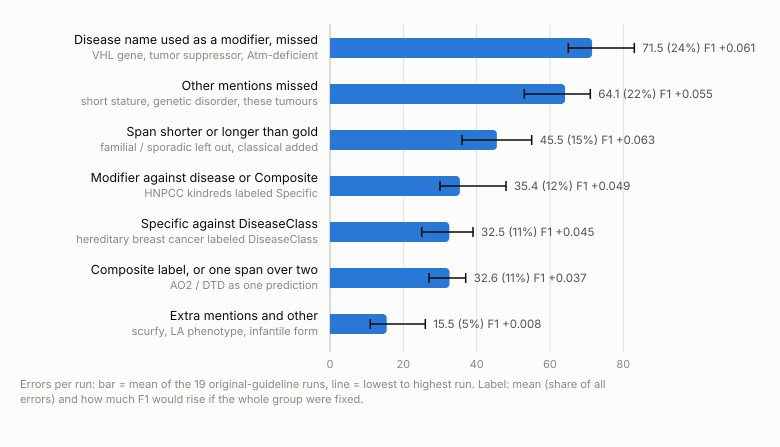
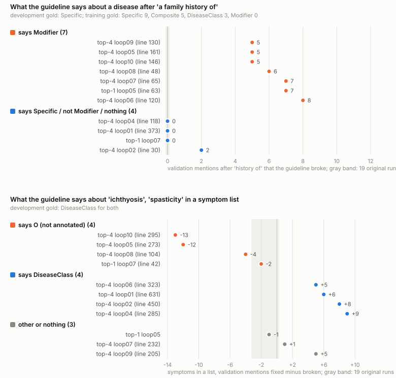

# Error analysis of the 10/23 reproduction

2026-10-24, revised 2026-10-25; the top-4 analysis (§3.5) added 2026-10-26. Everything was done offline, with no API calls. The data are the 30 validation runs of the 10/23 reproduction (100 documents, 791 gold mentions), the 44 refinement rounds on the 10 development documents with every prompt the loop sent, and the training gold minus the 50 test documents.

The [appendix](20261024_error_analysis_appendix.md) has the detailed tables, the full design of the next step, the revision log and the full verification record.

## Conclusion

1. Haiku's errors with the original guideline repeat from run to run. A run makes 297 errors, and 71% of them appear in at least 15 of the 19 original-guideline runs. Two groups of missed mentions make up 46% of the errors.

2. The rewrite step sees few of the correct answers. Its rules came out right where it saw the answer and went either way where it did not.

   Each round, Haiku rewrites the guideline from 5 development documents and a list headed "these are already correct, do not break them". The list shows at most 5 per document. Long documents have 12 to 14 gold mentions (a mention is one disease name in the text), so most correct answers are missing from it. 11 of the 20 loops ended with a rewritten guideline.

   "DTD" in "the DTD gene" should be Modifier. Cases like this come from short documents, so the list showed them almost every time (105 of 112). All 11 new guidelines wrote this rule, and 8 missed 12 to 32 fewer such names on validation.

   "ovarian cancer" in "a family history of ovarian cancer" should be Specific. The list never showed it (0 of 44 rounds) and instead showed five "ovarian cancer = Modifier" from the same document, as in "ovarian cancer cases". 7 guidelines then wrote "a disease after family history is Modifier", and each got 5 to 8 more validation mentions wrong. Symptom lists went the same way: "ichthyosis" and "spasticity" should be DiseaseClass and were shown once in 88 chances. The 4 guidelines that wrote "do not annotate" lost 2 to 13 each, and the 4 that wrote DiseaseClass gained 5 to 9 each.

   Among the top-4 loops, those that ended below the original range broke 61 validation mentions on average and those above it 27, mostly diseases labeled Modifier or mentions left out. All 10 top-4 loops wrote the family-history rule at some point; the loops that improved reversed it later or worded it narrowly (§3.5).

   We observed this pattern; no experiment has tested it as a cause. These three cases also cover only 17% to 44% of everything each guideline changed (mentions fixed plus mentions broken), and the rest is unexplained.

3. The evidence is limited. Each changed guideline ran once on validation, the best three were picked after the fact, and the link between the rules and what the prompt showed is an inference. The loop's keep decision is unreliable as well: about half the rounds it kept gained so little that luck alone could explain the gain (§2).

4. For Track 2, count true misses instead of strict FN. True misses stand in for the expert's search effort; no time was measured. Some guideline texts cut true misses in their single validation run without F1 falling, and rules that leave symptoms or tumors out raised them.

5. The next step is one hypothesis about a local mechanism: let the analysis and rewrite steps see every correct mention of the documents they already show, and test this by replaying the recorded rounds (about JPY 470 for all 44). A one-page plan has to fix the measures and criteria before any run. The choice is yours, then the professor's.

## 1. What errors Haiku makes with the original guideline

Each error is one discrepancy against gold, using the paper's kinds: missed, extra, label mismatch, boundary mismatch, and unpaired overlap (one prediction swallowing two gold mentions). Rules on the strings and labels sort them into 23 patterns and 7 groups (`patterns_lib.py`). A group name describes what its rules detect, which can be wider than the typical case. Counts are means over the 19 runs that used the original guideline: the 10 E1 runs and the 9 loops that ended unchanged. "F1 if fixed" is the rise in F1 if the whole group were fixed, so it is a ceiling.

**Figure 1.** The seven error groups under the original guideline. The narrow range lines show the same errors in every run.

| Group | Errors per run | Share | F1 if fixed | Typical errors |
| --- | --- | --- | --- | --- |
| Disease name used as a modifier, missed | 71.5 | 24.1% | +0.061 | "VHL" in "VHL gene", "tumor" in "tumor suppressor gene" |
| Other mentions missed: symptoms, general words, tumors, deficiencies, the rest | 64.1 | 21.6% | +0.055 | "short stature", "blindness", "genetic disorder", "these tumours" |
| Span shorter or longer than the gold span | 45.5 | 15.3% | +0.063 | leaves out "familial", "sporadic"; adds "classical" |
| Modifier against disease or Composite label | 35.4 | 11.9% | +0.049 | "HNPCC kindreds" labeled Specific |
| Specific against DiseaseClass | 32.5 | 10.9% | +0.045 | "hereditary breast cancer" labeled DiseaseClass |
| Composite label at the gold span, or one prediction over two gold mentions | 32.6 | 11.0% | +0.037 | "AO2 / DTD" as one prediction |
| Extra mentions and other | 15.5 | 5.2% | +0.008 | mouse diseases ("scurfy"), "LA phenotype" |

Haiku leaves mentions out far more often than it adds them: extra mentions are about 14 per run.

The guideline says little where the errors gather. Its Modifier rule has a single example sentence with no gene names, symptoms appear only as a "grey area, if appropriate", and no rule says whether Modifier or Composite wins. The training gold is clearer. A disease name right before a gene word is Modifier in 389 of 417 cases (93%), and coordinated names right before a noun they modify (families, patients, genes) are Modifier in 23 of 25. Appendix A sets each group against the guideline text and the training gold.

The gold itself limits one simple rule. The training gold includes some qualifiers (inherited, sporadic, classical, classic) only 43% to 70% of the time, so a plain include-or-exclude rule can fix only part of the span group.

Six validation gold spans end with a stray space, such as "C9 deficiency ". No run matched them (0 of 114 span × run cases), and they cost 8.0 errors per run. That is an observed count rather than a fixed floor: the aligner keeps spaces, so a prediction that includes the space would match.

## 2. Why 9 loops kept the original guideline

These 9 rewrites fixed what they targeted but turned other mentions into Modifier, which lowered development F1 and got the rounds rejected. The keep-or-reject decision is itself unreliable, because it rests on one run on 10 documents, and about half of the kept rounds may have been kept by luck.

A round is kept only if development F1 rises. In 9 of the 20 loops the first rewrite lowered it, so the loop stopped with the original guideline. 7 of the 9 rewrites did reduce the errors they targeted, yet all 9 added Modifier errors, 41 wrongly labeled mentions in total. 13 of them follow "a family history of", the same problem as Rule 1 in §3. Another 13 are "Tay-Sachs disease" or "TSD", which Haiku often labels Modifier even with the unchanged guideline.

The same guideline run twice on the same 10 documents gives different F1, typically about 0.021 apart, so a small change after a rewrite may be luck. Measured against that, 7 of the 9 rejected rounds dropped so much that luck alone would give a drop that large less than 1 time in 20. Top-1 loops 01 and 09 dropped so little that luck gives that about 1 time in 3 or 4. Of the 26 kept rounds, 13 gained so little that luck alone gives that at least 1 time in 20, and the round that produced the worst guideline (top-4 loop 10, round 1, +0.010) is one of them. Loops whose starting run happened to score high were also more likely to see round 1 fall (correlation −0.48 between the starting F1 and the round-1 change).

For the research, a round kept on the development set is therefore no evidence of improvement. That is why the replay test in §5 checks the rules written as well as development F1.

A threshold on development F1 does not repair this. Applied to the recorded rounds one at a time, requiring a gain beyond luck and at most 5 broken development mentions would keep 9 of the 44 rounds instead of 26, would still keep the round that wrote top-4 loop 07's family-history rule, and would reject one of the three rounds that reversed that rule (Appendix D.6).

The rejected candidates were never run on validation, so whether rejecting them was right cannot be checked there. Details and Figures 4 and 5 are in Appendix B.

## 3. Why some changed guidelines helped and others hurt

### 3.1 Linking a move to a rule

Eleven loops ended with a changed guideline. Their validation F1 runs from 0.659 to 0.748, against 0.692 to 0.724 for the 19 original runs. To see which rules lined up with which gains and losses, I compared each changed guideline with the original runs mention by mention (`rule_links.py`). A mention counts as fixed when the changed guideline gets it exactly right and at most 4 of the 19 original runs do, and as broken when the changed guideline gets it wrong and at least 15 of the 19 get it right. The chance level comes from counting each original run the same way against the other 18. Each fixed or broken mention is also tagged by a string match on the words around it, such as "before a gene word" or "after 'history of'" (`rule_chain.py`); these tags are the constructions.

Then I read each guideline's rule for those constructions and what the loop's prompts had shown. Appendix C gives every guideline's counts.

### 3.2 What each step sees

The rewrite prompt ends with "CONSTRAINT: DO NOT BREAK THESE EXAMPLES". It shows five development documents in full, each followed by a list of mentions Haiku got right. The list holds at most five, in arbitrary order (`iterative.py`, lines 393 to 397). The two documents behind Rules 1 and 2 have 12 and 14 gold mentions, so most of their correct labels never appear; 132 of the 220 document blocks over the 44 rounds hit the cap.

Information reaches the rewrite in three ways, counted separately below (`rule_chain_output.txt` B). The rewrite prompt's own list shows it directly. Upstream, the analysis prompts show the same list plus error examples with their gold labels. The principles that the analysis writes also appear in the rewrite prompt; for these I counted only whether the target string appears, which says nothing about whether a rule, its context or its label direction was passed on.

**Figure 7.** For two kinds of phrase (top: a disease after "a family history of"; bottom: symptoms in a list), what each changed guideline says and how it did on validation. 10 of the 11 guidelines have a rule for each. I read each guideline and noted which way its rule goes; a script only checks that the quoted wording is really on the stated line.

### 3.3 Three rules

#### Rule 1: a disease after "a family history of"

Here "ovarian cancer" is Specific in the development gold, and the training gold never labels this construction Modifier (Specific 9, Composite 5, DiseaseClass 3, not annotated 4).

The rewrite prompt listed this label in 0 of the 44 rounds, although Haiku had the mention right in 29 of the runs before a rewrite. In 43 of the 44 rounds the list for that document showed only "ovarian cancer" = Modifier, five times ("ovarian cancer cases", "ovarian cancer population" and so on). The analysis prompts showed the mention as an error example with its gold label in 7 rounds. The target string appeared in the principles once, as "ovarian cancer cases", outside a family-history context.

7 guidelines call a named disease there Modifier, such as top-4 loop 08, line 48: "the complement of a history frame (e.g., "a family history of ovarian cancer")". Top-4 loop 05 does the same at line 161 and leaves a bare "cancer" unannotated at line 160. Top-4 loop 04 first wrote Modifier too, then saw the mention as an error example with gold in round 2 and changed the rule to Specific (line 118).

On validation, each "Modifier" guideline broke 5 to 8 mentions after "history of", such as "family history of breast cancer" (gold Specific). The other four broke 0 to 2, and the chance level is 0.

#### Rule 2: bare symptoms in a list

"ichthyosis" and "spasticity" are DiseaseClass. In the training gold, single-word items of a "characterized by" list are annotated 23 of 30 times.

The rewrite prompt listed these labels in 1 of 88 cases (2 mentions × 44 rounds). In the other 87 it showed the sentence without them, although Haiku had them right 53 times. The analysis prompts showed them as error examples with gold 17 times, and the principles contained the string once, as "a spasticity-type finding".

4 guidelines say O, as in top-4 loop 08, line 104: "A bare, single-word sign or symptom noun that is a member of a coordinated list (e.g., "ichthyosis," "spasticity") remains O." 4 others say DiseaseClass.

On validation, the "O" guidelines lost 2 to 13 symptom mentions (fixed minus broken) and the "DiseaseClass" guidelines gained 5 to 9. The chance level is −3 to 0.

#### Rule 3: a disease name before a gene word, the rule that helped

"SLS" in "SLS genes" and "DTD" in "the DTD gene" are Modifier.

Short documents fit under the cap. Of the 176 mention × round cases, the rewrite prompt showed the document in 112 and listed the label in 105 of them. The analysis prompts showed these mentions as error examples with gold 23 times, 20 of them in rounds whose rewrite prompt did not show the document. The principles never contained the strings, which does not show that the abstract rule failed to pass on.

All 11 guidelines state a Modifier rule for disease names before gene, protein or locus words, as in top-4 loop 08, line 52: "in "the Norrie disease gene (NDP)," "Norrie disease" is a Modifier".

On validation, 8 of the 11 cut gene-name misses below the original range (33 to 49 per 100 documents), by 12 to 32. Three stayed inside it although they state the rule, so writing the rule does not guarantee an improvement.

### 3.4 What the three cases show

Where a guideline says Modifier or O for one of these phrases, its validation run mostly does the same, mention by mention, against chance levels of 0 and −3 to 0. Top-4 loop 05's five broken family-history mentions follow its two rules: three named diseases labeled Modifier and two bare "cancer" left out.

The convention the rewrite prompt listed (105 of 112) was stated in all 11 guidelines and effective in 8. For the conventions it almost never listed (0 of 44, 1 of 88), loops wrote rules in opposite directions, and the rules against the gold quote these documents' own text ("a family history of ovarian cancer" at top-4 loop 08 line 48; "ichthyosis," "spasticity" at line 104). One explanation is that the rewrite generalized from what the list showed; this has not been tested.

The keep rule misses these errors. It judges a whole rewrite on 10 development documents, where these constructions are rare (three mentions after "a family history of", two symptoms in one list). A wrong rule therefore costs at most 3 development errors and is kept whenever the same rewrite gains more elsewhere.

No single rule picks out the best guidelines. Top-4 loop 08 got Rules 1 and 2 wrong yet reached the highest F1 (0.748), carried by Rule 3 (26 fewer gene-name misses). The top three (0.741 to 0.748) differ by less than one run's SD (0.0095), so a rerun could change their order.

Construction coverage is 17% to 44%: that share of each guideline's fixed and broken mentions falls in the three constructions. The script matches strings and does not check that the guideline has a rule for each mention or that the change follows it. The rest, including top-1 loop 05's patient-level rule and top-4 loop 10's exclusions, is described in Appendix C but not traced.

### 3.5 Top-4 loops that improved and loops that fell

The 10 top-4 loops started from the same guideline and the same 10 development documents, and 9 ended with a changed guideline. The three above the original range (loops 08, 04, 01) fixed 51.7 validation mentions on average and broke 27.3. The three below it (07, 06, 10) fixed 36.0 and broke 61.0. Of the 33.7 extra broken mentions, 28.0 are diseases labeled Modifier (pattern L3) or mentions left out (M5, M7, M8), two kinds that an original run breaks only 0.6 and 2.4 times by chance (Appendix C).

These breaks follow the rules of §3.3 and how far their wording reaches. All 10 top-4 loops wrote the family-history Modifier rule in some round. Loops 01, 02 and 04 reversed it later, each in a round whose analysis prompt showed that mention's gold label; over all rounds that started from a Modifier rule, it switched to Specific in 3 of 7 rounds that showed the gold label and in 0 of 8 that did not (one-sided Fisher p = 0.077). Loop 08 kept it worded for a history frame only, and its 6 diseases labeled Modifier all follow "history of". The five loops whose wording names more nouns (risk, cases, cohort, a relational noun phrase) labeled 8 to 26 diseases Modifier, 2 to 15 of them after a risk or population noun, such as "80 % risk of breast cancer". Loops 05 and 10 also leave bare "cancer" and listed symptoms unannotated, and have 25 and 42 left-out breaks against 3 to 10 in the other seven.

The keep rule kept every round that brought one of these rules in. Of the 15 statements in the changed top-4 guidelines that contradict the development gold of a phrase they cover (Appendix C), 12 entered in a round whose own development run already labeled that phrase wrong; the round was kept because it fixed other mentions. Within top-4, rounds that first wrote the family-history rule were kept 9 of 10 times and the other rounds 12 of 19.

## 4. What the data say about the two tracks

### Track 1: LLM annotation used without correction

Part of the method's gains and losses lines up with what the rewrite prompt lists, and the prompt lists only part of the gold of the documents it must not break. That points to a possible mechanism inside the method and gives a specific, testable target (§5).

The data do not show that the method improves annotation. The three pre-registered tests (P1 to P3) were not significant. The best three guidelines (0.741 to 0.748, against at most 0.724 for the original) were picked after the fact, from one run each. Over the 11 changed loops, development F1 also predicts validation F1 only weakly: Spearman 0.53 for the final development F1 and 0.42 for the development gain.

### Track 2: building gold data with expert correction

A true miss is a gold mention that no prediction even overlaps, so the expert has to read the text to find it. Strict FN also counts label and boundary errors at spots the model already marked. True misses stand in for search effort, and "cheaper to fix once located" is a cost assumption; no correction time was measured, so nothing here shows that expert time is saved. A run's 281.6 strict FN hold 135.6 true misses, spread over 53 documents. The report should give true misses and the documents that contain them, with extra mentions and edits as the cost.

Some guideline texts cut true misses without F1 falling, in a single run each. Top-4 loops 01, 04 and 08 have 97 to 114 true misses in 40 to 46 documents, against 118 to 147 in 49 to 57, with FP of 131 to 150 against 134 to 155. Part of this lines up with the gene-name rule and, in loops 01 and 04, with the DiseaseClass rule for symptoms. Rules that leave symptoms or bare tumors out raise true misses (top-4 loops 05 and 10: 163 and 208).

As the professor suggested, F1 and ease of correction can part ways. Top-4 loops 06 and 07 have among the fewest true misses (99 and 104) but low F1 (0.685 and 0.691). Their extra errors are mostly wrong labels, which an expert need not search for (the cost assumption above).

"Without F1 falling" needs a margin fixed in advance that says how large a drop is acceptable; "no significant drop" cannot stand in for it. The limits in §6 apply here too, and no guideline was built to trade extras for misses on purpose.

## 5. Next step: one hypothesis to test

The hypothesis is that the rewrite step writes wrong rules where its prompt lists only part of a document's labels, so listing every correct mention of the documents it already sees should cut those rules. The family-history rule, never listed directly, went wrong in 7 of 11 guidelines and cost 5 to 8 validation mentions each. The gene-name convention, listed in 105 of 112 cases, was stated in all 11 and effective in 8.

### What changes

Only the per-document cap on correct mentions is lifted. The same function builds the list for the analysis and the rewrite prompts, so both see it in full. The number of documents shown (five) and the error examples per cluster (five) stay as they are. Today one parameter, n_examples = 5, sets all three limits, so it has to be split first (Appendix D.1). The list would grow from 19.3 to 35.9 correct mentions per round, and where Haiku had them right, the family-history mention (29 of 44 rounds) and the two symptoms (53 of 88) would appear with their labels.

Listing the gold of mentions Haiku got wrong, or marking right and wrong, is left out. It adds new information, the gold of errors, and belongs to a later arm. Five itself has no stated reason: it is the default of the published code, and lifting the per-document cap costs about JPY 0.05 per round (Appendix D.2).

### How it could be tested

Replay recorded rounds. Start a round from its recorded state (the same guideline and baseline annotation), regenerate the analysis, principles and rewrite with the full list, and annotate the 10 development documents once with the candidate. The recorded round is the control. This costs about JPY 470 for all 44 rounds, or 940 if the control is rerun alongside (estimate from measured per-call costs, Appendix D.4).

The replay shows whether the change alters the rules written for the listed constructions, in one round from fixed starting points. It tests a local mechanism. It does not test the multi-round loop or validation F1, and by itself it meets neither track's goal. The 44 rounds come from 20 loops, and rounds of one loop share a guideline history, so they are not 44 independent trials; the unit is the loop, or the round with the loop as a cluster.

Before any run, a one-page plan has to fix the primary measure and its unit; the control, and when the recorded rounds count as one (same model, effort, prompt templates, output cap and hash seed); the success and stopping criteria and a budget cap; and a pilot on a few recorded states to check the pipeline before running all 44.

### Risks not yet tested

Hard-coding here means development gold strings copied verbatim into the guideline. Strings listed with their label and strings cut by the cap were copied at the same observed rate (46% of 228 and of 160 string × round cases). That suggests a label on screen does not by itself raise copying, but the two rates come from different strings, so this is no test, and the replay must measure it.

The keep rule is the other risk. The 11 changed guidelines contain, word for word, 13 to 21 of the 37 development gold strings that the original guideline lacks. Guidelines that copied more scored higher on the development documents but not on validation: the rank correlation (Spearman) between the number of copied strings and development F1 is +0.73, and with validation F1 it is +0.08. Copying answers thus raises the score the keep rule uses without helping on new documents. The five documents the rewrite sees hold 60% of the development gold the keep rule scores, so a fuller list could lead the rewrite to copy more and get rounds kept for that. If the cap is lifted, the number of copied strings should be reported next to F1.

### After the mechanism result

Fix one method version and evaluate it independently: annotation quality for Track 1, and true misses, extra mentions and each kind of edit for Track 2. Other candidates are in Appendix D.5 to D.7.

These ideas come from validation analysis, so whatever is chosen must be evaluated once, at the end, on the 50 held-out test documents (`reproduction/test_splits/ncbi_disease_heldout50.json`). Decisions on whether to continue use development data only.

## 6. Limits

- Each changed guideline was annotated once on validation. The fixed and broken counts are compared with a chance level from the 19 original runs, but each changed guideline's own run-to-run spread is unmeasured.
- The best three guidelines were selected after the fact, and their order is within one run's SD.
- Construction coverage (17% to 44%) is a string match and does not check that a rule caused each change.
- Where the rules came from is untested. That the family-history rule was generalized from the five listed Modifier labels, and the gene-name rule taken from labels the prompt showed, is one reading of the prompts.
- Patterns and constructions are string rules. The rule directions in Figure 7 were read and noted by me alone; no second person checked them.
- The training gold check covers the constructions in `gold_precedent_output.txt`, not the coordination-merging and extra-mention groups.
- The statements counted as wrong in §3.5 and Appendix C were read by me for five development phrases chosen after the validation breaks were known. That is not a robust contradiction check.
- The keep-rule comparisons in §2, §3.5 and Appendix D.6 are observational and judge each round alone.

## Verification record

- Scripts in `todo-temp/error-analysis/scripts/`, each writing its output file to `outputs/` (figures to `reports/figures/`): `error_table.py`, `error_patterns.py` (with `patterns_lib.py`), `gold_precedent.py`, `rounds_table.py`, `rule_links.py`, `rule_chain.py`, `tp_exposure.py`, `example_caps.py`, `test_power.py`, `test_size_check.py`, `make_figures.py`, `history_tally.py`, `topk4_stability.py`, `keep_criteria.py`; `draw_test_split.py` for the 50 held-out documents.
- Hashes, sources and quoted lines are in Appendix F. Appendix SHA-256 (first 12): e8e2d3c28702.
- Two independent reviews and a final pass (exp-statistician, read-only), then three reader reviews of the restructured version, all on 10/25. The third (8.5 of 10) asked for three wording and figure fixes, made in this version (Appendix E). The analysis is frozen at this version.
- No API calls. The test documents' gold was not read.
